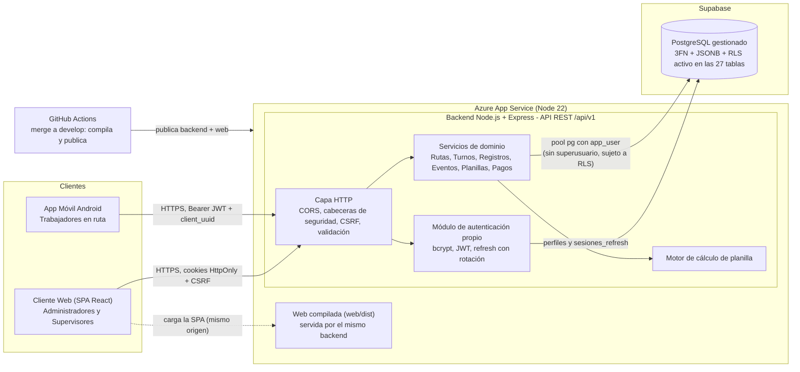
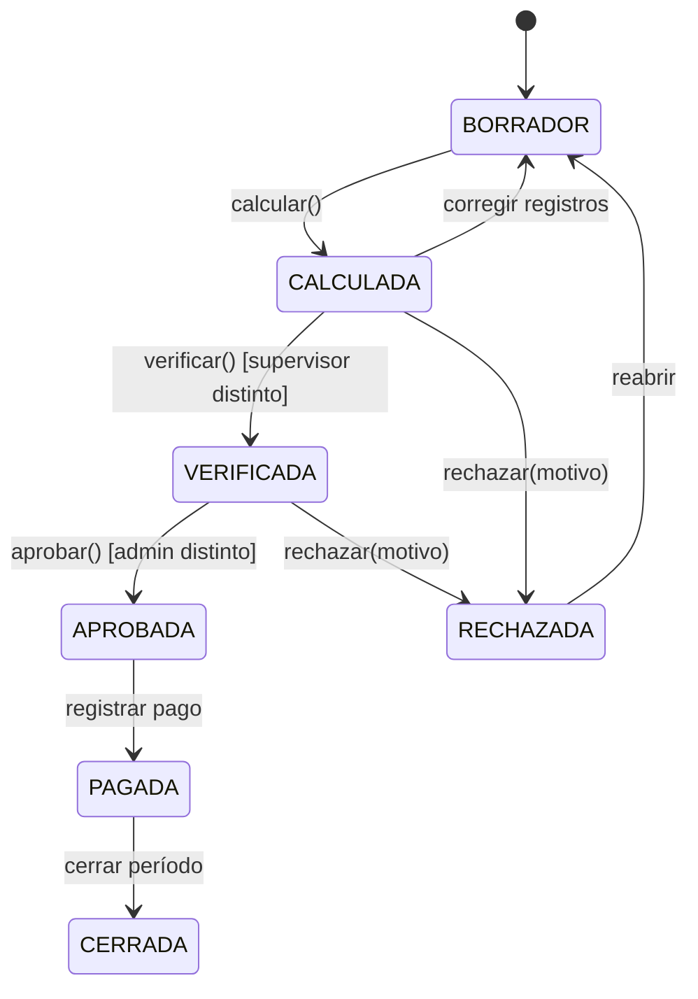
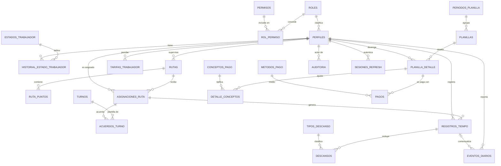
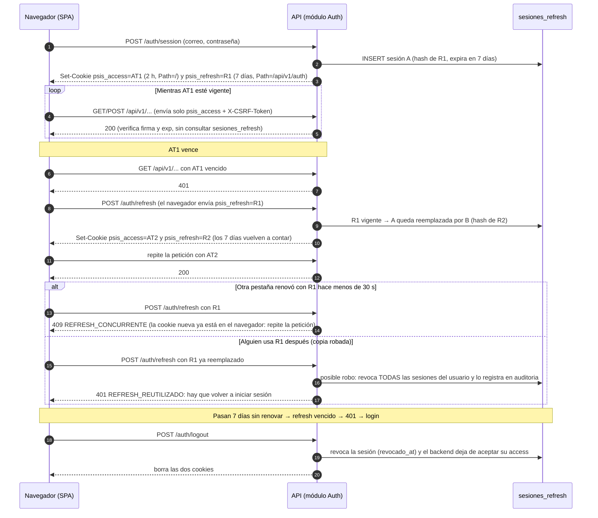

# Entregable: Arquitectura Técnica de la Solución

**Sistema de Control de Planillas y Rutas (`planilla-sis`)**

| Campo | Detalle |
| --- | --- |
| Versión | 3.0 (final) |
| Fecha | 28 de octubre de 2026 |
| Equipo | 6 integrantes (§A.1) |
| Repositorio | [https://github.com/AgosAnt/planilla-sis](https://github.com/AgosAnt/planilla-sis) |
| Despliegue | Backend y web en Azure App Service; PostgreSQL en Supabase (ver [`manual-despliegue.md`](manual-despliegue.md)) |

---

## A. Matriz de Asignación de Responsabilidades (RACI / RAM)

### A.1 Roles del equipo

| Integrante | Carné | Rol | Perfil | Foco principal |
| --- | --- | --- | --- | --- |
| Jonatan Josue Santiago Itzep | 0910-23-19455 | **Dev Backend 1** y **Dev Móvil 1** | Líder Técnico / Arquitecto | Contrato API, arquitectura, revisión de calidad; app móvil y sincronización offline |
| Marco Antonio Rolando Corado García | 0910-23-6501 | **Dev Backend 2** | Backend – Dominio | Rutas, turnos, registros de tiempo, motor de cálculo, aprobación y pagos |
| Dáliet Sofía Salguero Franco | 0910-23-6180 | **Dev Backend 3** | Datos / DBA | Esquema 3FN, JSONB, migraciones, RLS |
| Jose Daniel Pereira Cabrera | 0910-23-3852 | **Dev Backend 4** | Seguridad / DevOps / QA | Autenticación propia, OWASP, CI/CD, secretos, pruebas |
| Adal Samuel López Reyes | 0910-23-24277 | **Dev Web 1** | Líder Frontend | Shell de la SPA, routing, guardas, CSP |
| Stefany Mariana Hernández Galindo | 0910-23-6319 | **Dev Web 2** | Frontend | Módulos de UI (rutas, supervisión, planillas) |

El plan original contemplaba 7 integrantes, con un desarrollador móvil. El rol de Dev Móvil 1 lo asumió el líder técnico.

**Leyenda.** **R** = Responsable (ejecuta). **A** = Aprobador (rinde cuentas; **uno solo por fila**). **C** = Consultado. **I** = Informado. **A/R** = quien aprueba también ejecuta.

### A.2 Matriz RACI planificada

| # | Entregable técnico | Samuel | Stefany | Jonatan (BE1) | Marco | Sofía | Daniel | Jonatan (Móvil) |
| --- | --- | --- | --- | --- | --- | --- | --- | --- |
| 1 | Arquitectura, patrones y ADRs | C | I | **A/R** | C | C | C | C |
| 2 | Integración con el repositorio (estructura, ramas, convenciones) | C | I | **A** | R | C | R | I |
| 3 | Auditoría del esquema BD existente | I | I | C | C | **A/R** | C | C |
| 4 | Modelo ER 3FN, JSONB y migraciones | I | I | C | C | **A/R** | I | C |
| 5 | Seguridad a nivel de fila (RLS) | I | I | C | C | **A/R** | C | I |
| 6 | Contrato API REST (OpenAPI) | C | I | **A** | R | C | C | C |
| 7 | Backend: rutas, turnos, registros de tiempo | I | I | C | **A/R** | C | C | C |
| 8 | Backend: motor de cálculo, verificación y aprobación | I | I | C | **A/R** | C | C | I |
| 9 | Frontend: shell SPA, History API, guardas por rol | **A/R** | R | C | I | I | C | I |
| 10 | Frontend: rutas, turnos y supervisión | **A** | R | I | C | I | I | I |
| 11 | Frontend: planillas y pagos | **A** | R | I | C | I | I | I |
| 12 | Autenticación propia y endpoints de sesión | C | I | C | R | C | **A/R** | C |
| 13 | Seguridad OWASP (XSS, CSRF, CSP, secretos) | R | C | C | C | C | **A/R** | I |
| 14 | API móvil y sincronización offline | I | I | **A** | R | C | C | R |
| 15 | App móvil | I | I | I | C | I | C | **A/R** |
| 16 | Pruebas | C | R | C | R | C | **A** | C |
| 17 | CI/CD, entornos y secretos | I | I | C | C | C | **A/R** | I |
| 18 | Documentación técnica | R | C | **A** | R | R | R | C |

### A.3 Matriz RACI ejecutada

Elaborada a partir de los *pull requests* integrados a `develop` entre el #9 (13 de octubre) y el #58 (27 de octubre de 2026). La **R** corresponde a quien hizo el trabajo y la **A** al responsable del rol. Cuando el líder técnico avanzó un módulo de otra área, aparece como R con la anotación "apoyo".

| # | Entregable técnico | Samuel | Stefany | Jonatan | Marco | Sofía | Daniel | Evidencia (PRs) |
| --- | --- | --- | --- | --- | --- | --- | --- | --- |
| 1 | Arquitectura, patrones y ADRs | C | I | **A/R** | R | C | C | #10 (Marco), #30 (Jonatan) |
| 2 | Integración con el repositorio | R | I | **A** | R | C | C | #10 (Marco), #23 (Samuel) |
| 3 | Auditoría del esquema BD | I | I | C | C | **A/R** | I | #9 (Sofía) |
| 4 | Modelo 3FN, JSONB y migraciones | I | I | R | C | **A/R** | C | #9, #35, #44, #52 (Sofía); #11, #14 (Jonatan, apoyo) |
| 5 | RLS | I | I | R | C | **A/R** | R | #35 (Sofía); #13 (Jonatan); #36 (Daniel) |
| 6 | Contrato API REST | C | C | **A/R** | R | C | R | #12 (Jonatan); #42, #51 (Marco); #37, #45–#47, #50 (Daniel) |
| 7 | Backend: rutas, turnos, registros | I | C | R | **A/R** | C | C | #33, #40 (Marco); #16, #22, #24 (Jonatan, apoyo) |
| 8 | Backend: cálculo, verificación y aprobación | C | I | C | **A/R** | R | C | #42, #43 (Marco); #35 M009 (Sofía) |
| 9 | Frontend: shell SPA y guardas | **A/R** | R | R | I | I | C | #23 (Samuel); #26 (Stefany); #19, #21 (Jonatan, apoyo) |
| 10 | Frontend: rutas, turnos y supervisión | **A** | R | C | C | I | I | #26, #31 (Stefany); #29 (Jonatan) |
| 11 | Frontend: planillas y pagos | **A/R** | C | C | C | I | I | #54 (Samuel) |
| 12 | Autenticación propia y sesión | C | I | R | C | R | **A/R** | #32, #36, #47 (Daniel); #44 (Sofía); #15, #18, #48, #58 (Jonatan) |
| 13 | Seguridad OWASP | C | I | R | C | C | **A/R** | #53, #57 (Daniel); #15, #17 (Jonatan) |
| 14 | API móvil y sincronización offline | I | I | **A/R** | R | C | C | #10 (Marco); #24, #27 (Jonatan) |
| 15 | App móvil | I | I | **A/R** | C | I | C | #27, #39, #48, #49, #56 (Jonatan) |
| 16 | Pruebas | C | C | R | R | C | **A/R** | #42 (Marco); #13, #27, #39, #48, #49 (Jonatan) |
| 17 | CI/CD y secretos | I | I | R | I | C | **A/R** | #53 (Daniel); #38 (Jonatan, apoyo) |
| 18 | Documentación técnica | C | C | **A/R** | R | R | R | #30 y este documento (Jonatan); #51 (Marco) |
| 19 | Estados del trabajador (CU-03) | I | I | C | **A** | C | R | #46 (Daniel) |
| 20 | Emergencias (CU-08) | I | I | R | **A** | I | R | #45 (Daniel); #56 (Jonatan) |
| 21 | Usuarios, auditoría y permisos (CU-02, CU-14) | C | I | R | I | C | **A/R** | #37, #50 (Daniel); #18 (Jonatan) |
| 22 | Geocerca de las rutas (CU-04) | I | I | R | **A/R** | R | I | #55 (Marco); #52 (Sofía); #39 (Jonatan) |

**Cambios respecto al plan**

| Fila | Cambio | Motivo |
| --- | --- | --- |
| 11 | Samuel construyó las pantallas de planillas y pagos | Stefany tenía a su cargo rutas, supervisión, estados, turnos y panel |
| 12 | La autenticación la trabajaron Daniel y Jonatan | Marco se concentró en rutas, turnos y cálculo |
| 15 | La app móvil la desarrolló el líder técnico | El equipo quedó en 6 integrantes |
| 19–22 | Entregables nuevos | Se identificaron al implementar CU-02, CU-03, CU-04, CU-08 y CU-14 |

### A.4 Desglose y cumplimiento por integrante

Corte al 28 de octubre de 2026.

| Integrante | Módulos a su cargo | Sección del documento | PRs integrados | En curso |
| --- | --- | --- | --- | --- |
| Jonatan | Arquitectura y contrato API; app móvil; despliegue en Azure; documentación | A, B.1, B.5, manual | 21 | — |
| Marco | Backend: rutas, asignaciones, turnos, registros, motor de cálculo, aprobación y pagos, geocerca | C.3, E | 7 | — |
| Sofía | Base de datos: 3FN, JSONB, migraciones M002–M012, RLS | D | 4 | — |
| Daniel | Autenticación, sesiones, OWASP, usuarios, estados y emergencias | F | 9 | Renovación de sesión en la web (fase 2) |
| Samuel | Shell de la SPA, guardas, planillas y pagos | B.2, B.3 | 2 | Usuarios y auditoría; parámetros |
| Stefany | Módulos de UI: rutas, supervisión, geocerca, estados, turnos, panel | B.4, C | 2 | Geocerca, renovación de sesión, estados y emergencias, turnos, panel |

---

## B. Justificación de Arquitectura y Patrones

### B.1 Diagrama de arquitectura (contenedores, C4 nivel 2)



- **Contexto.** Tres actores: *Administrador* (configura, aprueba y paga), *Supervisor* (asigna, supervisa, verifica) y *Trabajador en ruta* (registra su jornada). Azure y Supabase son solo alojamiento: no se usan Supabase Auth, su API REST ni la llave `service_role`.
- **Contenedores.** La **SPA** (React + TypeScript + Vite) la sirve el mismo backend, por lo que web y API comparten origen. La **app Android** (Java) usa la misma API con `Bearer` y guarda los tokens cifrados con el Android Keystore. La **API REST** es la frontera de confianza: valida, autoriza y calcula. **PostgreSQL** aplica RLS como segunda barrera; el backend se conecta con `app_user` (sin superusuario).
- **Componentes de la API.** Controller → Service → Repository; el motor de cálculo es una función pura, probada con casos deterministas.

| Patrón | Dónde | Justificación |
| --- | --- | --- |
| Arquitectura por capas | Backend | Separa transporte, negocio y persistencia; facilita pruebas |
| Máquina de estados | Planilla, registro de tiempo, acuerdo de turno | Transiciones explícitas y auditables |
| Idempotencia (`Idempotency-Key`, `client_uuid`) | Escrituras del móvil | Los reintentos por mala señal no duplican registros |
| Defensa en profundidad | API + RLS | Un fallo de autorización en la API no expone datos |
| Bitácora *append-only* y *snapshot* inmutable | `auditoria`, `eventos_diarios`, `planilla_detalle` | Trazabilidad; los montos aprobados no cambian si cambia una tarifa |

### B.2 SPA o MPA

| Criterio | SPA | MPA | Ganador |
| --- | --- | --- | --- |
| Interacción intensiva (tablas, filtros, edición de registros) | Actualiza parcialmente y conserva el contexto | Recarga en cada acción | **SPA** |
| Flujo de planilla en varios pasos | El estado vive en la API; la vista no se reconstruye | Se reconstruye en cada página | **SPA** |
| Reutilizar la API del móvil | Mismo contrato JSON | Requiere además vistas en servidor | **SPA** |
| SEO | Débil | Fuerte | No aplica: es un panel privado con inicio de sesión |
| Carga inicial y superficie XSS | Mayores | Menores | MPA, mitigable con *code splitting* y CSP estricta |

**Decisión: SPA.** Los casos de uso son intensivos en interacción, no se necesita SEO y la API REST ya es obligatoria para el móvil.

**Tecnología adoptada:** React 19 + TypeScript + Vite, React Router (History API), Tailwind CSS con componentes shadcn/ui. TanStack Query y Zod, propuestos al inicio, no se adoptaron: un cliente propio (`web/src/lib/api.ts`) maneja sesión, token CSRF y errores, y la validación de seguridad se hace en el backend.

### B.3 Enrutamiento con History API

1. **Rutas limpias** sin `#` (`/planillas/2026-09`) con `pushState`, `replaceState` y `popstate`; el backend devuelve `index.html` para cualquier ruta que no sea un archivo ni `/api/*`, así funcionan los enlaces directos y el refresco.
2. **Estado compartible en la URL:** filtros y paginación como *query params* (`/supervision?ruta=R-12&fecha=2026-09-21`).
3. **Guardas por autenticación y rol** antes de mostrar la vista. Son solo experiencia de usuario: la autorización real está en la API y en RLS.
4. **Nada sensible** en la URL ni en `history.state`.

| Ruta | Vista | Roles |
| --- | --- | --- |
| `/login` | Inicio de sesión | Público |
| `/panel` | Resumen | Admin, Supervisor |
| `/rutas`, `/rutas/:rutaId` | Rutas, geocerca y asignaciones | Admin, Supervisor |
| `/turnos` | Turnos y acuerdos | Admin, Supervisor |
| `/supervision` | Registros de tiempo y emergencias | Admin, Supervisor |
| `/planillas`, `/planillas/:id` | Períodos, cálculo y verificación | Admin, Supervisor |
| `/pagos` | Pagos | Admin |
| `/admin/usuarios`, `/admin/parametros`, `/auditoria` | Administración | Admin |
| `/403`, `*` | Acceso denegado / no encontrado | Autenticado |

### B.4 Distribución del almacenamiento web

| Mecanismo | Se almacena | **No** se almacena | Justificación |
| --- | --- | --- | --- |
| **Cookies `HttpOnly; SameSite`** (`psis_access`, `psis_refresh`; `Secure` por HTTPS) | Access y refresh token | Datos de negocio | JavaScript no las lee: un XSS no puede robar la sesión |
| **Memoria** (estado de React) | Token CSRF, perfil y rol (`/api/v1/me`), datos de cada pantalla | — | Se pierde al recargar y se vuelve a pedir a la API |
| **`localStorage`** | Solo el tema claro/oscuro (`psis:v1:tema`) | Tokens, nómina, datos personales | Persistente y legible por cualquier script: solo preferencias inocuas |
| **`sessionStorage`** | Nada | Todo | No se necesitó (se explica a continuación) |
| **Caché HTTP** | Archivos estáticos versionados por Vite | Respuestas de la API (`Cache-Control: no-store`) | Evita fugas en equipos compartidos |

**Uso de `sessionStorage`.** En el diseño inicial se reservó para guardar borradores del flujo de planilla. Al implementarlo no fue necesario, porque cada paso (calcular, verificar, aprobar y pagar) se guarda como estado en la API y, al recargar, la web consulta el estado vigente. Además, los formularios son cortos y se envían en una sola acción. Al cerrar sesión se ejecuta `sessionStorage.clear()` como medida preventiva.

### B.5 Estructura del repositorio

```text
planilla-sis/
├── Database/          → migrations/ (M002–M012), seeds/ (S001), tests/ (pruebas de RLS)
├── backend/           → API REST: src/modules/<módulo>/ controller, service, repository, routes
├── web/               → SPA (React + TS + Vite); se compila a web/dist y la sirve el backend
├── mobile/            → App Android (Java)
├── docs/              → este entregable, manual de despliegue, OpenAPI, reglas de cálculo
└── .github/workflows/ → cada merge a develop compila la web y publica en Azure
```

Ramas `main` / `develop` / `feature/*`; todo cambio entra por *pull request* a `develop` con revisión y *squash and merge*; *Conventional Commits*; `docs/openapi.yaml` es la fuente única del contrato entre web, backend y móvil.

---

## C. Análisis de Sistemas e Ingeniería de Requisitos

### C.1 Actores

| Actor | Tipo | Plataforma | Responsabilidades |
| --- | --- | --- | --- |
| **Administrador** | Primario | Web | Usuarios y roles, parámetros de pago, **aprobar planilla**, registrar pagos, auditoría |
| **Supervisor** | Primario | Web | Rutas y asignaciones, acuerdos de turno, supervisar y validar registros, **verificar planilla** |
| **Trabajador en ruta** | Primario | Móvil | Registrar ingreso, salida, descansos y emergencias; consultar turnos y horas |
| **Módulo de autenticación** | Secundario (interno) | — | Verificar contraseñas, emitir y rotar tokens |
| **Motor de cálculo** | Secundario (interno) | — | Calcular horas y montos de forma determinista |

### C.2 Matriz y diagrama de casos de uso

| ID | Caso de uso | Actor(es) | Prioridad | Plataforma |
| --- | --- | --- | --- | --- |
| CU-01 | Iniciar sesión y verificar rol | Todos | Alta | Web / Móvil |
| CU-02 | Gestionar usuarios y roles | Administrador | Alta | Web |
| CU-03 | Gestionar estado del trabajador | Supervisor, Administrador | Media | Web |
| CU-04 | Crear y gestionar rutas y sus puntos (geocerca) | Administrador, Supervisor | Alta | Web |
| CU-05 | Asignar trabajadores a rutas | Supervisor, Administrador | Alta | Web |
| CU-06 | Definir turnos y confirmar acuerdos de turno | Supervisor, Trabajador | Alta | Web / Móvil |
| CU-07 | Registrar ingreso, salida y descansos | Trabajador | Alta | Móvil |
| CU-08 | Registrar eventos y emergencias | Trabajador | Media | Móvil |
| CU-09 | Supervisar horarios y registros | Supervisor | Alta | Web |
| CU-10 | Validar, corregir o rechazar registros | Supervisor | Alta | Web |
| **CU-11** | **Calcular, verificar y aprobar planilla** | Supervisor, Administrador | **Crítica** | Web |
| CU-12 | Registrar el pago de planilla | Administrador | Alta | Web |
| CU-13 | Consultar mis turnos y horas | Trabajador | Media | Móvil |
| CU-14 | Consultar bitácora de auditoría | Administrador | Media | Web |
| CU-15 | Configurar parámetros de pago | Administrador | Alta | Web |


*Usuario* es un actor abstracto del que heredan Administrador, Supervisor y Trabajador; los tres pueden ejecutar CU-01. CU-11 incluye a CU-10 porque no se puede calcular una planilla mientras haya registros pendientes de validar.

**Matriz de acceso por rol**

| Acción | Administrador | Supervisor | Trabajador |
| --- | --- | --- | --- |
| Gestionar usuarios | ✔ | ✖ | ✖ |
| Rutas y asignaciones | ✔ | Solo sus rutas | ✖ |
| Registrar ingreso, descanso o evento | ✖ | ✖ | ✔ (propio) |
| Ver y validar registros | ✔ | Sus rutas | Ver propios |
| Calcular / **verificar** / **aprobar** planilla | Calcular y **aprobar** | Calcular y **verificar** | ✖ |
| Registrar pago y consultar auditoría | ✔ | ✖ | ✖ |

### C.3 Especificación de los casos de uso principales

#### CU-11 · Calcular, verificar y aprobar planilla

| Campo | Descripción |
| --- | --- |
| **Actores** | Supervisor (calcula y verifica), Administrador (aprueba); secundario: motor de cálculo |
| **Precondiciones** | Usuario autenticado con rol autorizado; período existente y abierto; tarifas y parámetros vigentes; sin registros `PENDIENTE` en el alcance |
| **Flujo principal** | 1. El supervisor abre el período y elige el alcance. 2. El sistema lista excepciones (registros pendientes, jornadas sin salida). 3. El supervisor las resuelve (CU-10). 4. Ejecuta **Calcular**: en una transacción el backend lee registros, descansos, tarifas y parámetros, calcula horas ordinarias y extra y montos por trabajador, y guarda `planilla_detalle` con el desglose en JSONB → `CALCULADA`. 5. Otro supervisor **verifica** → `VERIFICADA`. 6. El administrador **aprueba** con reautenticación → `APROBADA`; los montos se congelan. 7. Cada transición queda en `auditoria`. |
| **Flujos alternos** | FA-1 hay registros pendientes: se bloquea el cálculo y se listan. FA-2 el verificador o el administrador rechaza con motivo → `RECHAZADA` → se corrige y se recalcula. FA-3 se corrige un registro después de calcular: la planilla vuelve a `BORRADOR`. |
| **Excepciones** | `403` sin rol o fuera de su ruta · `409 SEGREGACION_FUNCIONES` si la misma persona calcula y verifica o aprueba · `422` falta tarifa o parámetro · `409` cálculo concurrente · fallo de BD: *rollback* completo |
| **Postcondiciones** | Éxito: planilla `APROBADA`, *snapshot* inmutable, habilita CU-12 (pago). Fallo: la planilla queda en su último estado válido y el intento se audita. |



**Reglas de negocio**

- Horas efectivas = salida − ingreso − descansos no remunerados.
- Las horas que exceden la jornada ordinaria se pagan como extra, con el factor definido en los parámetros.
- Los montos se guardan como `numeric(12,2)`.
- Calcular, verificar y aprobar deben hacerlo personas distintas (restricción CHECK en la base y validación en la API).
- Una planilla aprobada no se puede modificar.

El detalle está en [`docs/reglas-calculo.md`](https://github.com/AgosAnt/planilla-sis/blob/develop/docs/reglas-calculo.md).

#### CU-07 · Registrar ingreso, salida y descansos

| Campo | Descripción |
| --- | --- |
| **Actores** | Trabajador en ruta (app móvil); secundario: GPS del teléfono |
| **Precondiciones** | Sesión iniciada como trabajador; asignación de ruta vigente (CU-05); permiso de ubicación y GPS encendido |
| **Flujo principal** | 1. El trabajador toca *Marcar entrada*. 2. La app lee el GPS y verifica que esté dentro del radio de algún punto de su ruta. 3. Guarda la marca en la cola local (SQLite) con un `client_uuid`. 4. Envía `POST /registros-tiempo/ingreso` con `Idempotency-Key`. 5. El backend verifica asignación, jornada abierta y solapamiento, recalcula la geocerca por su cuenta y responde `201`. 6. La app muestra la jornada en curso. |
| **Flujos alternos** | FA-1 sin conexión: la marca espera en la cola y se envía en orden al volver la red. FA-2 salida: `PATCH /registros-tiempo/{id}/salida`. FA-3 descanso: inicio y fin con su tipo. FA-4 reintento: el servidor reconoce el `client_uuid` y no duplica. |
| **Excepciones** | Fuera de la geocerca: la app no guarda y muestra la distancia · `422 ASIGNACION_NO_ACTIVA` · `409 REGISTRO_ABIERTO` (la app recupera esa jornada) · `422 SOLAPA_JORNADA_ANTERIOR` · error `5xx`: se reintenta |
| **Postcondiciones** | Éxito: registro `PENDIENTE` de validación con hora del dispositivo, hora de recepción y ubicación; el supervisor lo valida (CU-10). Fallo: la marca no se guarda o queda en la cola con su motivo visible. |

#### CU-01 · Iniciar sesión y verificar rol

| Campo | Descripción |
| --- | --- |
| **Actores** | Administrador y Supervisor (web), Trabajador (app); secundario: módulo de autenticación |
| **Precondiciones** | El administrador creó la cuenta (no hay registro público) y está activa |
| **Flujo principal** | 1. El usuario escribe correo y contraseña. 2. `POST /auth/session`. 3. El backend compara con `bcrypt` (con un hash de relleno si el correo no existe, para no revelar qué correos hay). 4. Firma el access token y guarda el *hash* del refresh en `sesiones_refresh`. 5. La web recibe las cookies `HttpOnly` y el token CSRF; la app recibe los tokens y los cifra con el Keystore. 6. Ambos consultan `GET /me` y muestran la pantalla de su rol. |
| **Flujos alternos** | FA-1 contraseña temporal: todo responde `403 DEBE_CAMBIAR_PASSWORD` hasta cambiarla. FA-2 access vencido: renovación con el refresh (§F.1). FA-3 rol equivocado para la plataforma: la web muestra `/403` y la app indica que es solo para trabajadores. |
| **Excepciones** | `401 CREDENCIALES_INVALIDAS` (mismo mensaje para correo o contraseña) · `423` con bloqueo progresivo de 1 a 15 min tras 5 intentos · refresh reutilizado: se revocan todas las sesiones |
| **Postcondiciones** | Éxito: sesión registrada con IP y dispositivo. Fallo: no hay sesión y el intento suma al contador de la cuenta. |

---

## D. Diseño de Base de Datos Híbrida (PostgreSQL en Supabase)

La base se diseñó para PostgreSQL estándar: las mismas migraciones corren en Supabase y en un PostgreSQL local.

### D.1 Punto de partida y migraciones

El prototipo tenía 6 tablas (`Usuarios`, `Rutas`, `Jornadas`, `Eventos_Ruta`, `Eventos_Descanso`, `Planillas`) con solo datos de prueba. El análisis encontró 21 problemas; los decisivos fueron:

| Problema | Corrección |
| --- | --- |
| Sin credenciales ni sesiones; la app se conectaba como `postgres` con la contraseña en el código | `email` + `password_hash`, tabla `sesiones_refresh`, rol `app_user` sin superusuario |
| `TIMESTAMP` sin zona horaria | Todo en `timestamptz`; el cliente envía UTC (ISO 8601) y se muestra en `America/Guatemala` |
| `ON DELETE CASCADE` borraba el historial de pagos al borrar un usuario | FK con `RESTRICT` y baja lógica (`activo`) |
| Sin restricciones: varias jornadas abiertas, duplicados por reintentos | Índice único de jornada abierta, `client_uuid` único por trabajador |
| `Planillas` mezclaba período y detalle, sin flujo de aprobación ni pagos | `periodos_planilla`, `planillas`, `planilla_detalle`, `pagos` con segregación de funciones |
| Sin RLS | RLS activo en las 27 tablas |

Se hizo una **reconstrucción limpia** con migraciones SQL versionadas, aplicadas en orden:

| Migración | Contenido |
| --- | --- |
| M002 | `pgcrypto`, rol `app_user`, identidad y auditoría |
| M003 | Rutas, geocerca, asignaciones (sin solapamiento, `btree_gist`) y turnos |
| M004 | Registros de tiempo, descansos y eventos (JSONB) |
| M005 | Tarifas, parámetros, períodos, planillas y pagos |
| M006 | Privilegios mínimos de `app_user` |
| M007 | Estados del trabajador y permisos por rol |
| M008 | RLS en registros y eventos, funciones `app.*` y pruebas por rol |
| M009 | Parámetros de pago y feriados del motor de cálculo |
| M010 | RLS en las 25 tablas restantes |
| M011 | Rotación de refresh tokens y detección de reúso |
| M012 | Validaciones de la geocerca (coordenadas, radio de 10 a 5000 m) |

### D.2 Modelo relacional (3FN)



| # | Tabla | PK | FK principales | Atributos clave / restricciones |
| --- | --- | --- | --- | --- |
| 1 | `roles` | `id smallint` | — | `nombre` UNIQUE |
| 2 | `permisos` | `id smallint` | — | `codigo` UNIQUE (p. ej. `planilla.aprobar`) |
| 3 | `rol_permiso` | (`rol_id`, `permiso_id`) | → roles, permisos | N:M |
| 4 | `perfiles` | `id uuid` | `rol_id` → roles | `email` UNIQUE, `password_hash`, `codigo_empleado` UNIQUE, `activo` |
| 5 | `estados_trabajador` | `id smallint` | — | `codigo` UNIQUE (ACTIVO, EN_RUTA, INCAPACIDAD, …) |
| 6 | `historial_estado_trabajador` | `id uuid` | → perfiles, estados_trabajador | `desde`, `hasta`; sin solapamiento por perfil |
| 7 | `rutas` | `id uuid` | `supervisor_id` → perfiles | `codigo` UNIQUE, `activa` |
| 8 | `ruta_puntos` | `id uuid` | `ruta_id` → rutas | `latitud`, `longitud`, `radio_m` (10–5000) |
| 9 | `asignaciones_ruta` | `id uuid` | → rutas, perfiles | `fecha_inicio`, `fecha_fin`; sin solapamiento por trabajador |
| 10 | `turnos` | `id smallint` | — | `hora_inicio`, `hora_fin`, `es_nocturno` |
| 11 | `acuerdos_turno` | `id uuid` | → asignaciones_ruta, turnos | `fecha`, `estado`; UNIQUE(`asignacion_id`, `fecha`) |
| 12 | `registros_tiempo` | `id uuid` | → perfiles, asignaciones_ruta | `ingreso_at`, `salida_at`, `estado_validacion`, `client_uuid`; CHECK(`salida_at > ingreso_at`) |
| 13 | `tipos_descanso` | `id smallint` | — | `remunerado boolean` |
| 14 | `descansos` | `id uuid` | → registros_tiempo, tipos_descanso | CHECK(`fin_at > inicio_at`) |
| 15 | `eventos_diarios` | `id uuid` | → perfiles, (registro, trabajador) → registros_tiempo | `tipo_evento`, `estado_atencion`, **JSONB** `payload` |
| 16 | `tarifas_trabajador` | `id uuid` | → perfiles | `valor_hora`, `vigente_desde`, `vigente_hasta` |
| 17 | `parametros_pago` | `id smallint` | — | `clave` UNIQUE + vigencia |
| 18 | `periodos_planilla` | `id uuid` | — | `fecha_inicio`, `fecha_fin`, `estado` |
| 19 | `planillas` | `id uuid` | → periodos, rutas, perfiles (calcula, verifica, aprueba) | `estado`; CHECK de segregación |
| 20 | `planilla_detalle` | `id uuid` | → planillas, perfiles | horas, montos, **JSONB** `calculo_detalle` |
| 21 | `conceptos_pago` | `id smallint` | — | `tipo` (BONIFICACION / DEDUCCION) |
| 22 | `detalle_conceptos` | `id uuid` | → planilla_detalle, conceptos_pago | `monto numeric(12,2)` |
| 23 | `metodos_pago` | `id smallint` | — | `nombre` |
| 24 | `pagos` | `id uuid` | → planilla_detalle, metodos_pago | `monto`, `referencia`, `pagado_at` |
| 25 | `auditoria` | `id bigint` | `actor_id` → perfiles | **JSONB** `datos_antes`, `datos_despues`, `contexto` |
| 26 | `sesiones_refresh` | `id uuid` | → perfiles, → sí misma (`reemplazado_por`) | `token_hash` UNIQUE, `expira_at`, `revocado_at` |
| 27 | `feriados` | `fecha` | — | Días de asueto para el cálculo (M009) |

**Justificación de 3FN**

- **1FN:** todos los atributos son atómicos; los descansos se registran en su propia tabla.
- **2FN:** en las tablas con clave compuesta ningún atributo depende solo de una parte de la clave.
- **3FN:** no hay dependencias transitivas; los catálogos evitan repetir descripciones.
- **Excepción:** `planilla_detalle` guarda los totales calculados para que un cambio de tarifa posterior no modifique pagos ya aprobados.

### D.3 Componente NoSQL: JSONB

Los datos que entran al cálculo del pago están en columnas tipadas; JSONB se usa para lo que varía según el tipo de evento o la acción y cambia más rápido que el esquema.

| Tabla.columna | Uso | Formato |
| --- | --- | --- |
| `eventos_diarios.payload` | Datos variables de cada evento del móvil | Objeto JSON (CHECK `jsonb_typeof = 'object'`), versionado con `esquema_version`, índice GIN |
| `planilla_detalle.calculo_detalle` | Desglose del cálculo por jornada | Objeto JSON generado por el motor de cálculo |
| `auditoria.datos_antes` / `datos_despues` / `contexto` | Estado anterior y nuevo del registro; IP, agente y `request_id` | Objetos JSON; índice GIN en `contexto` |

Ejemplo de `payload` de un evento `PROBLEMA_VEHICULO`:

```json
{ "precision_m": 12, "descripcion": "Llanta ponchada en el km 34", "dispositivo": { "so": "Android 15", "app": "1.4.2" } }
```

Reglas: la API valida el contenido y limita su tamaño; la web lo muestra siempre como texto, nunca como HTML (XSS); no se guardan datos personales innecesarios.

### D.4 Políticas de Seguridad a Nivel de Fila (RLS)

RLS está **activo en las 27 tablas** y es la segunda barrera después de la autorización de la API. El backend usa un único rol, `app_user` (`NOSUPERUSER`, no es dueño de las tablas), y en cada transacción declara quién es el usuario con los *claims* ya verificados de su JWT:

```sql
select set_config('app.jwt_claims', '{"sub":"5b1c…","rol":"supervisor"}', true);
```

Las políticas los leen con funciones de `M008_rls_registros_eventos.sql`: `app.usuario_actual()` (equivalente propio a `auth.uid()` de Supabase), `app.rol_actual()`, `app.supervisa_trabajador(id)` y `app.supervisa_ruta(id)`. La llave `service_role` y el rol `postgres` de Supabase saltan RLS: la aplicación no los usa; solo el DBA, desde el panel, para aplicar migraciones.

| Tabla | Trabajador | Supervisor | Administrador |
| --- | --- | --- | --- |
| `perfiles` | SELECT su fila | SELECT de trabajadores de sus rutas | ALL |
| Catálogos (`roles`, `permisos`, `turnos`, `tipos_descanso`, `metodos_pago`, …) | SELECT | SELECT | ALL |
| `historial_estado_trabajador` | SELECT propio | SELECT/INSERT de sus trabajadores | ALL |
| `rutas`, `ruta_puntos` | SELECT de su ruta asignada | SELECT/UPDATE de las que supervisa | ALL |
| `asignaciones_ruta` | SELECT propias | ALL sobre sus rutas | ALL |
| `acuerdos_turno` | SELECT propios; aceptar o rechazar | Confirmar los de sus trabajadores | ALL |
| `registros_tiempo`, `descansos` | SELECT propios; INSERT propio en `PENDIENTE` | SELECT/UPDATE (validar) de sus trabajadores | ALL |
| `eventos_diarios` | INSERT y SELECT propios; sin UPDATE/DELETE | SELECT; UPDATE solo de la atención | Igual que supervisor, sin límite de ruta |
| `tarifas_trabajador` | SELECT propia | ✖ | ALL |
| `periodos_planilla`, `planillas` | ✖ | SELECT/UPDATE de sus rutas (transiciones permitidas) | ALL |
| `planilla_detalle`, `detalle_conceptos` | SELECT propio si está verificada o aprobada | SELECT de sus trabajadores | ALL |
| `pagos` | SELECT propios | ✖ | ALL |
| `auditoria` | ✖ | ✖ | Solo SELECT; nadie modifica ni borra |

Ejemplo (`registros_tiempo`):

```sql
create policy rt_trabajador_select on public.registros_tiempo
  for select to app_user using (trabajador_id = app.usuario_actual());

create policy rt_supervisor_update on public.registros_tiempo
  for update to app_user
  using      (app.rol_actual() = 'supervisor' and app.supervisa_trabajador(trabajador_id))
  with check (app.rol_actual() = 'supervisor' and app.supervisa_trabajador(trabajador_id));
```

**Verificación en Supabase:** `pg_class` muestra las 27 tablas con `relrowsecurity = true`; las pruebas de `Database/tests/` fijan los *claims* de cada rol y comprueban lo permitido, lo denegado y que un supervisor no ve rutas ajenas.

---

## E. Especificación de la API REST (Contrato de Interfaz)

El contrato completo está en [`docs/openapi.yaml`](https://github.com/AgosAnt/planilla-sis/blob/develop/docs/openapi.yaml) (OpenAPI 3.1).

### E.1 Convenciones

| Aspecto | Convención |
| --- | --- |
| Base y formato | `/api/v1`, `application/json; charset=utf-8` |
| Auth web | Cookies `HttpOnly` (`psis_access`, `psis_refresh`) + `X-CSRF-Token` en métodos que modifican |
| Auth móvil | `Authorization: Bearer <JWT>` |
| Idempotencia | `Idempotency-Key: <uuid>` en las escrituras del móvil y en pagos |
| Errores | `application/problem+json`: `{ type, title, status, detail, code, request_id }` |
| Fechas y dinero | ISO 8601 en UTC; dinero como cadena decimal (`"1234.50"`) |

**Códigos:** `200`/`201` éxito · `400` petición inválida · `401` no autenticado · `403` sin permiso · `404` no existe o no visible · `409` conflicto de estado · `422` regla de negocio · `423` cuenta bloqueada · `429` demasiadas peticiones · `500` error del servidor.

### E.2 Matriz de endpoints principales

| Verbo | Ruta | Rol | Cabeceras | Éxito | Errores |
| --- | --- | --- | --- | --- | --- |
| `POST` | `/auth/session` | Público | `Content-Type` | `200` | `400`, `401`, `423`, `429` |
| `POST` | `/auth/refresh` | Autenticado | Cookie de refresh (web) / cuerpo (móvil) | `200` | `401`, `409` |
| `POST` | `/auth/logout` | Autenticado | Cookie + `X-CSRF-Token` / `Bearer` | `204` | `401` |
| `GET` | `/me` | Autenticado | Cookie / `Bearer` | `200` | `401` |
| `POST` | `/admin/usuarios` | Administrador | Cookie + `X-CSRF-Token` | `201` | `400`, `403`, `409`, `422` |
| `POST` | `/registros-tiempo/ingreso` | Trabajador | `Bearer` + `Idempotency-Key` | `201` | `400`, `401`, `409`, `422` |
| `PATCH` | `/registros-tiempo/{id}/salida` | Trabajador | `Bearer` + `Idempotency-Key` | `200` | `400`, `404`, `409`, `422` |
| `POST` | `/eventos:batch` | Trabajador | `Bearer` + `Idempotency-Key` | `207` | `400`, `401`, `413` |
| `PATCH` | `/registros-tiempo/{id}/validacion` | Supervisor, Admin | Cookie + `X-CSRF-Token` | `200` | `403`, `404`, `409` |
| `POST` | `/rutas/{id}/asignaciones` | Supervisor, Admin | Cookie + `X-CSRF-Token` | `201` | `403`, `404`, `409`, `422` |
| `POST` | `/planillas/{id}/calcular` | Supervisor, Admin | Cookie + `X-CSRF-Token` | `200` | `403`, `404`, `409`, `422` |
| `POST` | `/planillas/{id}/verificar` | Supervisor | Cookie + `X-CSRF-Token` | `200` | `403`, `409`, `422` |
| `POST` | `/planillas/{id}/aprobar` | Administrador | Cookie + `X-CSRF-Token` + `X-Reauth-Token` | `200` | `403`, `409`, `422` |
| `POST` | `/planillas/{id}/pagos` | Administrador | Cookie + `X-CSRF-Token` + `Idempotency-Key` | `201` | `403`, `409`, `422` |

### E.3 Contratos de los endpoints vitales

#### `POST /auth/session` (inicio de sesión)

Entrada: `{ "email": "supervisor@empresa.com", "password": "********" }`

Respuesta `200` para la web (los tokens se envían únicamente en `Set-Cookie`):

```json
{ "user": { "id": "5b1c…", "nombres": "Ana", "apellidos": "López", "rol": "supervisor" }, "csrf_token": "b7f0c1…" }
```

Con `X-Client-Type: mobile` la respuesta incluye además `access_token` y `refresh_token`. `401` usa el mismo mensaje sin importar si el correo existe.

#### `POST /registros-tiempo/ingreso` (marcar entrada)

Entrada:

```json
{
  "client_uuid": "0d3f4c1e-…",
  "asignacion_id": "c2a9f0f4-…",
  "ingreso_at": "2026-09-21T13:00:12Z",
  "ubicacion": { "lat": 14.6349, "lng": -90.5069, "precision_m": 9 }
}
```

Respuesta `201`: `{ "id": "e17b…", "estado_validacion": "PENDIENTE", "dentro_de_geocerca": true }`. Un reintento idéntico devuelve el registro original sin duplicarlo; `409` si ya hay una jornada abierta; `422` si no hay asignación activa.

#### `POST /planillas/{id}/aprobar` (aprobar planilla)

Requiere la cabecera `X-Reauth-Token`, que se obtiene al volver a ingresar la contraseña.

Entrada: `{ "comentario": "Aprobada quincena 1", "total_esperado": "184230.75" }`

Respuesta `200`:

```json
{ "id": "8c11…", "estado": "APROBADA", "aprobada_por": "f2b0…", "hash_integridad": "sha256:9c1f…" }
```

`409 TOTAL_DESACTUALIZADO` si alguien recalculó y el total cambió; `409 SEGREGACION_FUNCIONES` si quien aprueba calculó o verificó.

---

## F. Plan de Seguridad y Mitigaciones OWASP

### F.1 Sesiones y autenticación

**Integración con Supabase.** La base de datos está en Supabase, pero la autenticación se implementó en el backend en lugar de usar Supabase Auth, por estas razones:

1. **Tokens fuera del alcance de JavaScript.** El SDK de Supabase Auth guarda el JWT en `localStorage` o en cookies legibles por JavaScript; aquí la web usa cookies `HttpOnly` emitidas por nuestro dominio y el móvil usa `Bearer`, con un solo contrato.
2. **Altas controladas:** sin registro público; el administrador crea cada cuenta con contraseña temporal y el rol del sistema viaja en el token.
3. **Reglas propias:** bloqueo progresivo, reautenticación para aprobar y pagar, revocación de sesiones y auditoría en nuestra tabla.
4. **Portabilidad:** el mismo código corre contra un PostgreSQL local sin Supabase.

**Las dos cookies**

| Cookie | Contiene | Vida | Viaja a | Atributos |
| --- | --- | --- | --- | --- |
| `psis_access` | JWT firmado (`sub`, `rol`, `iss`, `aud`) | **2 h** hoy; **15 min** cuando la web renueve sola | Todo `/` | `HttpOnly; SameSite=Lax; Secure` |
| `psis_refresh` | Token aleatorio (en la base solo su *hash*) | **7 días**, se reinician en cada renovación | Solo `/api/v1/auth` | `HttpOnly; SameSite=Strict; Secure` |

El access es corto porque viaja en cada petición y el servidor no lo consulta en la base. El refresh es largo, pero casi nunca viaja, se reemplaza en cada uso (rotación) y se puede revocar.



**Estado de la implementación.** El servidor implementa el ciclo completo. La app móvil renueva la sesión automáticamente: cuando recibe un `401`, llama a `/auth/refresh` y repite la petición. La web todavía regresa al inicio de sesión cuando vence el access token. La renovación automática en la web está en integración; cuando se complete, la duración del access token se reducirá de 2 h a 15 min.

| Tema | Decisión |
| --- | --- |
| Contraseñas | `bcrypt` (costo 10); mínimo 12 caracteres; bloqueo progresivo de 1 a 15 min tras 5 fallos |
| Firma | JWT HS256 con `JWT_SECRET` en variables de entorno; se verifican firma, `exp`, `iss` y `aud` |
| Refresh | Solo su *hash* en `sesiones_refresh`; rotación en cada uso; reúso = revocar todas las sesiones |
| Operaciones críticas | Aprobar planilla y registrar pago piden reautenticación con contraseña (token de un solo uso) |
| Revocación | Logout, cambio de contraseña o baja cierran las sesiones; se comprueba `perfiles.activo` en cada petición |
| Móvil | Tokens cifrados con el Android Keystore; al no usar cookies, CSRF no aplica |
| MFA (TOTP) | Diferido a una fase posterior; la reautenticación cubre las acciones de mayor impacto |

### F.2 Matriz de mitigación

| Amenaza | Vector | Mitigación |
| --- | --- | --- |
| **XSS** | Nombres, observaciones y `payload` JSONB mostrados a supervisores; parámetros de la URL | React escapa por defecto; no se usa `innerHTML` ni `dangerouslySetInnerHTML`; JSONB se muestra como texto; validación y longitud máxima en la API; CSP estricta sin `unsafe-inline` |
| **Robo de sesión por XSS** | Script inyectado | Cookies `HttpOnly`; ningún token en `localStorage`; refresh revocable |
| **CSRF** | Las cookies viajan solas | `SameSite=Lax/Strict`; token en `X-CSRF-Token` para `POST/PUT/PATCH/DELETE`; CORS con lista blanca; ninguna mutación por `GET` |
| **Secretos** | Credenciales de BD, `JWT_SECRET` | Solo en variables de entorno de Azure y secretos de GitHub; `.env` ignorado por Git; `app_user` sin superusuario; `service_role` de Supabase nunca en la app, la web ni el repositorio; ningún secreto con prefijo `VITE_` |
| **Control de acceso roto (IDOR)** | Cambiar IDs en la URL | Autorización por rol y pertenencia en la API + RLS; IDs `uuid` |
| **Inyección SQL** | Filtros y cuerpos | Consultas parametrizadas con `pg`; nunca se concatena un valor del usuario |
| **Fuerza bruta** | Login | Límite de intentos, bloqueo progresivo, mensaje genérico |
| **Integridad de la planilla** | Alterar una planilla aprobada | Inmutabilidad, `hash_integridad`, segregación de funciones con CHECK |
| **Dependencias vulnerables** | npm | `npm audit` y actualización de dependencias (#53) |
| **Clickjacking** | `iframe` | `frame-ancestors 'none'` y `X-Frame-Options: DENY` |

**Cabeceras aplicadas** (`backend/src/middlewares/seguridad.js`):

```http
Content-Security-Policy: default-src 'self'; script-src 'self'; style-src 'self'; img-src 'self' data:; connect-src 'self'; object-src 'none'; base-uri 'none'; form-action 'self'; frame-ancestors 'none'
X-Frame-Options: DENY
X-Content-Type-Options: nosniff
Referrer-Policy: no-referrer
Cache-Control: no-store                      (API)
Strict-Transport-Security: max-age=15552000  (solo por HTTPS)
```
