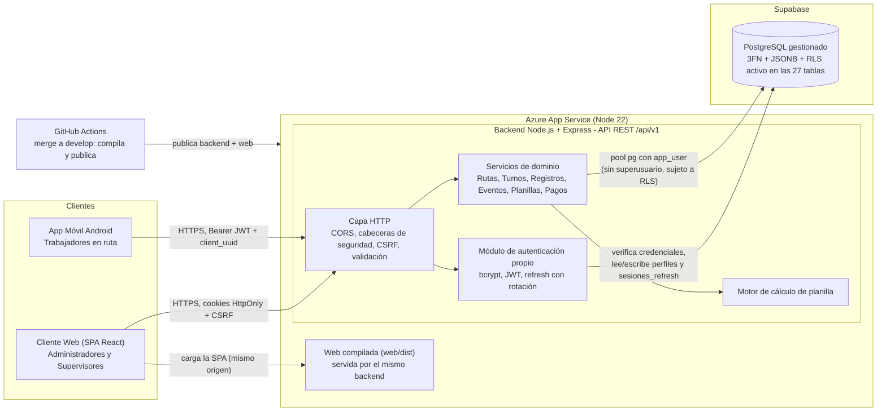
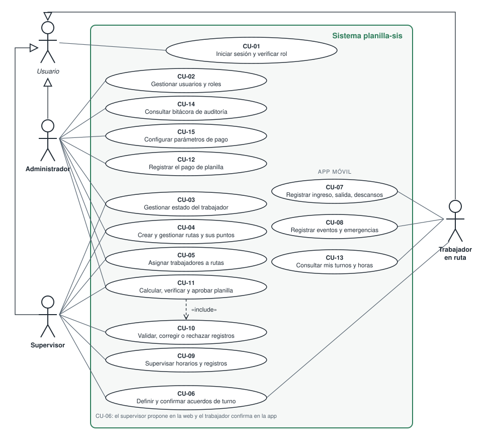
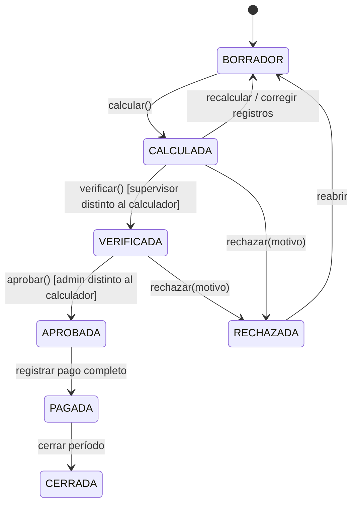
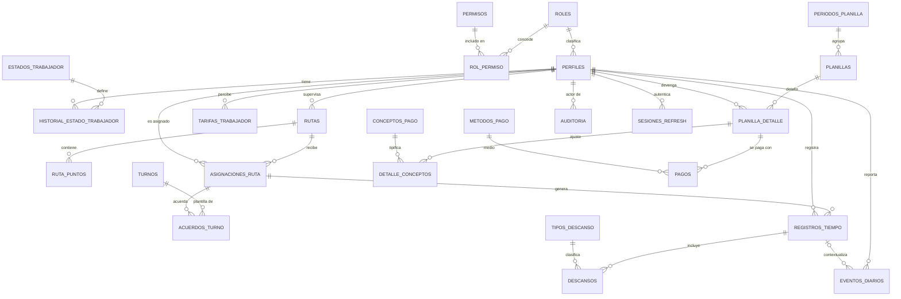
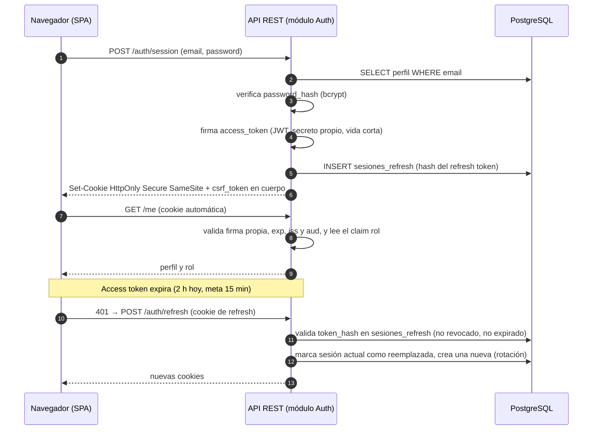
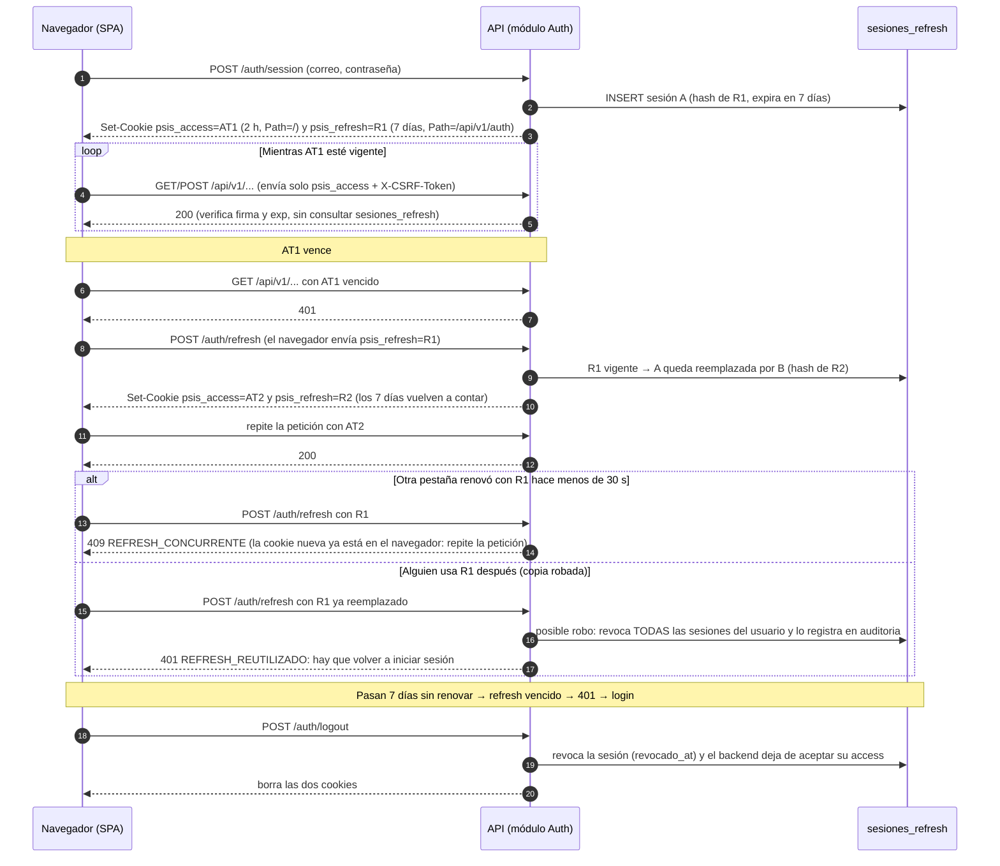

# Entregable: Arquitectura Técnica de la Solución

**Sistema de Control de Planillas y Rutas (`planilla-sis`)**

| Campo | Detalle |
| --- | --- |
| Versión | 3.0 – Versión final (actualizada con lo construido y desplegado) |
| Fecha | 28 de octubre de 2026 (versión 2.0: 21 de septiembre de 2026) |
| Elaborado por | Equipo `planilla-sis` (§A.1) |
| Equipo | 6 integrantes: 5 en Web/Backend y 1 que cubre Backend y App Móvil |
| Repositorio | [https://github.com/AgosAnt/planilla-sis](https://github.com/AgosAnt/planilla-sis) |
| Despliegue | Backend y web en Azure App Service; base de datos PostgreSQL en Supabase (ver [`manual-despliegue.md`](manual-despliegue.md)) |

---

## A. Matriz de Asignación de Responsabilidades (RACI / RAM)

### A.1 Roles del equipo

| Integrante | Carné | Rol | Perfil | Foco principal |
| --- | --- | --- | --- | --- |
| Jonatan | _________ | **Dev Backend 1** y **Dev Móvil 1** | Líder Técnico / Arquitecto | Contrato API, arquitectura, ADRs, revisión de calidad; app móvil y sincronización offline |
| Marco | _________ | **Dev Backend 2** | Backend – Dominio | Par inicial de la autenticación propia (consultado); rutas, turnos, registros de tiempo, motor de cálculo, aprobación y pagos |
| Sofía | _________ | **Dev Backend 3** | Datos / DBA | Esquema 3FN, JSONB, migraciones, RLS; datos del motor de cálculo (parámetros y feriados) |
| Daniel | _________ | **Dev Backend 4** | Seguridad / Autenticación / DevOps / QA | Autenticación propia (par inicial: hash, JWT, refresh), OWASP, CI/CD, secretos, pruebas |
| Samuel | _________ | **Dev Web 1** | Líder Frontend | Shell de la SPA, routing, guardas, CSP |
| Stefany | _________ | **Dev Web 2** | Frontend | Módulos de UI (rutas, supervisión, planillas) |

> El plan original preveía 7 integrantes con un desarrollador móvil dedicado. El equipo quedó en 6: el líder técnico cubre también el rol **Dev Móvil 1**, por eso en las matrices ese rol aparece con su nombre.

**Leyenda.** **R** = Responsable (ejecuta). **A** = Aprobador/Accountable (rinde cuentas; **uno solo por fila**). **C** = Consultado (bidireccional). **I** = Informado. **A/R** = quien aprueba también ejecuta.

### A.2 Matriz RACI planificada

Asignación acordada al inicio del proyecto, por rol.

| # | Entregable técnico | Dev Web 1 (Samuel) | Dev Web 2 (Stefany) | Dev BE 1 (Jonatan) | Dev BE 2 (Marco) | Dev BE 3 (Sofía) | Dev BE 4 (Daniel) | Dev Móvil (Jonatan) |
| --- | --- | --- | --- | --- | --- | --- | --- | --- |
| 1 | Arquitectura, patrones y ADRs | C | I | **A/R** | C | C | C | C |
| 2 | Integración con repo `planilla-sis` (estructura, ramas, convenciones) | C | I | **A** | R | C | R | I |
| 3 | Auditoría del esquema BD existente | I | I | C | C | **A/R** | C | C |
| 4 | Modelo ER 3FN, JSONB y migraciones | I | I | C | C | **A/R** | I | C |
| 5 | Autorización a nivel de fila (RLS, defensa en profundidad, §D.4) | I | I | C | C | **A/R** | C | I |
| 6 | Contrato API REST (OpenAPI 3.x) | C | I | **A** | R | C | C | C |
| 7 | Backend: módulos Rutas, Turnos, Registros de tiempo | I | I | C | **A/R** | C | C | C |
| 8 | Backend: motor de cálculo, verificación y aprobación de planilla | I | I | C | **A/R** | C | C | I |
| 9 | Frontend: shell SPA, History API, guardas por rol | **A/R** | R | C | I | I | C | I |
| 10 | Frontend: módulos de rutas, turnos y supervisión | **A** | R | I | C | I | I | I |
| 11 | Frontend: módulos de planillas y pagos | **A** | R | I | C | I | I | I |
| 12 | Autenticación propia (hash de contraseñas, JWT, rotación de refresh, MFA) y endpoints de sesión | C | I | C | R | C | **A/R** | C |
| 13 | Seguridad OWASP (XSS, CSRF, CSP, secretos) | R | C | C | C | C | **A/R** | I |
| 14 | API móvil y sincronización offline (idempotencia) | I | I | **A** | R | C | C | R |
| 15 | App móvil (registro de ingreso/descanso/eventos, cálculos) | I | I | I | C | I | C | **A/R** |
| 16 | Pruebas (unitarias, integración, e2e, seguridad) | C | R | C | R | C | **A** | C |
| 17 | CI/CD, entornos y gestión de secretos | I | I | C | C | C | **A/R** | I |
| 18 | Documentación técnica y entregables de fase | R | C | **A** | R | R | R | C |

**Verificación de consistencia:** cada fila tiene exactamente una **A**; ningún integrante concentra más de 7 filas como A, y ninguna persona es único R en un entregable crítico sin un C de respaldo (mitiga el riesgo de "factor camión").

### A.3 Matriz RACI ejecutada

Lo que ocurrió en la construcción, a partir de los *pull requests* integrados a `develop` desde el **#9 (13 de octubre de 2026)** hasta el **#58 (27 de octubre de 2026)**. Las filas 1 a 18 son las de la matriz planificada; las filas 19 a 22 son entregables que surgieron durante el desarrollo.

- **R** refleja la autoría real en GitHub (columna *Evidencia*). Cuando el líder técnico construyó la primera versión de un módulo de otra área para desbloquear al equipo, figura como **R** de apoyo y el dueño del área conserva la **A**.
- **A** sigue al dueño del rol (§A.1), no a quien presionó *merge*: la aprobación de cada entregable corresponde a quien rinde cuentas por él.

| # | Entregable técnico | Samuel | Stefany | Jonatan | Marco | Sofía | Daniel | Evidencia (PRs) |
| --- | --- | --- | --- | --- | --- | --- | --- | --- |
| 1 | Arquitectura, patrones y ADRs | C | I | **A/R** | R | C | C | #10 arquitectura modular controller-service-repository (Marco); #30 reglas de cálculo aprobadas (Jonatan) |
| 2 | Integración con repo (estructura, ramas, convenciones) | R | I | **A** | R | C | C | #10 estructura del backend (Marco); #23 base de la web (Samuel) |
| 3 | Auditoría del esquema BD existente | I | I | C | C | **A/R** | I | #9 M001 trabajo previo (Sofía) |
| 4 | Modelo ER 3FN, JSONB y migraciones | I | I | R | C | **A/R** | C | #9 M002–M007, #35 M009, #44 M011, #52 M012 (Sofía); #11 permisos de M007 y #14 seed de desarrollo (Jonatan, apoyo) |
| 5 | Autorización a nivel de fila (RLS) | I | I | R | C | **A/R** | R | #35 M010 RLS en todas las tablas (Sofía); #13 M008 RLS en registros y eventos (Jonatan); #36 login y `/me` con RLS (Daniel) |
| 6 | Contrato API REST (OpenAPI 3.x) | C | C | **A/R** | R | C | R | #12 OpenAPI 0.3 (Jonatan); #42 y #51 (Marco); #37, #45–#47 y #50 (Daniel): cada PR documenta sus endpoints |
| 7 | Backend: Rutas, Turnos, Registros de tiempo | I | C | R | **A/R** | C | C | #33 asignaciones y acuerdos de turno, #40 nombre del trabajador (Marco); #16 CRUD de rutas, #22 registros de tiempo, #24 asignación activa en `/me` (Jonatan, apoyo) |
| 8 | Backend: motor de cálculo, verificación y aprobación | C | I | C | **A/R** | R | C | #42 motor de cálculo, #43 aprobación con reautenticación y pagos (Marco); M009 parámetros y feriados en #35 (Sofía) |
| 9 | Frontend: shell SPA, History API, guardas por rol | **A/R** | R | R | I | I | C | #23 SPA con sesión, router y layout (Samuel); #26 módulos en el router (Stefany); #19 y #21 prototipo navegable (Jonatan, apoyo) |
| 10 | Frontend: rutas, turnos y supervisión | **A** | R | C | C | I | I | #26 y #31 módulos de Rutas y Supervisión (Stefany); #29 corrección de llamadas a la API (Jonatan) |
| 11 | Frontend: planillas y pagos | **A/R** | C | C | C | I | I | #54 pantallas de planillas y pagos con la API real (Samuel) |
| 12 | Autenticación propia y endpoints de sesión | C | I | R | C | R | **A/R** | #32 reautenticación, cambio de contraseña y bloqueo, #36 y #47 refresh con rotación y detección de reúso (Daniel); #44 M011 (Sofía); #15 sesión web con cookies y CSRF, #18 alta de usuarios, #48 renovación en el móvil y #58 IP del cliente en Azure (Jonatan) |
| 13 | Seguridad OWASP (XSS, CSRF, CSP, secretos) | C | I | R | C | C | **A/R** | #53 dependencia vulnerable, #57 cookies `Secure` y HSTS (Daniel); #15 cabeceras de seguridad y CSRF, #17 autenticación en registros y planillas (Jonatan) |
| 14 | API móvil y sincronización offline | I | I | **A/R** | R | C | C | #10 módulo de eventos (Marco); #24 y #27 `/api/v1` con cola offline e idempotencia (Jonatan) |
| 15 | App móvil | I | I | **A/R** | C | I | C | #27, #39 geocerca y GPS, #48, #49 mi cálculo, turnos y contraseña, #56 Material 3 y emergencia al mantener presionado (Jonatan) |
| 16 | Pruebas | C | C | R | R | C | **A/R** | Pruebas del motor en #42 (Marco); pruebas unitarias y de integración del móvil en #27, #39, #48 y #49 (Jonatan); pruebas de RLS en #13; cada PR incluye "Cómo se probó" y Daniel revisa la parte de seguridad |
| 17 | CI/CD, entornos y gestión de secretos | I | I | R | I | C | **A/R** | #53 auditoría de dependencias (Daniel); #38 despliegue a Azure con secretos en GitHub y Azure (Jonatan, apoyo) |
| 18 | Documentación técnica y entregables | C | C | **A/R** | R | R | R | Este documento, `manual-despliegue.md` y #30 (Jonatan); #51 alcance (Marco); README de migraciones (Sofía); documentación de endpoints (Daniel) |
| 19 | Estados del trabajador y catálogos (CU-03) | I | I | C | **A** | C | R | #46 estados con historial y catálogos (Daniel) |
| 20 | Emergencias: envío desde la app, consulta y atención (CU-08) | I | I | R | **A** | I | R | #45 consulta y atención (Daniel); #56 botón de emergencia en la app (Jonatan) |
| 21 | Administración: usuarios, auditoría y permisos por rol (CU-02, CU-14) | C | I | R | I | C | **A/R** | #37 usuarios y auditoría, #50 permisos por rol (Daniel); #18 alta de usuarios (Jonatan) |
| 22 | Geocerca de las rutas (CU-04) | I | I | R | **A/R** | R | I | #55 consultar y reemplazar puntos (Marco); #52 M012 validaciones (Sofía); #39 geocerca en la app (Jonatan) |

**En curso al cierre de esta versión** (paquetes listos, sin integrar a `develop`): pantallas de usuarios y auditoría, y de parámetros (Samuel); editor de geocerca, renovación de sesión en la web, estados y emergencias, turnos y panel (Stefany); segunda fase de la renovación de sesión en la web (Daniel).

**Diferencias entre lo planificado y lo ejecutado**

| Fila | Plan | Ejecución | Motivo |
| --- | --- | --- | --- |
| 8 | Motor de cálculo a cargo de Dev BE 2 (Marco) | Marco lo construyó; Sofía aportó la parte de datos (M009) | Las reglas de cálculo necesitaban tablas nuevas de parámetros y feriados |
| 11 | Pantallas de planillas: R Dev Web 2 (Stefany) | Las construyó Samuel | Stefany quedó con rutas, supervisión, estados, turnos y panel; se repartió la carga |
| 12 | Par inicial de autenticación: Daniel y Marco | Daniel y Jonatan | Marco quedó con el dominio (rutas, turnos, cálculo); la sesión web se necesitaba antes para la SPA |
| 15 | Dev Móvil dedicado | El líder técnico | El equipo quedó en 6 integrantes |
| 19–22 | No estaban en el plan | Se agregaron durante el desarrollo | Surgieron de los casos de uso CU-02, CU-03, CU-04, CU-08 y CU-14 al construirlos |

### A.4 Desglose de entregables por integrante

| Integrante | Módulos a su cargo (A o R principal) | Carpetas del repositorio | Sección de este documento |
| --- | --- | --- | --- |
| Jonatan | Arquitectura y contrato API; app móvil y sincronización offline; despliegue en Azure; documentación | `docs/`, `mobile/`, `.github/workflows/` | A, B.1, B.5, manual de despliegue |
| Marco | Backend REST: rutas, asignaciones, turnos, registros, motor de cálculo, aprobación y pagos, geocerca | `backend/src/modules/` (rutas, asignaciones, registros, planillas, parametros) | C.3, E |
| Sofía | Modelado de la base de datos (3FN, JSONB), migraciones y RLS | `Database/` | D |
| Daniel | Autenticación propia, sesiones, seguridad OWASP, administración de usuarios, estados y emergencias | `backend/src/modules/` (auth, usuarios, auditoria, eventos, estados), `backend/src/middlewares/` | F |
| Samuel | Shell de la SPA, History API, guardas por rol, pantallas de planillas y pagos | `web/src/` (router, layout, sesión, planillas, pagos) | B.2, B.3 |
| Stefany | Módulos de UI: rutas, supervisión, geocerca, estados y emergencias, turnos y panel | `web/src/paginas/` | B.4, C (excepto C.3) |

### A.5 Reporte de cumplimiento por integrante

Corte al 28 de octubre de 2026, con los *pull requests* integrados a `develop` desde el #9. Se actualiza antes de la entrega final.

| Integrante | PRs integrados | Entregables cumplidos | En curso |
| --- | --- | --- | --- |
| Jonatan | 21 (#11–#19, #21, #22, #24, #27, #29, #30, #38, #39, #48, #49, #56, #58) | Contrato OpenAPI, app móvil completa (sesión, cola offline, geocerca, cálculo, turnos, emergencia), despliegue en Azure, sesión web inicial, documentación | — |
| Marco | 7 (#10, #33, #40, #42, #43, #51, #55) | Arquitectura modular del backend, asignaciones y turnos, motor de cálculo, aprobación con reautenticación y pagos, geocerca | — |
| Sofía | 4 (#9, #35, #44, #52) | Migraciones M002–M007 y M009–M012, RLS en todas las tablas | — |
| Daniel | 9 (#32, #36, #37, #45–#47, #50, #53, #57) | Reautenticación y bloqueo, login con RLS, refresh con rotación, usuarios y auditoría, estados, emergencias, permisos por rol, cookies `Secure` y HSTS | Renovación de sesión en la web (segunda fase) |
| Samuel | 2 (#23, #54) | SPA con sesión, router y layout; pantallas de planillas y pagos | Pantallas de usuarios y auditoría, y de parámetros |
| Stefany | 2 (#26, #31) | Módulos de rutas y supervisión | Editor de geocerca, renovación de sesión en la web, estados y emergencias, turnos, panel |

---

## B. Justificación de Arquitectura y Patrones

### B.1 Diagrama de arquitectura (vista de contenedores, nivel C4-2)

> Diagrama del sistema **tal como está desplegado**. La decisión de usar autenticación propia sobre PostgreSQL está en el ADR-001 (`adr/ADR-001-autenticacion-propia.md`).



**Descripción textual (C4)**

- **Nivel 1 – Contexto.** Tres personas interactúan con el sistema: el *Administrador* (configura, aprueba y paga), el *Supervisor* (asigna, supervisa, verifica) y el *Trabajador en ruta* (registra su jornada). No hay proveedores externos de identidad: la autenticación es propia del backend. La infraestructura es de terceros (Azure para ejecutar el backend y Supabase para alojar PostgreSQL), pero solo como alojamiento: no se usan Supabase Auth ni sus API.
- **Nivel 2 – Contenedores.**
  1. **Cliente Web (SPA):** React + TypeScript compilado con Vite y servido por el mismo backend (mismo origen, sin CORS en producción). Se comunica **solo** con la API REST mediante cookies `HttpOnly`.
  2. **App Móvil:** aplicación nativa Android (Java). Se comunica con la misma API mediante `Authorization: Bearer` y guarda los tokens cifrados con una llave del Android Keystore (`AlmacenSeguro`).
  3. **API REST (Backend):** contenedor de lógica de negocio, validación, autorización y motor de cálculo. Es la **frontera de confianza**. Se ejecuta en Azure App Service, que termina HTTPS y reenvía la petición (`trust proxy`).
  4. **Módulo de autenticación (dentro del backend):** valida credenciales, emite y renueva JWT propios, gestiona la rotación de *refresh tokens*.
  5. **PostgreSQL en Supabase:** persistencia con 3FN, JSONB y RLS **activo** como segunda barrera. El backend se conecta con el rol `app_user` (sin superusuario y sin ser dueño de las tablas), así que RLS se aplica a todas sus consultas. La llave `service_role` y el rol `postgres` de Supabase **no** se usan en la aplicación: solo los usa el DBA desde el editor SQL para aplicar migraciones.
- **Nivel 3 – Componentes (API).** Capa HTTP → Servicios de dominio → Repositorios de datos. El *Motor de cálculo* es un componente puro (sin E/S), fácilmente testeable con casos de prueba deterministas.

**Patrones aplicados**

| Patrón | Dónde | Justificación |
| --- | --- | --- |
| **API Gateway ligero / BFF de facto** | Capa HTTP del backend | Un único contrato para Web y Móvil; la web nunca recibe llaves privilegiadas. |
| **Arquitectura por capas** (Controller → Service → Repository) | Backend | Separa transporte, negocio y persistencia; facilita pruebas. |
| **Máquina de estados** | Planilla, registro de tiempo, acuerdo de turno | Transiciones explícitas y auditables. |
| **Idempotencia** (`Idempotency-Key` / `client_uuid`) | Endpoints de escritura del móvil | Evita duplicar registros en reintentos por red inestable. |
| **Defensa en profundidad** | API (autorización) + RLS (BD) | Un fallo de autorización en la API no expone datos. |
| **Append-only log** | `auditoria`, `eventos_diarios` | Trazabilidad e integridad forense. |
| **Snapshot inmutable** | `planilla_detalle` al aprobar | Los montos pagados no cambian si cambian las tarifas después. |

### B.2 ¿SPA o MPA? Decisión y justificación

| Criterio | SPA | MPA (multipágina, render en servidor) | Ganador para este caso |
| --- | --- | --- | --- |
| Interacción intensiva (tablas de horas, filtros, edición en línea de registros) | Actualización parcial sin recargar; mantiene estado de filtros y selecciones | Recarga por cada acción; pierde contexto | **SPA** |
| Supervisión "casi en vivo" de horarios | Polling/SSE actualiza solo los componentes afectados | Requiere recargas o JS adicional por página | **SPA** |
| Flujo de planilla de varios pasos (calcular → revisar → verificar → aprobar) | Estado del flujo en memoria; el estado de la planilla vive en la API | Estado a reconstruir en cada página | **SPA** |
| Reutilización del contrato API con el móvil | Mismo API JSON, cero duplicación | Requiere capa de vistas en servidor además de la API | **SPA** |
| SEO / indexación | Débil | Fuerte | **Irrelevante** (panel administrativo privado tras login) |
| Tiempo de carga inicial | Mayor (bundle JS) | Menor | MPA, **mitigable** con *code splitting* y carga diferida por ruta |
| Superficie XSS | Mayor responsabilidad en cliente | Menor | MPA, **mitigable** con CSP estricta y escape por defecto del framework |
| Equipo (2 devs web) | Un solo paradigma y una sola base de código | Dos capas de render (servidor y cliente) | **SPA** |

**Decisión:** **SPA**. Los casos de uso (supervisión, cálculo de planilla y control de rutas) son intensivos en interacción y estado, el panel no requiere SEO, y la API REST ya es obligatoria para el móvil. Las debilidades de la SPA (carga inicial, superficie XSS) son mitigables con técnicas estándar (§B.3 y §F).

**Tecnología adoptada:** React 19 + TypeScript + Vite; React Router (implementa la History API); Tailwind CSS con componentes de shadcn/ui. La propuesta inicial incluía TanStack Query y Zod; no se adoptaron porque las pantallas cargan datos con un cliente propio (`web/src/lib/api.ts`) que ya maneja la sesión, el token CSRF y los errores de la API, y la validación de entrada que importa para la seguridad se hace en el backend. Agregarlos no cambiaría los principios de este documento.

### B.3 Estrategia de enrutamiento con History API

**Principios**

1. **Rutas limpias** (`/planillas/2026-09`), sin hash (`#`), usando `history.pushState`, `history.replaceState` y el evento `popstate`.
2. **Fallback del servidor:** el servidor estático debe devolver `index.html` para cualquier ruta que no sea un archivo o `/api/*`, para que los *deep links* y el refresco funcionen.
3. **Estado de UI compartible en la URL:** filtros, paginación y ordenamiento viajan como *query params* (`/supervision?ruta=R-12&fecha=2026-09-21`). Esto permite enlazar y restaurar vistas.
4. **Guardas de navegación** por autenticación y rol antes de renderizar.
5. **Protección contra pérdida de cambios:** confirmación al abandonar formularios sucios (mediante `beforeunload` y bloqueo de transición en el router).
6. **Nunca datos sensibles en `history.state`** ni en la URL (el `state` es visible al JavaScript de la página y persiste en la sesión del navegador).

**Mapa de rutas (SPA)**

| Ruta | Vista | Roles permitidos |
| --- | --- | --- |
| `/login` | Inicio de sesión | Público |
| `/` → `/panel` | Panel/resumen | Admin, Supervisor |
| `/rutas`, `/rutas/:rutaId` | Listado y detalle de rutas, asignación de personal | Admin, Supervisor |
| `/turnos`, `/turnos/acuerdos` | Catálogo de turnos y confirmación de acuerdos | Admin, Supervisor |
| `/supervision` | Supervisión de horarios y registros (móvil) | Admin, Supervisor |
| `/planillas`, `/planillas/:periodoId` | Períodos y planillas | Admin, Supervisor |
| `/planillas/:planillaId/detalle` | Detalle por trabajador, verificación | Admin, Supervisor |
| `/pagos` | Registro y consulta de pagos | Admin |
| `/admin/usuarios`, `/admin/parametros` | Gestión de usuarios, roles y parámetros de pago | Admin |
| `/auditoria` | Consulta de bitácora | Admin |
| `/403`, `*` | Acceso denegado / no encontrado | Autenticado |

**Núcleo de navegación (referencia)**

```js
function navigate(path, { replace = false, state = {} } = {}) {
  const url = new URL(path, window.location.origin);
  if (url.origin !== window.location.origin) return;      // evita open-redirect
  history[replace ? "replaceState" : "pushState"](state, "", url);
  renderRoute(url.pathname + url.search);                  // guardas + carga diferida
}
window.addEventListener("popstate", () =>
  renderRoute(window.location.pathname + window.location.search)
);
```

> **Nota de seguridad:** la guarda de rutas en el cliente es solo **experiencia de usuario**. La autorización real ocurre en la API (rol + pertenencia) y en RLS; ocultar una ruta no protege un dato.

### B.4 Distribución del almacenamiento web

| Mecanismo | Se almacena | **No** se almacena | Justificación |
| --- | --- | --- | --- |
| **Cookies `HttpOnly; SameSite`** (`psis_access`, `psis_refresh`; `Secure` cuando la petición llega por HTTPS) | Access token (JWT), refresh token | Datos de negocio | Inaccesibles a JavaScript: un XSS no puede exfiltrar los tokens. Se envían automáticamente al mismo origen. |
| **Memoria (variable de módulo / estado de React)** | Token CSRF, perfil del usuario y rol cargados desde `/api/v1/me`, filtros y datos de cada pantalla | — | Se pierde al recargar; se rehidrata desde la API. Mínima persistencia = mínima exposición. |
| **`localStorage`** | Solo preferencias no sensibles: el tema claro/oscuro (`psis:v1:tema`, `web/src/lib/preferencias.ts`) | **Tokens, JWT, datos de nómina, PII** | Persistente y legible por cualquier script del origen: solo para preferencias inocuas. |
| **`sessionStorage`** | Nada (evaluado y descartado, ver abajo) | Todo | — |
| **`IndexedDB`** | Nada (no se necesitó) | Datos de pago | Los catálogos son pequeños y la API responde rápido; una caché persistente solo agregaría datos que limpiar. |
| **Caché HTTP** | Activos estáticos con nombre versionado por Vite | Respuestas de la API con datos personales (`Cache-Control: no-store`) | Evita fugas en equipos compartidos. |

**Por qué no se usó `sessionStorage`.** La versión 2.0 de este documento lo reservaba para borradores de formularios de planilla, filtros de la pestaña y el paso actual del asistente de planilla. Al construir la web ninguno de esos casos lo necesitó:

1. **El flujo de planilla no es un asistente con estado en el cliente.** Cada paso (calcular, verificar, aprobar, pagar) es una transición de estado que se guarda en la API (§C.3). Si el usuario recarga la página, la web vuelve a leer el estado real de la planilla; un borrador local podría incluso mostrar un paso que ya no corresponde.
2. **Los formularios son cortos** (una ruta, un pago, un usuario) y se envían en una sola acción, así que no hay borradores que valga la pena conservar.
3. **Menos datos en el navegador = menos exposición.** `sessionStorage` también es legible por cualquier script del origen; si no hace falta, no guardar nada ahí reduce lo que un XSS podría leer.

Aun así, al cerrar sesión la web ejecuta `sessionStorage.clear()` (`limpiarSesionApi` en `web/src/lib/api.ts`) como medida preventiva, por si una pantalla futura llegara a usarlo.

**Reglas transversales**

- **Cerrar sesión** ejecuta `POST /auth/logout` (revoca la sesión en el servidor y borra las cookies), olvida el token CSRF y el perfil en memoria y limpia `sessionStorage`. La preferencia de tema se conserva porque no es dato del usuario.
- Toda clave de almacenamiento usa el prefijo `psis:` y un **versionado** (`psis:v1:`) para migrar formatos sin errores.
- Se lee siempre con `try/catch` y se asume que el almacenamiento puede estar vacío o bloqueado (modo privado).

### B.5 Integración con el repositorio y estructura

```text
planilla-sis/
├── Database/
│   ├── 01_schema_inicial.sql → script del prototipo (6 tablas, analizado en §D.1; solo referencia histórica)
│   ├── migrations/    → M002 a M012, en orden (README con el procedimiento)
│   ├── seeds/         → S001 datos de desarrollo
│   └── tests/         → pruebas de RLS
├── backend/           → API REST (src/modules/<módulo>/ controller, service, repository, routes)
├── web/               → SPA (React + TS + Vite); se compila a web/dist y la sirve el backend
├── mobile/            → App Android (Java)
├── docs/              → este entregable, manual de despliegue, ADRs, OpenAPI, reglas de cálculo
└── .github/workflows/ → despliegue-azure.yml: cada merge a develop compila la web y publica en Azure
```

Convenciones (detalle en `CONTRIBUTING.md`): ramas `main` / `develop` / `feature/*` y `fix/*`; todo cambio entra por *pull request* hacia `develop` con al menos 1 revisión y *squash and merge*; *Conventional Commits*; contrato OpenAPI en `docs/openapi.yaml` como fuente única de verdad entre Web, Backend y Móvil.

---

## C. Análisis de Sistemas e Ingeniería de Requisitos

### C.1 Actores

| Actor | Tipo | Descripción | Plataforma | Responsabilidades |
| --- | --- | --- | --- | --- |
| **Administrador** | Primario | Responsable de configuración, aprobación final y pago | Web | Gestionar usuarios/roles, parámetros de pago, **aprobar planilla**, registrar pagos, consultar auditoría |
| **Supervisor** | Primario | Responsable operativo de una o varias rutas | Web | Asignar rutas y turnos, confirmar acuerdos, supervisar horarios, validar registros, **verificar cálculo de horas** |
| **Trabajador en Ruta** | Primario | Personal operativo | Móvil | Registrar ingreso/salida, descansos y eventos; consultar sus turnos, horas y horas extra |
| **Módulo de Autenticación** | Secundario (interno) | Componente del backend que valida credenciales y emite/renueva JWT propios | — | Hash y verificación de contraseñas, emisión y rotación de tokens |
| **Motor de cálculo** | Secundario (interno) | Componente que aplica reglas de pago | — | Calcular horas y montos de forma determinista |
| **Auditor** *(opcional, fase futura)* | Primario | Rol de solo lectura | Web | Consultar planillas y bitácora |

### C.2 Matriz de casos de uso principales

| ID | Caso de uso | Actor(es) | Módulo | Prioridad | Plataforma |
| --- | --- | --- | --- | --- | --- |
| CU-01 | Iniciar sesión y verificar rol | Todos | Acceso | Alta | Web / Móvil |
| CU-02 | Gestionar usuarios y asignar roles | Administrador | Acceso | Alta | Web |
| CU-03 | Gestionar estado del trabajador (activo, en ruta, descanso, incapacidad, vacaciones, suspendido) | Supervisor, Administrador | Estados | Media | Web |
| CU-04 | Crear y gestionar rutas y sus puntos | Administrador, Supervisor | Rutas | Alta | Web |
| CU-05 | Asignar trabajadores a rutas | Supervisor, Administrador | Rutas | Alta | Web |
| CU-06 | Definir turnos y proponer/confirmar acuerdos de turno | Supervisor, Trabajador | Turnos | Alta | Web / Móvil |
| CU-07 | Registrar ingreso, salida y descansos | Trabajador | Registro de tiempo | Alta | Móvil |
| CU-08 | Registrar eventos diarios (incidentes, notas, geocercas) | Trabajador | Eventos | Media | Móvil |
| CU-09 | Supervisar horarios y registros en tiempo casi real | Supervisor | Supervisión | Alta | Web |
| CU-10 | Validar, corregir o rechazar registros de tiempo | Supervisor | Supervisión | Alta | Web |
| **CU-11** | **Cálculo, verificación y aprobación de planilla** | Supervisor, Administrador | Planillas | **Crítica** | Web |
| CU-12 | Registrar el pago final de planilla | Administrador | Pagos | Alta | Web |
| CU-13 | Consultar mis turnos, horas y horas extra | Trabajador | Consulta | Media | Móvil |
| CU-14 | Consultar bitácora de auditoría | Administrador | Auditoría | Media | Web |
| CU-15 | Configurar parámetros de pago (multiplicadores, jornada) | Administrador | Configuración | Alta | Web |

**Diagrama de casos de uso (UML)**



*Usuario* es un actor abstracto: Administrador, Supervisor y Trabajador en ruta lo especializan y heredan CU-01. CU-11 incluye CU-10 porque no se calcula una planilla con registros pendientes de validar (FA-1 de §C.3). Las especificaciones detalladas están en §C.3 (CU-11), §C.4 (CU-01), §C.5 (CU-07) y §C.6 (CU-08).

**Matriz de acceso por rol (resumen de permisos)**

| Recurso / Acción | Administrador | Supervisor | Trabajador |
| --- | --- | --- | --- |
| Gestionar usuarios y roles | ✔ | ✖ | ✖ |
| Rutas (crear/editar) | ✔ | Solo las suyas | ✖ |
| Asignar trabajadores | ✔ | Solo sus rutas | ✖ |
| Registrar ingreso/descanso/evento | ✖ | ✖ | ✔ (propio) |
| Ver registros de tiempo | ✔ (todos) | Sus rutas | Propios |
| Validar/corregir registros | ✔ | Sus rutas | ✖ |
| Calcular planilla | ✔ | ✔ (sus rutas) | ✖ |
| **Verificar** planilla | ✖ | ✔ | ✖ |
| **Aprobar** planilla | ✔ | ✖ | ✖ |
| Registrar pago | ✔ | ✖ | ✖ |
| Ver mi cálculo/pago | — | — | ✔ (propio) |
| Consultar auditoría | ✔ | ✖ | ✖ |

### C.3 Especificación detallada – CU-11: Cálculo, verificación y aprobación de planilla

| Campo | Descripción |
| --- | --- |
| **Identificador** | CU-11 |
| **Nombre** | Cálculo, verificación y aprobación de planilla |
| **Actores primarios** | Supervisor (calcula y verifica), Administrador (aprueba) |
| **Actores secundarios** | Motor de cálculo, PostgreSQL (persistencia) |
| **Descripción** | Genera la planilla de un período a partir de los registros de tiempo validados, aplica las reglas de pago vigentes, somete el resultado a revisión independiente y a aprobación final, dejando el resultado inmutable y listo para pago. |
| **Disparador** | Cierre de un período de planilla (fecha fin alcanzada) o solicitud manual de un usuario autorizado. |
| **Precondiciones** | 1. El usuario está autenticado con rol autorizado. 2. El período existe en estado `ABIERTO`. 3. Existen parámetros de pago y tarifa vigentes para el período. 4. No quedan registros de tiempo en estado `PENDIENTE` dentro del alcance (o el usuario acepta excluirlos explícitamente). |
| **Postcondiciones (éxito)** | La planilla queda en `APROBADA`; sus montos son un *snapshot* inmutable; se registran eventos en `auditoria`; queda habilitado CU-12 (pago). |
| **Postcondiciones (fallo)** | La planilla permanece en su último estado válido; no se altera ningún monto aprobado; el intento queda auditado. |

**Máquina de estados de la planilla**



**Flujo principal**

1. El **Supervisor** abre `/planillas/:periodoId` y selecciona alcance (ruta o todas las de su responsabilidad).
2. El sistema lista **excepciones previas**: registros pendientes de validación, jornadas sin salida, descansos incompletos, solapamientos.
3. El Supervisor resuelve excepciones (CU-10) o marca exclusión justificada.
4. El Supervisor ejecuta **Calcular** (`POST /planillas/{id}/calcular`). El backend, en una transacción:
   1. Bloquea el período (evita cálculos concurrentes).
   2. Lee registros validados, descansos, tarifas y parámetros vigentes.
   3. Por trabajador, calcula horas efectivas, ordinarias, extras diurnas y nocturnas, y montos.
   4. Aplica bonificaciones y deducciones (`detalle_conceptos`).
   5. Persiste `planilla_detalle` con el desglose en JSONB (`calculo_detalle`) y estado `CALCULADA`.
5. La web muestra el resultado por trabajador, con *drill-down* a cada jornada y comparación con el período anterior (alertas por variaciones atípicas).
6. Un **Supervisor verificador** (distinto de quien calculó) revisa y ejecuta **Verificar** con observaciones. Estado → `VERIFICADA`.
7. El **Administrador** revisa el resumen y ejecuta **Aprobar** (con reautenticación/MFA). Estado → `APROBADA`; se congelan los montos.
8. El sistema registra `auditoria` (actor, IP, antes/después) y notifica a los interesados.

**Flujos alternos**

| ID | Condición | Comportamiento |
| --- | --- | --- |
| FA-1 | Existen registros `PENDIENTE` | Se bloquea el cálculo y se muestra el listado; el usuario valida, rechaza o excluye con motivo. |
| FA-2 | El verificador detecta una inconsistencia | **Rechazar** con motivo → `RECHAZADA` → se corrige y se recalcula (vuelve a `BORRADOR`). |
| FA-3 | El administrador rechaza | Igual que FA-2; el motivo queda en auditoría. |
| FA-4 | Se corrige un registro después de calcular | La planilla vuelve a `BORRADOR`; se exige recalcular y re-verificar. |
| FA-5 | Recálculo tras cambio de parámetros | Solo permitido antes de `APROBADA`. Los parámetros nuevos no afectan planillas aprobadas. |

**Flujos de excepción**

| ID | Excepción | Respuesta |
| --- | --- | --- |
| FE-1 | Usuario sin rol o fuera de su ruta | `403 Forbidden`; se audita el intento. |
| FE-2 | Mismo usuario intenta calcular y verificar (o calcular y aprobar) | `409 Conflict` con código `SEGREGACION_FUNCIONES`. |
| FE-3 | Falta tarifa/parámetro vigente | `422 Unprocessable Entity` indicando trabajador/parámetro faltante. |
| FE-4 | Cálculo concurrente sobre el mismo período | `409 Conflict` (bloqueo optimista/*advisory lock*). |
| FE-5 | Falla de BD durante el cálculo | *Rollback* completo; estado sin cambios; `503`/`500` con identificador de correlación. |
| FE-6 | Sesión expirada | `401`; la SPA intenta *refresh* y reintenta una vez; si falla, redirige a `/login` conservando la ruta destino. |

**Reglas de negocio**

- **RN-01.** Horas efectivas = (salida − ingreso) − descansos **no remunerados**.
- **RN-02.** Horas ordinarias = mínimo entre horas efectivas y jornada ordinaria diaria (parámetro).
- **RN-03.** Horas extra = exceso sobre la jornada ordinaria; se clasifican en diurnas/nocturnas según el turno y se multiplican por el factor parametrizado (`parametros_pago`).
- **RN-04.** El redondeo (p. ej. al minuto o al cuarto de hora) es un parámetro y se aplica **una sola vez** por jornada.
- **RN-05.** Los montos se almacenan con `numeric(12,2)`; nunca `float`.
- **RN-06.** Segregación de funciones: `calculada_por ≠ verificada_por`; `calculada_por ≠ aprobada_por`; `verificada_por ≠ aprobada_por` (restricciones `CHECK` y validación en API).
- **RN-07.** Una planilla `APROBADA` es **inmutable**: cualquier cambio requiere una planilla de ajuste, no edición.
- **RN-08.** Toda transición de estado genera un registro de auditoría.
- **RN-09.** El cálculo es **idempotente y reproducible**: mismos insumos → mismo resultado.

**Requisitos no funcionales asociados**

| Atributo | Meta |
| --- | --- |
| Rendimiento | Cálculo de 500 trabajadores × 31 días ≤ 30 s (ejecución transaccional) |
| Integridad | Transacción ACID; nunca resultados parciales |
| Seguridad | Reautenticación/MFA para *aprobar* y *pagar*; autorización a nivel API y RLS |
| Trazabilidad | Auditoría completa (quién, cuándo, antes/después, IP) |
| Usabilidad | Advertencias antes de acciones irreversibles; confirmación explícita |

### C.4 Especificación detallada – CU-01: Iniciar sesión y verificar rol

| Campo | Descripción |
| --- | --- |
| **Identificador** | CU-01 |
| **Nombre** | Iniciar sesión y verificar rol |
| **Actores primarios** | Administrador, Supervisor (web); Trabajador en ruta (app móvil) |
| **Actores secundarios** | Módulo de autenticación, PostgreSQL (`perfiles`, `sesiones_refresh`, `auditoria`) |
| **Descripción** | El usuario se identifica con correo y contraseña; el sistema verifica las credenciales, abre una sesión con tokens propios y lo dirige a la plataforma que corresponde a su rol. |
| **Disparador** | El usuario abre la web o la app sin una sesión válida, o su sesión venció. |
| **Precondiciones** | 1. El Administrador creó la cuenta (no hay registro público). 2. La cuenta está activa (`perfiles.activo`). |
| **Postcondiciones (éxito)** | Existe una sesión en `sesiones_refresh` (hash del refresh token, IP y dispositivo); la web recibe las cookies `psis_access` y `psis_refresh` y un token CSRF; la app recibe los tokens en el cuerpo y los guarda cifrados con el Android Keystore. |
| **Postcondiciones (fallo)** | No se crea sesión; el intento fallido suma al contador de la cuenta y, si la bloquea, queda en `auditoria`. |

**Flujo principal**

1. El usuario escribe correo y contraseña. La app móvil envía además `X-Client-Type: mobile`.
2. El sistema ejecuta `POST /api/v1/auth/session`.
3. El backend busca el perfil por correo y compara la contraseña con `bcrypt`. Si el correo no existe, compara contra un hash de relleno para que el tiempo de respuesta no revele qué correos están registrados.
4. El backend reinicia el contador de intentos fallidos, firma el access token (JWT con `sub`, `rol`, `iss` y `aud`) y guarda el hash del refresh token en `sesiones_refresh`.
5. La web recibe las cookies `HttpOnly` y el token CSRF; consulta `GET /api/v1/me` y muestra el panel según el rol (Administrador o Supervisor).
6. La app recibe `access_token` y `refresh_token`, consulta `GET /api/v1/me` (perfil, asignación del día, geocerca y jornada abierta) y muestra la pantalla principal.

**Flujos alternos**

| ID | Condición | Comportamiento |
| --- | --- | --- |
| FA-1 | La cuenta tiene contraseña temporal (`debe_cambiar_password`) | El login responde, pero las demás operaciones devuelven `403 DEBE_CAMBIAR_PASSWORD` hasta cambiarla con `POST /auth/password`; la app lleva al trabajador a la pantalla de cambio de contraseña y conserva sus marcas pendientes. |
| FA-2 | El access token venció durante el uso | La web y la app llaman a `POST /auth/refresh`, reciben un par nuevo (rotación) y repiten la operación una vez. |
| FA-3 | Un Trabajador entra en la web, o un Administrador o Supervisor en la app | La web muestra "Acceso denegado" (`/403`); la app indica "Esta aplicación es para trabajadores en ruta. Usa la web para tu rol." y no abre sesión. |

**Flujos de excepción**

| ID | Excepción | Respuesta |
| --- | --- | --- |
| FE-1 | Correo o contraseña incorrectos | `401 CREDENCIALES_INVALIDAS`, con el mismo mensaje en ambos casos. |
| FE-2 | 5 o más intentos fallidos seguidos | `423` con `Retry-After`; bloqueo progresivo de 1, 2, 4, 8 y hasta 15 minutos. También aplica a correos inexistentes. |
| FE-3 | Se usa un refresh token que ya fue rotado | Se asume robo: se revocan todas las sesiones del usuario y se registra en `auditoria`; el usuario debe volver a iniciar sesión. |
| FE-4 | Servidor no disponible | La app muestra el servidor configurado y permite cambiarlo; la web muestra un error de conexión. |

**Reglas de negocio**

- **RN-01.** Solo el Administrador crea cuentas; cada una nace con contraseña temporal.
- **RN-02.** La contraseña nunca se guarda ni se registra en claro: solo su hash `bcrypt`.
- **RN-03.** El rol que vale es el del token firmado por el backend; la guarda de rutas de la web es solo experiencia de usuario.

### C.5 Especificación detallada – CU-07: Registrar ingreso, salida y descansos

| Campo | Descripción |
| --- | --- |
| **Identificador** | CU-07 |
| **Nombre** | Registrar ingreso, salida y descansos |
| **Actores primarios** | Trabajador en ruta (app móvil) |
| **Actores secundarios** | GPS del teléfono, PostgreSQL (`registros_tiempo`, `descansos`) |
| **Descripción** | El trabajador marca el inicio y el fin de su jornada y sus descansos desde el lugar de trabajo. La app valida la ubicación contra la geocerca de su ruta y guarda cada marca aunque no haya señal, para enviarla cuando vuelva la conexión. |
| **Disparador** | El trabajador presiona *Marcar entrada*, *Marcar salida* o *Descanso*. |
| **Precondiciones** | 1. Sesión iniciada (CU-01) con rol Trabajador. 2. Asignación de ruta vigente para la fecha (CU-05). 3. Permiso de ubicación concedido y GPS encendido. |
| **Postcondiciones (éxito)** | El registro queda en `registros_tiempo` con estado `PENDIENTE` de validación, la hora del dispositivo, la hora de recepción y la ubicación; el supervisor lo ve en CU-09 y lo valida en CU-10. |
| **Postcondiciones (fallo)** | La marca no se guarda (fuera de zona o sin GPS) o queda en la cola local como rechazada, con el motivo visible para el trabajador. |

**Flujo principal (ingreso)**

1. El trabajador presiona *Marcar entrada*.
2. La app pide una lectura actual del GPS (alta precisión; espera hasta 20 s).
3. La app compara la ubicación con los puntos de la geocerca de su ruta (recibidos en `GET /me`): está dentro si la distancia a algún punto es menor o igual a su radio.
4. La app guarda la marca en la cola local (SQLite) con un `client_uuid` nuevo y muestra "ENTRADA guardada".
5. La app envía `POST /api/v1/registros-tiempo/ingreso` con `Idempotency-Key`, la asignación, la hora, la ubicación y los datos del dispositivo.
6. El backend verifica la asignación vigente, que no haya otra jornada abierta y que no se solape con la anterior; guarda el registro, calcula `dentro_de_geocerca` por su cuenta y responde `201`.
7. La app marca la entrada como enviada y muestra la jornada en curso.

**Flujos alternos**

| ID | Condición | Comportamiento |
| --- | --- | --- |
| FA-1 | Sin conexión | La marca queda en la cola local y se envía en orden cuando vuelve la red (también al reconectarse al WiFi). |
| FA-2 | Salida | Igual que el ingreso; se envía `PATCH /registros-tiempo/{id}/salida` sobre la jornada abierta. |
| FA-3 | Descanso | El primer toque guarda el inicio; el segundo pide el tipo de descanso y envía `POST /registros-tiempo/{id}/descansos` con inicio y fin. |
| FA-4 | La ruta no tiene puntos de geocerca | La app permite marcar; el servidor guarda la ubicación y el supervisor la revisa al validar. |
| FA-5 | Reintento de una marca ya recibida | El servidor reconoce el mismo `client_uuid` y no la duplica. |

**Flujos de excepción**

| ID | Excepción | Respuesta |
| --- | --- | --- |
| FE-1 | Fuera de la geocerca | La app no guarda la marca y muestra la distancia al punto más cercano y el radio permitido; si el GPS tiene poca precisión, sugiere intentar al aire libre. |
| FE-2 | Sin asignación vigente | La app avisa "No tienes ruta asignada hoy"; el servidor responde `422 ASIGNACION_NO_ACTIVA`. |
| FE-3 | Ya hay una jornada abierta (p. ej. marcada desde otro teléfono) | `409 REGISTRO_ABIERTO`; la app recupera esa jornada del servidor para que la salida y los descansos vayan a ella. |
| FE-4 | El ingreso es anterior a la última salida | `422 SOLAPA_JORNADA_ANTERIOR`. |
| FE-5 | Servidor caído o `5xx`/`408`/`429` | La marca sigue en la cola y se reintenta; los rechazos `4xx` no se reintentan y se muestran con su motivo. |
| FE-6 | Sesión vencida | Se renueva con el refresh token (FA-2 de CU-01) y se reintenta. |

**Reglas de negocio**

- **RN-01.** Una sola jornada abierta por trabajador (índice único `registros_uno_abierto`).
- **RN-02.** El servidor guarda la hora del dispositivo y la de recepción; la diferencia queda como `desfase_segundos` para el supervisor.
- **RN-03.** La geocerca la valida la app para dar respuesta inmediata y el servidor la vuelve a calcular; la decisión del servidor es la que ve el supervisor.
- **RN-04.** Todas las horas viajan en UTC (ISO 8601) y se muestran en la zona de operación (`America/Guatemala`).

### C.6 Especificación detallada – CU-08: Enviar una emergencia

Variante crítica de CU-08 (registrar eventos diarios).

| Campo | Descripción |
| --- | --- |
| **Identificador** | CU-08 (emergencia) |
| **Nombre** | Enviar una emergencia y atenderla |
| **Actores primarios** | Trabajador en ruta (envía, app móvil); Supervisor o Administrador (atiende, web) |
| **Actores secundarios** | GPS del teléfono, PostgreSQL (`eventos_diarios`) |
| **Descripción** | El trabajador pide ayuda desde el lugar donde está; el sistema guarda la emergencia con su ubicación y la deja en la cola de revisión del supervisor, que registra su atención. |
| **Disparador** | El trabajador mantiene presionado el botón *Emergencia*. |
| **Precondiciones** | 1. Sesión iniciada con rol Trabajador. 2. Permiso de ubicación concedido. |
| **Postcondiciones (éxito)** | Hay un registro en `eventos_diarios` con `tipo_evento = EMERGENCIA`, ubicación, precisión del GPS y estado `PENDIENTE_REVISION`; si había jornada abierta, queda vinculado a ella. |
| **Postcondiciones (fallo)** | La emergencia queda en la cola local y se reenvía hasta que el servidor la reciba. |

**Flujo principal**

1. El trabajador mantiene presionado el botón *Emergencia*. La barra se llena durante 1,5 s y el teléfono vibra al empezar.
2. Al completarse, el teléfono vibra de nuevo y la app lee la ubicación actual. **No** se valida la geocerca: una emergencia puede ocurrir en cualquier lugar.
3. La app guarda el evento en la cola local con un `client_uuid`, el tipo `EMERGENCIA`, la hora, la ubicación y la precisión en `payload`.
4. La app lo envía en `POST /api/v1/eventos:batch` con `Idempotency-Key`.
5. El backend responde `207` con el resultado por evento (`CREADO`, `DUPLICADO` o `RECHAZADO`); la app marca como enviados los dos primeros.
6. El Supervisor consulta las emergencias de sus rutas (`GET /api/v1/eventos?tipo_evento=EMERGENCIA`) y registra la atención con `PATCH /api/v1/eventos/{id}/atencion`; cada cambio queda en `auditoria`. La pantalla web de emergencias está en integración (§A.3, "En curso").

**Flujos alternos**

| ID | Condición | Comportamiento |
| --- | --- | --- |
| FA-1 | El trabajador suelta el botón antes de 1,5 s o desliza el dedo fuera | Se cancela sin enviar nada (evita envíos accidentales). |
| FA-2 | El trabajador usa TalkBack o teclado | Un toque abre un diálogo de confirmación en lugar de mantener presionado. |
| FA-3 | Sin conexión | El evento espera en la cola local y se envía al volver la red; `ocurrido_en` conserva la hora real y `recibido_en` la de llegada. |
| FA-4 | Atención | `PENDIENTE_REVISION` → `EN_ATENCION` → `ATENDIDO` o `DESCARTADO` (también directo desde `PENDIENTE_REVISION`); se guarda quién y cuándo. |

**Flujos de excepción**

| ID | Excepción | Respuesta |
| --- | --- | --- |
| FE-1 | Sin permiso de ubicación o GPS apagado | La app pide activarlo y no envía; el trabajador puede reintentar al instante. |
| FE-2 | Evento repetido (reintento) | El servidor lo reconoce por `(trabajador_id, client_uuid)` y responde `DUPLICADO`, sin crear otro. |
| FE-3 | Transición de atención inválida (p. ej. reabrir un `ATENDIDO`) | `409`; el estado no cambia. |
| FE-4 | Un Trabajador intenta cambiar la atención | `403`; solo Supervisor y Administrador atienden. |

**Reglas de negocio**

- **RN-01.** Los eventos son *append-only* para el trabajador: puede crearlos, no editarlos ni borrarlos (RLS de M008).
- **RN-02.** El `payload` JSONB se muestra siempre como texto en la web, nunca como HTML (mitigación XSS, §F.2).

---

## D. Diseño de Base de Datos Híbrida (PostgreSQL en Supabase)

> **Alojamiento.** La base se diseñó para PostgreSQL estándar y se aloja en Supabase como PostgreSQL gestionado. No depende de funciones propias de Supabase: las mismas migraciones corren en un PostgreSQL local (así se prueban en desarrollo) y la aplicación no usa Supabase Auth, la API REST de Supabase ni la llave `service_role`.

### D.1 Análisis del esquema existente (`Database/` en `planilla-sis`)

> **Fuente del análisis.** Script SQL del prototipo (`Database/01_schema_inicial.sql`, 6 tablas: `Usuarios`, `Rutas`, `Jornadas`, `Eventos_Ruta`, `Eventos_Descanso`, `Planillas`), contrastado con el código del backend y de la app móvil del prototipo. Este análisis describe el **punto de partida**; las decisiones que tomó y su estado actual están en §D.1.4.

#### D.1.1 Valoración general

**Aciertos que se conservan**

- La app móvil ya captura **geolocalización** de entrada, salida y eventos.
- Los **descansos** están en una tabla hija (`Eventos_Descanso`) en lugar de columnas repetidas en la jornada: buen criterio de normalización.
- Los **eventos de emergencia** están separados de la jornada y tienen un estado de atención pensado para que el supervisor los revise en la web.
- Los importes usan `NUMERIC` y no `FLOAT`.
- Ya se definieron políticas `ON DELETE` en las claves foráneas y se documentaron los valores esperados de los estados.

**Brechas principales:** el esquema cubre bien el registro de campo, pero **no** cubre asignación de rutas por supervisor, confirmación de acuerdos de turno, flujo de aprobación de planilla, pagos, auditoría ni seguridad por fila. Además contiene varios defectos de integridad que afectarían al cálculo de pago (H-07, H-09, H-11, H-12, H-17).

#### D.1.2 Hallazgos

Severidad: **Crítica** (bloquea seguridad o integridad de pago) · **Alta** · **Media** · **Baja**.

| ID | Tabla | Hallazgo | Impacto | Sev. |
| --- | --- | --- | --- | --- |
| H-01 | `Usuarios` | No existe columna de credenciales (`email`, `password_hash`) ni tabla de sesiones; no hay forma de emitir un login real ni de derivar la identidad de un JWT. | Sin esto no hay autenticación propia ni RLS por usuario. | Alta |
| H-02 | `Usuarios` | `rol` es texto libre (`VARCHAR(50)`) sin `CHECK` ni catálogo. | Valores inválidos o con distinta capitalización rompen la autorización. | Media |
| H-03 | `Usuarios` | `tarifa_hora` vive en la tabla de identidad, **sin vigencia ni historial**. | Un cambio de tarifa altera la reproducibilidad de pagos pasados; cualquier política que exponga `Usuarios` expone salarios. | Alta |
| H-04 | `Usuarios` | Faltan `activo`, estado laboral (CU-03), documento y datos de contacto. | No hay baja lógica ni estados de trabajador. | Media |
| H-05 | `Rutas` | No hay **supervisor responsable** ni bandera `activa`. | La regla RLS "el supervisor ve su ruta" es **imposible de expresar**. | Alta |
| H-06 | `Rutas` / `Jornadas` | La relación trabajador–ruta existe **solo dentro de `Jornadas`**; no hay asignación previa ni vigencia. | No se puede "asignar rutas" antes de que exista una jornada; el caso de uso CU-05 no tiene soporte. | Alta |
| H-07 | `Jornadas` | **Contradicción interna:** `hora_entrada` es `NOT NULL`, pero el estado `'PROGRAMADA'` describe una jornada que aún no ocurrió. | Es imposible insertar una jornada programada sin inventar una hora de entrada. | Alta |
| H-08 | `Jornadas` | `estado` mezcla el ciclo operativo (`EN_RUTA`, `EN_PAUSA`, `FINALIZADA`) con la validación administrativa (`APROBADA`); `EN_PAUSA` además es derivable de un descanso abierto. | Estado inconsistente; no se sabe quién validó ni cuándo. | Media |
| H-09 | `Jornadas`, `Eventos_*` | Todas las marcas de tiempo son `TIMESTAMP` **sin zona horaria**. | Ambigüedad entre hora del dispositivo y del servidor; errores en horas nocturnas y turnos que cruzan la medianoche. | Alta |
| H-10 | `Jornadas` | `fecha` es redundante con `hora_entrada` (dependencia funcional). | Puede quedar inconsistente, sobre todo en turnos nocturnos. | Baja |
| H-11 | Varias | `ON DELETE CASCADE` desde `Usuarios` hacia `Jornadas`, `Eventos_Ruta` y `Planillas`. | **Borrar un usuario destruye su historial de tiempo y de pagos.** | Alta |
| H-12 | `Jornadas`, `Eventos_Descanso`, `Planillas` | No hay restricciones de integridad: `salida > entrada`, **una sola jornada abierta** por trabajador, descansos sin solapamiento, `UNIQUE(usuario, periodo)`. | Datos contradictorios que llegan al cálculo de horas. | Alta |
| H-13 | `Jornadas`, eventos | No hay identificador de idempotencia generado por el cliente. | Con conectividad intermitente el móvil reintentará y **duplicará** registros. | Alta |
| H-14 | `Eventos_Ruta` | `id_usuario` es redundante: ya se deduce de `id_jornada → id_usuario` (**dependencia transitiva, viola 3FN**). | Un evento podría apuntar a la jornada de otro usuario. | Media |
| H-15 | `Eventos_Ruta` | `tipo_evento` y `estado_atencion` sin `CHECK`; faltan `atendido_por`, `atendido_at`, notas y un campo flexible para datos variables. | El flujo de revisión del supervisor no queda trazado. | Media |
| H-16 | `Eventos_Descanso` | `tipo_evento` es texto libre y no indica si el descanso es **remunerado**; el nombre "evento" es confuso. | El cálculo no puede parametrizar qué descansos restan. | Media |
| H-17 | `Planillas` | Mezcla cabecera de período y detalle por trabajador; `periodo` es `VARCHAR` (`'SEMANA_1_SEP_2026'`) **sin fechas**. | No es consultable ni validable por rango; no se puede evitar solapar períodos. | Alta |
| H-18 | `Planillas` | `estado_aprobacion` solo admite `PENDIENTE`/`PAGADA`; no hay `calculada_por`, `verificada_por`, `aprobada_por`. | No soporta el flujo calcular → verificar → aprobar ni la segregación de funciones (CU-11). | Alta |
| H-19 | `Planillas` | No guarda la tarifa aplicada, la separación de horas extra diurnas/nocturnas, bonificaciones/deducciones ni el desglose del cálculo; no existe tabla de **pagos**. | El pago no es auditable ni reproducible. | Alta |
| H-20 | Todas | El script **no habilita RLS** ni define índices. En el prototipo la única barrera era la API, y esta no autenticaba. | Con autenticación propia y sin RLS, toda la autorización recae en el código del backend; un error de autorización en un endpoint expone o modifica datos sin una segunda barrera. | **Crítica** |
| H-21 | Backend | La aplicación se conectaba con el rol `postgres` (superusuario) y la contraseña estaba escrita en el código. | Un fallo de autorización o una inyección comprometen toda la base; no hay separación de privilegios. | **Crítica** |

#### D.1.3 Disposición por tabla (conservar / modificar / agregar)

| Tabla existente | Decisión | Destino en el modelo objetivo | Cambios principales |
| --- | --- | --- | --- |
| `Usuarios` | **Modificar y dividir** | `perfiles` (+ `roles`, `estados_trabajador`, `historial_estado_trabajador`, `tarifas_trabajador`, `sesiones_refresh`) | La PK pasa a `uuid` generado con `gen_random_uuid()`; se añaden `email` (UNIQUE) y `password_hash` para el login propio; `rol` → `rol_id` (FK); se **retira** `tarifa_hora` hacia `tarifas_trabajador` con vigencia; se añaden `activo`, documento, código de empleado, y la tabla `sesiones_refresh` para las sesiones (§D.2, §F.1). |
| `Rutas` | **Modificar** | `rutas` (+ `ruta_puntos`) | Añadir `codigo`, `supervisor_id` (FK), `activa`; `descripcion` → `nombre`/`descripcion`; el texto `ubicacion` se conserva como referencia y las coordenadas van a `ruta_puntos`. |
| `Jornadas` | **Dividir** | `registros_tiempo` (lo que **ocurrió**) + `asignaciones_ruta` y `acuerdos_turno` (lo que está **programado**) + `turnos` | Se resuelve H-07: lo programado deja de vivir en la misma fila que la entrada real. `hora_entrada` sigue `NOT NULL` en `registros_tiempo`. `APROBADA` pasa a `estado_validacion`. `TIMESTAMP` → `timestamptz`. `fecha` se elimina (se deriva). |
| `Eventos_Ruta` | **Conservar y evolucionar** | `eventos_diarios` | Se conservan las columnas tipadas (`tipo_evento`, `fecha_hora`, `latitud`, `longitud`, `estado_atencion`) porque alimentan la cola de revisión del supervisor. Se añaden `payload jsonb`, `client_uuid`, `atendido_por`, `atendido_at`, `CHECK` de dominios y FK compuesta (H-14). |
| `Eventos_Descanso` | **Renombrar y modificar** | `descansos` (+ `tipos_descanso`) | `tipo_evento` → `tipo_id` (FK a catálogo con `remunerado`); `CHECK (fin > inicio)`; sin solapamiento por jornada. |
| `Planillas` | **Reinterpretar y dividir** | `planilla_detalle` (cada fila actual es en realidad el detalle de **un trabajador**) + `periodos_planilla` + `planillas` (cabecera) + `detalle_conceptos` + `pagos` | `periodo` texto → `periodos_planilla` con fechas; se añade el flujo de estados y las columnas de segregación; se guarda la tarifa aplicada y el desglose en `calculo_detalle jsonb`. |

**Tablas nuevas (20):** `roles`, `permisos`, `rol_permiso`, `estados_trabajador`, `historial_estado_trabajador`, `ruta_puntos`, `asignaciones_ruta`, `turnos`, `acuerdos_turno`, `tipos_descanso`, `tarifas_trabajador`, `parametros_pago`, `periodos_planilla`, `planillas` (cabecera), `conceptos_pago`, `detalle_conceptos`, `metodos_pago`, `pagos`, `auditoria`, `sesiones_refresh`.

**Resultado:** 6 tablas existentes (todas modificadas o evolucionadas) + 20 nuevas = **26 tablas** del modelo de §D.2.

**Convenciones de nombres.** Se propone `snake_case`, minúsculas y plurales (`registros_tiempo`), y `trabajador_id` en lugar de `id_usuario`. Equivalencias de columnas más usadas:

| Actual | Objetivo |
| --- | --- |
| `Usuarios.id_usuario` | `perfiles.id` (uuid) |
| `Jornadas.id_usuario` | `registros_tiempo.trabajador_id` |
| `Jornadas.hora_entrada` / `hora_salida` | `registros_tiempo.ingreso_at` / `salida_at` |
| `Eventos_Descanso.hora_inicio` / `hora_fin` | `descansos.inicio_at` / `fin_at` |
| `Planillas.horas_normales` / `horas_extras` | `planilla_detalle.horas_ordinarias` / `horas_extra_diurnas` + `horas_extra_nocturnas` |
| `Planillas.total_pago` | `planilla_detalle.neto` (snapshot inmutable al aprobar) |

**Ejemplos de correcciones clave**

```sql
-- H-14: un evento solo puede apuntar a una jornada del MISMO trabajador (FK compuesta)
alter table public.registros_tiempo
  add constraint registros_tiempo_id_trabajador_uk unique (id, trabajador_id);

alter table public.eventos_diarios
  add constraint eventos_registro_trabajador_fk
  foreign key (registro_tiempo_id, trabajador_id)
  references public.registros_tiempo (id, trabajador_id);

-- H-12: una sola jornada abierta por trabajador
create unique index registros_uno_abierto
  on public.registros_tiempo (trabajador_id) where salida_at is null;

-- H-11: el historial no se borra en cascada
--   FK a perfiles con ON DELETE RESTRICT; baja lógica mediante perfiles.activo = false
```

#### D.1.4 Estrategia de migración

**Decisión D-1 (resuelta y aplicada):** las tablas del prototipo contenían **solo datos de prueba**. Se hizo una **reconstrucción limpia** del esquema con migraciones versionadas en SQL plano (`Database/migrations/M002` a `M012`), que se aplican en orden con `psql -1 -v ON_ERROR_STOP=1` (cada archivo en una sola transacción) o desde el editor SQL de Supabase. Se descartó una herramienta adicional (`node-pg-migrate`, Flyway): con un archivo por cambio, numeración estricta y migraciones idempotentes (`IF NOT EXISTS`) el equipo no necesitó más, y el mismo SQL se puede revisar en cada *pull request*. Los datos de prueba se descartaron; el seed `S001` crea solo datos de desarrollo: tres usuarios (uno por rol), una ruta con el trabajador asignado y una jornada abierta.

**Decisión D-2 (resuelta y aplicada):** el código de la app del prototipo ya enviaba UTC (`yyyy-MM-dd'T'HH:mm:ss.SSS'Z'`), pero el servidor lo insertaba en columnas `TIMESTAMP`, que **ignoran el sufijo `Z`**. Como los datos se descartaron, no hubo que convertirlos; el contrato vigente es:

- El cliente envía siempre **UTC en ISO 8601**.
- La base guarda `timestamptz`.
- La conversión a hora local se hace **solo al mostrar o al agrupar por fecha de calendario**, con la zona de operación configurable (`ZONA_OPERACION`, por defecto `America/Guatemala`).

**Transición de la app móvil (completada).** La app del prototipo ya se comunicaba con la API (no escribía en la base). La transición se hizo en fases:

| Fase | Trabajo | Riesgo que cerró | Estado |
| --- | --- | --- | --- |
| **0** | Credenciales del código a variables de entorno y rol de aplicación `app_user` sin superusuario; índice parcial único de jornada abierta; en la app, sincronización secuencial y no marcar como enviadas las marcas rechazadas (`400`/`409`). | Credenciales en el repositorio; marcas perdidas o duplicadas en la app (H-12, H-21) | Hecha (#5, M002, M006) |
| **1** | Reconstruir el esquema (M002 a M008) y publicar `/api/v1` con autenticación. | H-01 a H-20; API sin autenticación | Hecha (#9 a #17) |
| **2** | La app migra a `/api/v1`: inicio de sesión, `client_uuid`, `Idempotency-Key`, precisión de la ubicación y descansos. | Duplicados por reintentos (H-13); datos de ubicación incompletos | Hecha (#27) |
| **3** | Retirar los endpoints públicos del prototipo (`POST /api/registros`, `GET /api/jornadas`). | Endpoints sin autenticación | Hecha: el backend solo expone `/api/v1` y cualquier otra ruta bajo `/api` responde `404` |

**Migraciones aplicadas** (detalle y procedimiento en `Database/migrations/README.md` y en `manual-despliegue.md`)

| Migración | Contenido | Tablas nuevas |
| --- | --- | --- |
| M002 | Extensión `pgcrypto`, rol `app_user`, identidad y auditoría | `roles`, `perfiles`, `sesiones_refresh`, `auditoria` |
| M003 | Rutas, geocerca, asignaciones y turnos (extensión `btree_gist` para impedir asignaciones solapadas) | `rutas`, `ruta_puntos`, `asignaciones_ruta`, `turnos`, `acuerdos_turno` |
| M004 | Registro de tiempo, descansos y eventos (índice `registros_uno_abierto`, JSONB) | `registros_tiempo`, `tipos_descanso`, `descansos`, `eventos_diarios` |
| M005 | Tarifas, parámetros, períodos, planillas y pagos | `tarifas_trabajador`, `parametros_pago`, `periodos_planilla`, `planillas`, `planilla_detalle`, `conceptos_pago`, `detalle_conceptos`, `metodos_pago`, `pagos` |
| M006 | Privilegios mínimos de `app_user` (`GRANT` por tabla) | — |
| M007 | Estados del trabajador y permisos por rol (RBAC) | `estados_trabajador`, `historial_estado_trabajador`, `permisos`, `rol_permiso` |
| M008 | RLS en `registros_tiempo` y `eventos_diarios`, funciones `app.*` y pruebas por rol (`Database/tests/`) | — |
| M009 | Parámetros de pago y feriados para el motor de cálculo (`docs/reglas-calculo.md`) | `feriados` |
| M010 | RLS en las 25 tablas restantes | — |
| M011 | Rotación de refresh tokens y detección de reúso en `sesiones_refresh` | — |
| M012 | Validaciones de los puntos de la geocerca (coordenadas válidas, radio de 10 a 5000 m) | — |

**Resultado:** 27 tablas (las 26 del modelo de §D.2 más `feriados`), todas con RLS activado.

#### D.1.5 Información que estaba pendiente (resuelta)

| Pendiente en la versión 2.0 | Cómo se resolvió |
| --- | --- |
| Archivos restantes de la app móvil (cola offline, cliente HTTP, permisos) | Se revisaron y se reescribieron al migrar a `/api/v1` (#27): cola en SQLite con estados de envío, Retrofit con renovación de sesión y permisos de ubicación en tiempo de uso. |
| Estructura del backend | Se reorganizó en módulos controller-service-repository (#10). |
| Estado real de la base local (índice de jornada abierta) | Ya no aplica: el esquema se reconstruyó y el índice `registros_uno_abierto` está en M004. |
| Reglas de negocio del cálculo | Aprobadas por la empresa y documentadas en `docs/reglas-calculo.md` (#30): planilla quincenal, jornada ordinaria diurna, mixta y nocturna, horas extra a 1.5, recargo nocturno, Bonificación Incentivo e IGSS laboral. |
| Política de contraseñas y MFA del Administrador | Contraseña mínima de 12 caracteres, bloqueo progresivo y reautenticación con contraseña para aprobar y pagar (#32). El MFA (TOTP) se difiere a una fase posterior (§F.1). |

### D.2 Modelo relacional transaccional (3FN)

**Modelo Entidad-Relación**



**Diccionario de datos (tablas, PK y FK)**

| # | Tabla | PK | FK principales | Atributos clave / restricciones |
| --- | --- | --- | --- | --- |
| 1 | `roles` | `id smallint` | — | `nombre` UNIQUE (`administrador`, `supervisor`, `trabajador`) |
| 2 | `permisos` | `id smallint` | — | `codigo` UNIQUE (p. ej. `planilla.aprobar`) |
| 3 | `rol_permiso` | (`rol_id`, `permiso_id`) | `rol_id`→roles, `permiso_id`→permisos | PK compuesta (N:M) |
| 4 | `perfiles` | `id uuid` (gen. con `gen_random_uuid()`) | `rol_id`→roles | `email` UNIQUE, `password_hash`, `codigo_empleado` UNIQUE, nombres, apellidos, documento UNIQUE, `activo`, `mfa_secret` (nullable) |
| 5 | `estados_trabajador` | `id smallint` | — | `codigo` UNIQUE (ACTIVO, EN_RUTA, DESCANSO, INCAPACIDAD, VACACIONES, SUSPENDIDO, INACTIVO) |
| 6 | `historial_estado_trabajador` | `id uuid` | `perfil_id`→perfiles, `estado_id`→estados_trabajador, `registrado_por`→perfiles | `desde`, `hasta` NULL = vigente; sin solapamiento por perfil (*exclusion constraint*) |
| 7 | `rutas` | `id uuid` | `supervisor_id`→perfiles | `codigo` UNIQUE, `nombre`, `activa` |
| 8 | `ruta_puntos` | `id uuid` | `ruta_id`→rutas | `orden`, `nombre`, `latitud`, `longitud`, `radio_m`; UNIQUE(`ruta_id`,`orden`) |
| 9 | `asignaciones_ruta` | `id uuid` | `ruta_id`→rutas, `trabajador_id`→perfiles, `asignado_por`→perfiles | `fecha_inicio`, `fecha_fin`, `activa`; sin solapamiento por trabajador |
| 10 | `turnos` | `id smallint` | — | `nombre`, `hora_inicio`, `hora_fin`, `minutos_descanso`, `es_nocturno` |
| 11 | `acuerdos_turno` | `id uuid` | `asignacion_id`→asignaciones_ruta, `turno_id`→turnos, `confirmado_por`→perfiles | `fecha`, `estado` (PROPUESTO/ACEPTADO/RECHAZADO/CONFIRMADO), `confirmado_at`; UNIQUE(`asignacion_id`,`fecha`) |
| 12 | `registros_tiempo` | `id uuid` | `trabajador_id`→perfiles, `asignacion_id`→asignaciones_ruta, `validado_por`→perfiles | `ingreso_at`, `salida_at`, `lat/lng`, `origen`, `estado_validacion`, `client_uuid`; CHECK(`salida_at > ingreso_at`); UNIQUE(`trabajador_id`,`client_uuid`) |
| 13 | `tipos_descanso` | `id smallint` | — | `nombre`, `remunerado boolean` |
| 14 | `descansos` | `id uuid` | `registro_tiempo_id`→registros_tiempo, `tipo_id`→tipos_descanso | `inicio_at`, `fin_at`; CHECK(`fin_at > inicio_at`) |
| 15 | `eventos_diarios` (evoluciona de `Eventos_Ruta`) | `id uuid` | `trabajador_id`→perfiles, (`registro_tiempo_id`,`trabajador_id`)→registros_tiempo, `atendido_por`→perfiles | `tipo_evento`, `latitud`, `longitud`, `estado_atencion`, `client_uuid`; **JSONB** `payload` (§D.3) |
| 16 | `tarifas_trabajador` | `id uuid` | `trabajador_id`→perfiles | `valor_hora numeric(12,4)`, `vigente_desde`, `vigente_hasta` |
| 17 | `parametros_pago` | `id smallint` | — | `clave` UNIQUE + vigencia (jornada diaria, factor extra diurna, factor extra nocturna, regla de redondeo) |
| 18 | `periodos_planilla` | `id uuid` | — | `fecha_inicio`, `fecha_fin`, `estado`; UNIQUE(`fecha_inicio`,`fecha_fin`) |
| 19 | `planillas` | `id uuid` | `periodo_id`→periodos, `ruta_id`→rutas (nullable), `calculada_por`, `verificada_por`, `aprobada_por`→perfiles | `estado`; CHECK de segregación de funciones |
| 20 | `planilla_detalle` | `id uuid` | `planilla_id`→planillas, `trabajador_id`→perfiles | horas ordinarias/extra, `monto_*`, `calculo_detalle jsonb`; UNIQUE(`planilla_id`,`trabajador_id`) |
| 21 | `conceptos_pago` | `id smallint` | — | `nombre`, `tipo` (BONIFICACION/DEDUCCION) |
| 22 | `detalle_conceptos` | `id uuid` | `detalle_id`→planilla_detalle, `concepto_id`→conceptos_pago | `monto numeric(12,2)` |
| 23 | `metodos_pago` | `id smallint` | — | `nombre` (TRANSFERENCIA, EFECTIVO, CHEQUE) |
| 24 | `pagos` | `id uuid` | `detalle_id`→planilla_detalle, `metodo_id`→metodos_pago, `registrado_por`→perfiles | `monto`, `referencia`, `pagado_at`, `estado` |
| 25 | `auditoria` | `id bigint identity` | `actor_id`→perfiles | **JSONB** `datos_antes`, `datos_despues`, `contexto` (§D.3) |
| 26 | `sesiones_refresh` | `id uuid` | `perfil_id`→perfiles, `reemplazado_por`→sesiones_refresh (self-FK, nullable) | `token_hash` UNIQUE (nunca el token en claro), `creado_at`, `expira_at`, `revocado_at`, `ip`, `user_agent`; encadena la rotación (§F.1) |

**Tabla `sesiones_refresh` (soporta la autenticación propia, §F.1)**

```sql
create table public.sesiones_refresh (
  id                uuid primary key default gen_random_uuid(),
  perfil_id         uuid        not null references public.perfiles(id) on delete cascade,
  token_hash        text        not null unique,        -- SHA-256 del refresh token; nunca el token en claro
  creado_at         timestamptz not null default now(),
  expira_at         timestamptz not null,
  revocado_at       timestamptz,                        -- logout o detección de reúso
  reemplazado_por   uuid        references public.sesiones_refresh(id), -- encadena la rotación
  ip                inet,
  user_agent        text
);

create index sesiones_refresh_perfil on public.sesiones_refresh (perfil_id) where revocado_at is null;
```

**Justificación de 3FN**

- **1FN:** todos los atributos son atómicos; los descansos (antes potencial lista dentro del registro) se extraen a `descansos`.
- **2FN:** en tablas con PK compuesta (`rol_permiso`) no hay atributos que dependan de solo una parte de la clave.
- **3FN:** no existen dependencias transitivas; los catálogos (`roles`, `estados_trabajador`, `tipos_descanso`, `metodos_pago`, `conceptos_pago`) evitan repetir descripciones y permiten cambios en un solo lugar.
- **Desnormalización deliberada y documentada:** `planilla_detalle` almacena **totales derivados** (horas y montos). Es un *snapshot* contable: recalcular en cada consulta permitiría que un cambio de tarifa alterara pagos históricos. La integridad se garantiza porque el snapshot solo se escribe en el cálculo y se congela al aprobar (RN-07). Este es el único desvío de 3FN y se acepta por requisito de inmutabilidad.

**Integridad y rendimiento (resumen)**

- `EXCLUDE USING gist` (extensión `btree_gist`) para impedir asignaciones e historiales de estado con rangos de fechas solapados por trabajador.
- Índices en todas las FKs y compuestos para consultas frecuentes: `registros_tiempo(trabajador_id, ingreso_at DESC)`, `asignaciones_ruta(ruta_id, activa)`.
- Tipos: `uuid` para entidades transaccionales, `smallint` para catálogos, `timestamptz` (UTC) para toda marca de tiempo, `numeric` para dinero.
- Borrado lógico (`activo`) en entidades maestras; las transaccionales no se borran.

### D.3 Componente NoSQL: JSONB

**Justificación.** La app móvil produce eventos de estructura variable (incidentes, geocercas, cambios de conectividad, notas) que evolucionan más rápido que el esquema relacional. JSONB permite **almacenar sin migrar** mientras se conserva consulta indexada y transaccionalidad de PostgreSQL (más RLS, §D.4). Los datos que participan en el **cálculo de pago** permanecen en columnas relacionales tipadas. De igual forma, en `eventos_diarios` se conservan como columnas tipadas los campos que el supervisor filtra a diario (tipo, coordenadas, estado de atención) y solo la parte variable va en `payload`.

**Tabla 1: `eventos_diarios`** (generada por el móvil y por la web)

```sql
create table public.eventos_diarios (
  id                 uuid primary key default gen_random_uuid(),
  client_uuid        uuid        not null,              -- idempotencia desde el móvil
  trabajador_id      uuid        not null references public.perfiles(id),
  registro_tiempo_id uuid,                              -- FK compuesta a (id, trabajador_id), ver §D.1.3
  tipo_evento        text        not null
    check (tipo_evento in ('EMERGENCIA','VISITA_FALLIDA','PROBLEMA_VEHICULO','CAMBIO_ESTADO','NOTA','OTRO')),
  origen             text        not null check (origen in ('MOVIL','WEB','SISTEMA')),
  latitud            numeric(10,8),                    -- se conservan de Eventos_Ruta (cola de revisión)
  longitud           numeric(11,8),
  estado_atencion    text        not null default 'PENDIENTE_REVISION'
    check (estado_atencion in ('PENDIENTE_REVISION','EN_ATENCION','ATENDIDO','DESCARTADO')),
  atendido_por       uuid        references public.perfiles(id),
  atendido_at        timestamptz,
  esquema_version    smallint    not null default 1,    -- versionado del payload
  payload            jsonb       not null default '{}'::jsonb
    check (jsonb_typeof(payload) = 'object'),           -- parte dinámica (evoluciona sin migrar)
  ocurrido_en        timestamptz not null,             -- hora del dispositivo
  recibido_en        timestamptz not null default now(),-- hora del servidor
  unique (trabajador_id, client_uuid),
  foreign key (registro_tiempo_id, trabajador_id)
    references public.registros_tiempo (id, trabajador_id)
);

create index eventos_payload_gin on public.eventos_diarios using gin (payload jsonb_path_ops);
create index eventos_pendientes  on public.eventos_diarios (estado_atencion, ocurrido_en desc)
  where estado_atencion = 'PENDIENTE_REVISION';
create index eventos_trab_fecha  on public.eventos_diarios (trabajador_id, ocurrido_en desc);
```

Ejemplo de `payload` (`tipo_evento = 'PROBLEMA_VEHICULO'`):

```json
{
  "subtipo": "LLANTA",
  "severidad": "MEDIA",
  "descripcion": "Llanta ponchada en el km 34",
  "precision_m": 12,
  "adjuntos": [{ "tipo": "foto", "ref": "storage://incidentes/2026/09/abc.jpg" }],
  "dispositivo": { "so": "Android 15", "app": "1.4.2", "bateria": 62 }
}
```

**Tabla 2: `auditoria`** (cambios hechos desde la web y eventos de seguridad)

```sql
create table public.auditoria (
  id             bigint generated always as identity primary key,
  actor_id       uuid references public.perfiles(id),
  actor_rol      text,
  entidad        text not null,
  entidad_id     text not null,
  accion         text not null
    check (accion in ('INSERT','UPDATE','DELETE','VERIFICAR','APROBAR','RECHAZAR','PAGAR','LOGIN','EXPORT')),
  datos_antes    jsonb,
  datos_despues  jsonb,
  contexto       jsonb not null default '{}'::jsonb,   -- ip, user_agent, request_id
  ocurrido_en    timestamptz not null default now()
);

create index auditoria_entidad on public.auditoria (entidad, entidad_id, ocurrido_en desc);
create index auditoria_ctx_gin on public.auditoria using gin (contexto);

-- Append-only: nadie modifica ni borra bitácora desde la API de datos
revoke update, delete, truncate on public.auditoria from anon, authenticated;
```

**Reglas del componente JSONB**

1. **Validación en la API** con esquema por `tipo_evento` y `esquema_version` (Zod/JSON Schema); PostgreSQL solo garantiza que sea objeto JSON.
2. **Nunca se renderiza como HTML** en la web: se muestra como texto (mitigación XSS; ver §F).
3. **Sin PII innecesaria** en `payload`; datos personales solo por referencia (`trabajador_id`).
4. Tamaño máximo por evento (p. ej. 32 KB), controlado en API.
5. La auditoría se escribe mediante **triggers `SECURITY DEFINER`** para cambios en tablas críticas y desde la API para acciones de negocio (aprobar, pagar).

### D.4 Políticas de Seguridad a Nivel de Fila (RLS activo, defensa en profundidad)

**Alcance de esta sección.** Con autenticación propia sobre PostgreSQL (Opción B, ADR-001), **la primera barrera de autorización es el backend** (rol + pertenencia verificados en cada endpoint, §E y §F.1). RLS es la **segunda barrera** y está **activa en las 27 tablas**: M008 la activó en `registros_tiempo` y `eventos_diarios`, y M010 en las 25 restantes. En la versión 2.0 figuraba como opcional; se activó antes de desplegar porque el backend ya se conectaba con un rol sin privilegios y el costo era bajo.

**Verificación en el entorno desplegado (Supabase):** la consulta a `pg_class` devuelve 27 tablas en `public`, las 27 con `relrowsecurity = true`; el backend en Azure se conecta como `app_user` (rol creado `NOSUPERUSER`, que no es dueño de las tablas), así que las políticas se aplican a todas sus consultas.

**Llaves y roles de Supabase.** Supabase entrega una llave `anon`, una llave `service_role` y el rol `postgres`. La aplicación **no usa ninguno**: la llave `service_role` y el rol `postgres` saltan RLS, por eso solo los usa el DBA desde el panel de Supabase para aplicar migraciones, y nunca se guardan en el repositorio, en la web ni en la app. La web y el móvil no tienen credenciales de base de datos: solo hablan con la API.

**Principios**

- **RLS activada en todas las tablas** del esquema `public` (`alter table ... enable row level security`). Sin política = sin acceso.
- El backend **no tiene un usuario de base de datos por persona**: usa un único rol de aplicación (`app_user`, sin privilegios de superusuario, cierra H-21) para todas las conexiones del *pool* `pg`. Por eso, para que RLS distinga entre trabajador, supervisor y administrador, **cada transacción que necesite RLS debe declarar quién es el usuario actual** después de verificar su JWT propio:

  ```sql
  -- Al inicio de cada transacción que requiera RLS, con los claims YA verificados por el backend:
  select set_config('app.jwt_claims', '{"sub":"5b1c2d3e-…","rol":"supervisor"}', true);
  ```

  Las políticas leen ese valor con la función auxiliar `app.usuario_actual()` (equivalente casero a `auth.uid()`), nunca con un dato que el cliente pueda manipular directamente.
- **El rol de aplicación (`app_user`) tiene los privilegios mínimos** que sus operaciones requieren; nunca se conecta con `postgres` ni con un rol de superusuario (cierra H-21).
- Las funciones auxiliares usan `security definer` con `search_path` fijo para evitar recursión y suplantación.

**Funciones auxiliares** (definidas en `Database/migrations/M008_rls_registros_eventos.sql`; el backend fija los *claims* en `conClaims`, `backend/src/config/db.js`)

```sql
create schema if not exists app;

-- Lee los claims que el backend fijó con set_config() tras verificar su propio JWT.
create or replace function app.jwt_claims() returns jsonb
language sql stable security definer set search_path = ''
as $$ select coalesce(nullif(current_setting('app.jwt_claims', true), ''), '{}')::jsonb $$;

create or replace function app.rol_actual() returns text
language sql stable security definer set search_path = ''
as $$ select coalesce(app.jwt_claims() ->> 'rol', 'sin_rol') $$;

-- Equivalente casero a auth.uid(): el id del perfil autenticado.
create or replace function app.usuario_actual() returns uuid
language sql stable security definer set search_path = ''
as $$ select nullif(app.jwt_claims() ->> 'sub', '')::uuid $$;

create or replace function app.supervisa_trabajador(p_trabajador uuid) returns boolean
language sql stable security definer set search_path = ''
as $$
  select exists (
    select 1
    from public.asignaciones_ruta a
    join public.rutas r on r.id = a.ruta_id
    where a.trabajador_id = p_trabajador
      and a.activa
      and r.supervisor_id = app.usuario_actual()
  )
$$;

create or replace function app.supervisa_ruta(p_ruta uuid) returns boolean
language sql stable security definer set search_path = ''
as $$
  select exists (
    select 1 from public.rutas r
    where r.id = p_ruta and r.supervisor_id = app.usuario_actual()
  )
$$;
```

**Catálogo de políticas**

| Tabla | Trabajador | Supervisor | Administrador |
| --- | --- | --- | --- |
| `perfiles` | SELECT solo su fila | SELECT de trabajadores en sus rutas | ALL |
| `roles`, `permisos`, `rol_permiso` | SELECT | SELECT | ALL |
| `estados_trabajador`, `tipos_descanso`, `turnos`, `metodos_pago`, `conceptos_pago` | SELECT | SELECT | ALL |
| `historial_estado_trabajador` | SELECT propio | SELECT/INSERT de sus trabajadores | ALL |
| `rutas`, `ruta_puntos` | SELECT de rutas con asignación propia activa | SELECT/UPDATE de rutas que supervisa | ALL |
| `asignaciones_ruta` | SELECT propias | ALL sobre sus rutas (`app.supervisa_ruta`) | ALL |
| `acuerdos_turno` | SELECT propios; UPDATE solo `estado` ∈ {ACEPTADO, RECHAZADO} de los propios | SELECT/UPDATE (confirmar) de sus trabajadores | ALL |
| `registros_tiempo` | SELECT propios; INSERT propio con `estado_validacion='PENDIENTE'`; sin UPDATE/DELETE una vez validado | SELECT/UPDATE (validar/corregir) de sus trabajadores | ALL |
| `descansos` | Igual que su `registros_tiempo` padre | Igual que padre | ALL |
| `eventos_diarios` | INSERT y SELECT propios; **sin UPDATE/DELETE** | SELECT de sus trabajadores; UPDATE **solo** de `estado_atencion`, `atendido_por`, `atendido_at` | SELECT/UPDATE (mismas columnas) |
| `tarifas_trabajador` | SELECT propia | ✖ (no ve salarios) | ALL |
| `parametros_pago` | SELECT | SELECT | ALL |
| `periodos_planilla` | ✖ | SELECT | ALL |
| `planillas` | ✖ | SELECT/UPDATE de las de sus rutas, solo transiciones permitidas | ALL |
| `planilla_detalle`, `detalle_conceptos` | SELECT propio **solo si** la planilla está `VERIFICADA`/`APROBADA`/`PAGADA` | SELECT de sus trabajadores | ALL |
| `pagos` | SELECT propios | ✖ | ALL |
| `auditoria` | ✖ | ✖ | **Solo SELECT**; INSERT vía trigger/función; UPDATE/DELETE nadie |

> El trabajador consulta su **cálculo estimado** en curso mediante el endpoint `GET /me/calculo`, que el backend deriva de sus `registros_tiempo` (que sí puede leer) sin exponer tarifas de otros ni la planilla en borrador.

**Ejemplo de implementación (`registros_tiempo`)**

```sql
alter table public.registros_tiempo enable row level security;

-- "to app_user" porque todas las conexiones del backend usan ese único rol de aplicación;
-- lo que distingue al trabajador del supervisor es app.jwt_claims(), fijado por transacción.

create policy rt_trabajador_select on public.registros_tiempo
  for select to app_user
  using (trabajador_id = app.usuario_actual());

create policy rt_trabajador_insert on public.registros_tiempo
  for insert to app_user
  with check (
    trabajador_id = app.usuario_actual()
    and app.rol_actual() = 'trabajador'
    and estado_validacion = 'PENDIENTE'
  );

create policy rt_supervisor_select on public.registros_tiempo
  for select to app_user
  using (app.rol_actual() = 'supervisor' and app.supervisa_trabajador(trabajador_id));

create policy rt_supervisor_update on public.registros_tiempo
  for update to app_user
  using      (app.rol_actual() = 'supervisor' and app.supervisa_trabajador(trabajador_id))
  with check (app.rol_actual() = 'supervisor' and app.supervisa_trabajador(trabajador_id));

create policy rt_admin_all on public.registros_tiempo
  for all to app_user
  using      (app.rol_actual() = 'administrador')
  with check (app.rol_actual() = 'administrador');
```

**Pruebas de RLS:** `Database/tests/M008_pruebas_rls.sql` fija `app.jwt_claims` con cada rol y verifica (a) lo permitido, (b) lo denegado y (c) que un supervisor **no** accede a datos de rutas ajenas. Se corre con `psql` sobre una base de prueba; además, cada PR que tocó tablas con RLS se probó con usuarios de los tres roles.

**Restricción de segregación de funciones en BD:**

```sql
alter table public.planillas add constraint planillas_segregacion check (
  (verificada_por is null or verificada_por <> calculada_por) and
  (aprobada_por   is null or aprobada_por   <> calculada_por) and
  (aprobada_por   is null or aprobada_por   <> verificada_por)
);
```

---

## E. Especificación de la API REST (Contrato de Interfaz)

### E.1 Convenciones generales

| Aspecto | Convención |
| --- | --- |
| Base URL | `/api/v1` (versionado en la ruta) |
| Formato | `application/json; charset=utf-8` |
| **Auth Web** | Cookies `HttpOnly` propias (`psis_access`, `psis_refresh`) + cabecera `X-CSRF-Token` en métodos que modifican estado |
| **Auth Móvil** | `Authorization: Bearer <JWT>` |
| Idempotencia | `Idempotency-Key: <uuid>` en `POST` del móvil (además de `client_uuid` en el cuerpo) |
| Trazabilidad | `X-Request-Id` (generado si no viene); se devuelve en toda respuesta |
| Errores | RFC 9457 / 7807 `application/problem+json`: `{ "type", "title", "status", "detail", "code", "request_id", "errors": [...] }` |
| Fechas | ISO 8601 en UTC (`2026-09-21T13:05:00Z`) |
| Paginación | `?page=1&page_size=50` → `{ data, page, page_size, total }` |
| Dinero | Cadena decimal (`"1234.50"`) para evitar errores de punto flotante |
| Autorización | Rol en el claim `rol` del JWT propio + verificación de pertenencia (ruta/trabajador) en la API + RLS activo en la base (segunda barrera, §D.4) |

**Códigos HTTP comunes:** `400` petición mal formada · `401` no autenticado/token vencido · `403` sin permiso · `404` no existe (o no visible por RLS) · `409` conflicto de estado/duplicado · `422` regla de negocio incumplida · `429` límite de tasa · `500`/`503` error del servidor.

### E.2 Matriz de endpoints

| # | Verbo | Ruta | Actor / Rol | Cabeceras de Auth | Éxito | Errores |
| --- | --- | --- | --- | --- | --- | --- |
| 1 | `POST` | `/auth/session` | Público | `Content-Type` (Web: recibe cookies `Set-Cookie`) | `200` | `400`, `401`, `423`, `429` |
| 1b | `POST` | `/auth/refresh` | Autenticado (cookie/token de refresh) | Cookie de refresh (Web) / `refresh_token` en el cuerpo (Móvil) | `200` | `401` |
| 2 | `POST` | `/auth/logout` | Autenticado | Cookie + `X-CSRF-Token` (Web) / `Bearer` (Móvil) | `204` | `401` |
| 2b | `POST` | `/admin/usuarios` | Administrador | Cookie + `X-CSRF-Token` | `201` | `400`, `401`, `403`, `409`, `422` |
| 3 | `GET` | `/me` | Autenticado | Cookie / `Bearer` | `200` | `401` |
| 4 | `POST` | `/registros-tiempo/ingreso` | Trabajador | `Bearer` + `Idempotency-Key` | `201` (`200` si repetido) | `400`, `401`, `403`, `409`, `422` |
| 5 | `POST` | `/registros-tiempo/{id}/descansos` | Trabajador | `Bearer` + `Idempotency-Key` | `201` | `400`, `401`, `403`, `404`, `409`, `422` |
| 6 | `PATCH` | `/registros-tiempo/{id}/salida` | Trabajador | `Bearer` + `Idempotency-Key` | `200` | `400`, `401`, `403`, `404`, `409`, `422` |
| 7 | `POST` | `/eventos:batch` | Trabajador (sync móvil) | `Bearer` + `Idempotency-Key` | `207` (multi-estado) | `400`, `401`, `413`, `422` |
| 8 | `PATCH` | `/registros-tiempo/{id}/validacion` | Supervisor, Admin | Cookie + `X-CSRF-Token` | `200` | `400`, `401`, `403`, `404`, `409` |
| 9 | `POST` | `/rutas/{rutaId}/asignaciones` | Supervisor (propia), Admin | Cookie + `X-CSRF-Token` | `201` | `400`, `401`, `403`, `404`, `409`, `422` |
| 10 | `POST` | `/acuerdos-turno/{id}/confirmar` | Supervisor, Admin | Cookie + `X-CSRF-Token` | `200` | `400`, `401`, `403`, `404`, `409` |
| 11 | `GET` | `/me/calculo?desde=&hasta=` | Trabajador | `Bearer` | `200` | `400`, `401`, `403` |
| 12 | `GET` | `/planillas/periodos/{periodoId}/calculo` | Supervisor, Admin | Cookie | `200` | `400`, `401`, `403`, `404` |
| 13 | `POST` | `/planillas/{id}/calcular` | Supervisor, Admin | Cookie + `X-CSRF-Token` | `200` | `401`, `403`, `404`, `409`, `422` |
| 14 | `POST` | `/planillas/{id}/verificar` | Supervisor | Cookie + `X-CSRF-Token` | `200` | `401`, `403`, `404`, `409`, `422` |
| 15 | `POST` | `/planillas/{id}/aprobar` | Administrador | Cookie + `X-CSRF-Token` + reautenticación/MFA | `200` | `401`, `403`, `404`, `409`, `422` |
| 16 | `POST` | `/planillas/{id}/pagos` | Administrador | Cookie + `X-CSRF-Token` + `Idempotency-Key` | `201` | `401`, `403`, `404`, `409`, `422` |

### E.3 Contratos de los endpoints vitales

#### E-1 · `POST /api/v1/auth/session` (login)

**Solicitud**

```json
{ "email": "supervisor@empresa.com", "password": "********" }
```

El backend busca `perfiles` por `email`, verifica `password_hash` con bcrypt. El segundo factor (MFA) para el administrador está diferido (§F.1); las operaciones críticas (aprobar y pagar) piden reautenticación con contraseña (`POST /auth/reauth`).

**Respuesta `200`** (Web: los tokens viajan **solo** en `Set-Cookie`, no en el cuerpo)

```json
{
  "user": { "id": "5b1c…", "nombres": "Ana", "apellidos": "López", "rol": "supervisor" },
  "csrf_token": "b7f0c1…"
}
```

Web: `Set-Cookie: psis_access=…; HttpOnly; Secure; SameSite=Lax; Path=/` (JWT propio, firmado por el backend) y `Set-Cookie: psis_refresh=…; HttpOnly; Secure; SameSite=Strict; Path=/api/v1/auth`. El backend guarda el *hash* del refresh token emitido en `sesiones_refresh`. Móvil: enviar `X-Client-Type: mobile` para recibir `access_token`/`refresh_token` en el cuerpo (se guardan en Keychain/Keystore). **Errores:** `400` validación · `401` credenciales inválidas (mensaje genérico, no revela si el correo existe) · `423` cuenta bloqueada por intentos fallidos · `429` demasiados intentos.

#### E-1b · `POST /api/v1/auth/refresh` (renovar sesión)

El cliente no envía el refresh token en el cuerpo si es Web (viaja en la cookie `psis_refresh`); el móvil sí lo envía explícito.

**Respuesta `200`**

```json
{ "access_token_emitido": true, "expira_en": 900 }
```

El backend: (1) busca el `token_hash` recibido en `sesiones_refresh`; (2) si está `revocado_at` o no existe, responde `401` y, si el token ya había sido reemplazado antes (indicio de robo/reúso), **revoca todas las sesiones del usuario**; (3) si es válido, emite un access token nuevo y **rota** el refresh (marca el actual como reemplazado y crea uno nuevo). **Errores:** `401` refresh inválido, expirado o revocado.

#### E-2b · `POST /api/v1/admin/usuarios` (crear usuario)

No hay registro público: el Administrador da de alta a cada trabajador/supervisor.

**Solicitud**

```json
{
  "email": "trabajador3@empresa.com",
  "nombres": "Carlos",
  "apellidos": "Pérez",
  "rol": "trabajador",
  "codigo_empleado": "EMP-0034"
}
```

**Respuesta `201`**

```json
{ "id": "9a77…", "email": "trabajador3@empresa.com", "password_temporal": "X7f2-Km91", "debe_cambiar_password": true }
```

El backend genera una contraseña temporal aleatoria (nunca la elige el Administrador) y obliga a cambiarla en el primer inicio de sesión. **`409`** si el correo o el código de empleado ya existen. **`422`** si el rol no es válido.

#### E-4 · `POST /api/v1/registros-tiempo/ingreso` (registrar ingreso)

**Solicitud**

```json
{
  "client_uuid": "0d3f4c1e-6a4e-4a5b-9c6c-1d0c1f2e9a77",
  "asignacion_id": "c2a9f0f4-7e2b-4a0d-8c34-1f9ea1a0b111",
  "ingreso_at": "2026-09-21T13:00:12Z",
  "ubicacion": { "lat": 14.6349, "lng": -90.5069, "precision_m": 9 },
  "dispositivo": { "id": "dev-9F3A", "app_version": "1.4.2" }
}
```

**Respuesta `201`**

```json
{
  "id": "e17b2f7a-3c1d-4d86-9b3a-2f1d0c9a5555",
  "estado_validacion": "PENDIENTE",
  "turno": { "nombre": "Matutino", "hora_inicio": "06:00", "hora_fin": "14:00" },
  "dentro_de_geocerca": true
}
```

**Reglas:** el servidor **no confía en la hora del dispositivo** para el cálculo: guarda `ingreso_at` (cliente) y `recibido_en` (servidor) y marca desviaciones grandes para revisión del supervisor. **`409`** si ya existe un ingreso abierto o `client_uuid` repetido con contenido distinto; **`200`** con el recurso original si es un reintento idéntico (idempotencia). **`422`** si no hay asignación activa.

#### E-7 · `POST /api/v1/eventos:batch` (sincronización de eventos móviles)

**Solicitud**

```json
{
  "eventos": [
    {
      "client_uuid": "6f2b…",
      "tipo_evento": "PROBLEMA_VEHICULO",
      "esquema_version": 1,
      "ocurrido_en": "2026-09-21T15:20:00Z",
      "registro_tiempo_id": "e17b2f7a-…",
      "latitud": 14.6349,
      "longitud": -90.5069,
      "payload": { "subtipo": "LLANTA", "severidad": "MEDIA", "descripcion": "Llanta ponchada" }
    }
  ]
}
```

**Respuesta `207`**

```json
{
  "resultados": [
    { "client_uuid": "6f2b…", "estado": "CREADO", "id": "a91c…" },
    { "client_uuid": "77aa…", "estado": "DUPLICADO" },
    { "client_uuid": "12de…", "estado": "RECHAZADO", "code": "PAYLOAD_INVALIDO" }
  ]
}
```

Máximo 100 eventos y 256 KB por lote (`413` si se excede).

#### E-9 · `POST /api/v1/rutas/{rutaId}/asignaciones`

**Solicitud**

```json
{
  "trabajador_id": "5b1c2d3e-…",
  "fecha_inicio": "2026-10-01",
  "fecha_fin": null,
  "turno_id": 2
}
```

**Respuesta `201`**

```json
{
  "id": "c2a9f0f4-…",
  "ruta_id": "9d0e…",
  "trabajador_id": "5b1c2d3e-…",
  "activa": true,
  "acuerdo_turno": { "id": "77b1…", "estado": "PROPUESTO" }
}
```

**`409`** si el trabajador ya tiene una asignación solapada. **`403`** si el supervisor no es responsable de la ruta.

#### E-12 · `GET /api/v1/planillas/periodos/{periodoId}/calculo` (obtener cálculo)

**Respuesta `200`**

```json
{
  "periodo": { "id": "2f0a…", "desde": "2026-09-01", "hasta": "2026-09-15", "estado": "ABIERTO" },
  "planilla": { "id": "8c11…", "estado": "CALCULADA", "calculada_por": "a3e2…" },
  "resumen": { "trabajadores": 48, "horas_ordinarias": "7360.00", "horas_extra": "412.50", "total_bruto": "184230.75" },
  "detalle": [
    {
      "trabajador_id": "5b1c…",
      "horas_ordinarias": "120.00",
      "horas_extra_diurnas": "6.50",
      "horas_extra_nocturnas": "2.00",
      "monto_bruto": "3840.25",
      "total_bonificaciones": "150.00",
      "total_deducciones": "212.40",
      "neto": "3777.85",
      "alertas": ["VARIACION_MAYOR_20_PORCIENTO"]
    }
  ],
  "page": 1, "page_size": 50, "total": 48
}
```

Un **supervisor** solo recibe trabajadores de sus rutas; los montos salariales requieren rol autorizado.

#### E-14 · `POST /api/v1/planillas/{id}/verificar`

**Solicitud**

```json
{ "observaciones": "Revisadas 3 alertas de variación; justificadas por cobertura de ausencias.", "excepciones_revisadas": ["5b1c…", "9a77…"] }
```

**Respuesta `200`**

```json
{ "id": "8c11…", "estado": "VERIFICADA", "verificada_por": "d4f6…", "verificada_at": "2026-09-16T10:14:00Z" }
```

**`409`** con `code: "SEGREGACION_FUNCIONES"` si quien verifica calculó la planilla. **`409`** `ESTADO_INVALIDO` si no está `CALCULADA`.

#### E-15 · `POST /api/v1/planillas/{id}/aprobar` (aprobar)

**Cabeceras:** cookie de sesión + `X-CSRF-Token` + `X-Reauth-Token` (token de reautenticación/MFA reciente, válido pocos minutos). **Solicitud**

```json
{ "comentario": "Aprobada para pago quincena 1 de septiembre.", "total_esperado": "184230.75" }
```

`total_esperado` es una **protección contra condición de carrera**: si el total actual difiere (alguien recalculó), se responde `409 TOTAL_DESACTUALIZADO`. **Respuesta `200`**

```json
{ "id": "8c11…", "estado": "APROBADA", "aprobada_por": "f2b0…", "aprobada_at": "2026-09-16T11:02:31Z", "hash_integridad": "sha256:9c1f…" }
```

`hash_integridad` (resumen criptográfico del snapshot) permite detectar alteraciones posteriores.

#### E-16 · `POST /api/v1/planillas/{id}/pagos`

**Solicitud**

```json
{
  "metodo_id": 1,
  "fecha_pago": "2026-09-17",
  "pagos": [
    { "detalle_id": "d1a2…", "monto": "3777.85", "referencia": "TRX-000123" }
  ]
}
```

**Respuesta `201`**

```json
{ "planilla_id": "8c11…", "estado": "PAGADA", "pagos_registrados": 1, "total_pagado": "3777.85" }
```

**`422`** si `monto` ≠ neto aprobado, o la planilla no está `APROBADA`. **`409`** si el detalle ya fue pagado (idempotencia por `Idempotency-Key`).

---

## F. Plan de Seguridad y Mitigaciones OWASP

### F.1 Estrategia de sesiones y autenticación (JWT propio en cookies seguras)

> Decisión D-3 (ADR-001, `adr/ADR-001-autenticacion-propia.md`): autenticación construida en el backend, sin proveedor externo.

**Integración con Supabase: por qué no Supabase Auth.** La base vive en Supabase, pero la autenticación **no** usa Supabase Auth. Se evaluó y se descartó por cuatro razones:

1. **Un solo contrato para web y móvil.** La web necesita cookies `HttpOnly` emitidas por nuestro propio dominio, con token CSRF; el móvil necesita `Bearer`. Con Supabase Auth la sesión la maneja su SDK en el navegador (por defecto guarda el JWT en `localStorage`, y su variante para servidor usa cookies que JavaScript sí puede leer), lo que contradice la regla de §B.4 de no dejar tokens al alcance de JavaScript.
2. **Altas controladas.** No hay registro público: el Administrador crea cada cuenta con contraseña temporal, y la sesión lleva el rol del sistema (administrador, supervisor, trabajador) que usan la API y RLS.
3. **Reglas propias de sesión:** bloqueo progresivo, reautenticación con token de un solo uso para aprobar planillas y registrar pagos, revocación de todas las sesiones al cambiar la contraseña, y auditoría de cada evento en nuestra tabla `auditoria`.
4. **Portabilidad.** El sistema también debe funcionar en un servidor de la red local de la oficina (D-4), donde no hay Supabase; con autenticación propia, el mismo código corre en ambos entornos.

El equivalente de `auth.uid()` de Supabase es `app.usuario_actual()`: el backend verifica su JWT y fija los *claims* en la transacción (`set_config('app.jwt_claims', …)`), y las políticas RLS los leen (§D.4).

**Flujo Web**



**Ciclo de vida de las dos cookies**

La sesión web usa dos tokens con vidas distintas, cada uno en su cookie:

| Cookie | Contiene | Vida | Viaja a | Para qué |
| --- | --- | --- | --- | --- |
| `psis_access` | Access token (JWT firmado, con `sub`, `rol`, `iss`, `aud`) | **2 h** hoy; baja a **15 min** cuando la web renueve sola | Todo `/` (cada petición a la API) | Demostrar quién es el usuario en cada petición; no se guarda en la base |
| `psis_refresh` | Refresh token (aleatorio; en la base solo su *hash*) | **7 días**, y se vuelven a contar en cada renovación | Solo `/api/v1/auth` (renovar y cerrar sesión) | Pedir un access nuevo sin volver a escribir la contraseña |

El access es corto porque viaja en cada petición y el servidor no lo consulta en la base: si se filtrara, solo sirve hasta su `exp`. El refresh es largo pero casi nunca viaja, cada uso lo reemplaza por uno nuevo (rotación) y se puede revocar en la base. Las dos son `HttpOnly` (JavaScript no las lee), `SameSite` (`Lax` y `Strict`) y `Secure` por HTTPS.



**Estado actual.** El servidor ya implementa todo el ciclo (#47). La **app móvil** renueva sola: guarda los dos tokens cifrados con el Android Keystore y, ante un `401`, llama a `/auth/refresh` con el refresh en el cuerpo y repite la petición (#48). La **web** todavía no renueva sola: ante un `401` vuelve al login. La renovación automática está en integración (§A.3, "En curso"); cuando entre, el access baja de 2 h a 15 min (`DURACION_ACCESS_SEG` en `backend/src/config/sesion.js`).

**Decisiones**

| Tema | Decisión | Justificación |
| --- | --- | --- |
| Emisión de tokens | El propio backend firma los JWT (librería estándar, p. ej. `jsonwebtoken`), con un secreto (`JWT_SECRET`, HS256) o par de llaves (RS256) fuera del código, en variables de entorno | La SPA nunca manipula tokens; JavaScript no puede leerlos. Ningún proveedor externo emite ni valida credenciales. |
| Hash de contraseñas | `bcrypt` con costo 10 (nunca hash propio ni reversible) | Estándar de la industria; resistente a fuerza bruta con hardware dedicado. |
| Cookies del access token | `psis_access`, `HttpOnly; SameSite=Lax; Path=/`, sin atributo `Domain`; `Secure` cuando la petición llega por HTTPS (Azure) | El backend lee `X-Forwarded-Proto` del frontal de Azure (`trust proxy`) para saber si la conexión es HTTPS. Se descartaron los prefijos `__Host-`/`__Secure-` porque obligan a `Secure` y la app también se prueba por HTTP dentro de la red local. |
| Cookie de refresh | `psis_refresh`, `HttpOnly; SameSite=Strict; Path=/api/v1/auth`; `Secure` por HTTPS | Solo viaja a los endpoints de sesión (renovar y cerrar); menor exposición. |
| Persistencia del refresh | Tabla `sesiones_refresh`: se guarda el **hash** del token (no el token), con `expira_at`, `revocado_at` y `reemplazado_por` para encadenar la rotación | Un volcado de la base no revela tokens utilizables; permite revocar sesiones individuales o todas las de un usuario. |
| Vida de tokens | Access de 2 h mientras se termina la renovación automática en la web (la meta es ≈15 min); refresh de 7 días con **rotación en cada uso** | Limita el daño de un robo de token. |
| Detección de reúso | Si llega un refresh ya marcado `reemplazado_por`, se asume robo: se revocan **todas** las sesiones de ese usuario y se registra en `auditoria` | Un atacante que copie un refresh viejo dispara la alarma en el primer intento. |
| Verificación en API | Firma con el secreto/llave propios, `exp`, `iss`, `aud`; el rol se toma del claim `rol` del propio JWT | Un JWT manipulado o firmado con otra clave se rechaza. |
| Revocación | Logout marca la sesión como `revocado_at`; cambio de rol o baja del usuario fuerza cierre de sus sesiones activas | El access token sigue siendo válido hasta su `exp`; por eso su vida es corta y además se comprueba `perfiles.activo` en cada request. |
| MFA (TOTP) | **Recomendado** para el Administrador y para reautenticar *aprobar planilla* y *pagar*; puede diferirse a una fase posterior sin bloquear el resto del sistema (decisión de equipo, §D.1.5) | Acciones de mayor impacto financiero; construirlo a mano (p. ej. con `otplib`) es poco código pero se prioriza después del login básico. |
| Política de contraseña | Longitud mínima ≥ 12, verificación contra contraseñas filtradas, bloqueo progresivo tras intentos fallidos | Reduce ataques de fuerza bruta y *credential stuffing*; compensa no depender de un proveedor con estas protecciones ya integradas. |
| Alta de usuarios | Sin registro público: el Administrador crea cada cuenta (E-2b) con contraseña temporal de un solo uso | Sistema interno, no orientado al público; reduce superficie de ataque. |
| Móvil | `Bearer` en almacén seguro del SO (Keychain/Keystore); sin tokens en almacenamiento plano | No hay cookies, por lo que CSRF no aplica. |
| Registro de accesos | `LOGIN`, fallos, refresh con reúso detectado y cambios de rol a `auditoria` | Detección de anomalías, ahora sin el respaldo de un proveedor externo. |
| Autorización | Guarda de UI (solo UX) → **autorización en API** (rol + pertenencia, primera barrera real) → **RLS activo** (segunda barrera, §D.4) | Defensa en profundidad: si un endpoint olvida una verificación, la base sigue sin entregar filas ajenas. |

### F.2 Matriz de mitigación para la Web

| Amenaza | Vector en este sistema | Mitigación | Verificación |
| --- | --- | --- | --- |
| **XSS almacenado** | Observaciones de planilla, nombres, descripciones de incidentes y `payload` JSONB enviados desde el móvil se muestran a supervisores | 1) **Escape por defecto** del framework (React/Vue/Angular); prohibido `innerHTML`, `dangerouslySetInnerHTML`, `v-html`, `bypassSecurityTrust*`. 2) Todo texto de usuario/JSONB se renderiza **como texto**. 3) Si se requiere texto enriquecido, **DOMPurify** con lista blanca estricta. 4) Validación y normalización de entrada en la API (esquemas Zod/JSON Schema, longitud máxima). 5) **Trusted Types** habilitado. | Regla ESLint (`no-danger`, `no-unsanitized`) en CI; pruebas con *payloads* XSS; revisión de PR |
| **XSS reflejado / basado en DOM** | Parámetros de la URL (filtros, `?ruta=`) leídos por la SPA; History API | Parsear y **validar** *query params* contra una lista/esquema antes de usarlos; nunca insertar en el DOM como HTML; validar `next`/`redirect` (solo rutas internas, mismo origen) | Pruebas unitarias del *parser* de rutas; prueba de *open redirect* |
| **Impacto de XSS (contención)** | Un XSS residual no debe robar sesión | Cookies `HttpOnly` (no exfiltrables); **CSP estricta** (abajo); sin tokens en `localStorage`; refresh tokens revocables desde `sesiones_refresh` | Escaneo de cabeceras (securityheaders); auditoría de almacenamiento |
| **CSRF** | Cookies de sesión se envían automáticamente a la API | 1) `SameSite=Lax/Strict`. 2) **Token CSRF** (sincronizador o *double-submit* firmado) en `X-CSRF-Token` para `POST/PUT/PATCH/DELETE`. 3) Validar `Origin`/`Referer` contra lista blanca. 4) CORS con **lista blanca** de orígenes y `credentials` solo para el dominio de la web. 5) Las mutaciones nunca usan `GET`. 6) Exigir `Content-Type: application/json`. | Pruebas: petición cruzada sin token → `403`; CORS con origen no permitido rechazado |
| **Exposición de secretos** | Credenciales de BD (en el prototipo estaban escritas en el código), `JWT_SECRET`/llave de firma, contraseña del rol `app_user` | 1) `DATABASE_URL` (con el rol `app_user`, sin superusuario) y `JWT_SECRET` **solo en el backend**, en variables de entorno del servidor o gestor de secretos; **jamás** en el bundle web ni en el móvil ni en el repositorio. 2) La web y el móvil **nunca** tienen credenciales de base de datos: solo hablan con la API. Las llaves de Supabase (`anon` y sobre todo `service_role`, que salta RLS) no se usan en la aplicación: no están en Azure, en el repositorio, en la web ni en la app, y solo el DBA usa el panel de Supabase para las migraciones (§D.4). 3) Prohibido prefijar secretos con `VITE_`/`NEXT_PUBLIC_`/`REACT_APP_` (se incrustan en el cliente). 4) `.env` en `.gitignore`; `.env.example` sin valores; si una contraseña llegó a estar versionada (como en el prototipo), **cambiarla** y limpiar el historial de Git. 5) **Escaneo de secretos** en CI (gitleaks/GitHub secret scanning) y *pre-commit hook*. 6) Bases de datos separadas para dev/staging/prod; **rotación** de `JWT_SECRET` y contraseñas ante cualquier sospecha (invalida todas las sesiones activas). | Búsqueda de la llave en el bundle compilado; escaneo del historial de Git del repositorio |
| **Control de acceso roto / IDOR** | Manipular IDs (`/planillas/{id}`, `/registros-tiempo/{id}`) | Autorización por objeto en la API (pertenencia a ruta/trabajador), reforzada con **RLS activo** en la base; IDs `uuid`; respuesta `404` en lugar de `403` cuando el recurso no es visible | Suite de pruebas con JWT de roles cruzados (§D.4) |
| **Inyección (SQL/NoSQL/JSONB)** | Filtros y payloads | Consultas **siempre parametrizadas** con `pg` (`pool.query(texto, [valores])`); **nunca** concatenar valores del usuario en el SQL (las únicas interpolaciones son listas fijas de columnas definidas en el código); validación de esquema; `jsonb_path` con parámetros, no con cadenas del usuario | SAST (Semgrep/CodeQL) en CI |
| **Fallas de autenticación** | Fuerza bruta, credenciales filtradas | Límite de tasa en `/auth/session`, bloqueo progresivo, MFA, mensajes de error genéricos | Pruebas de límite de tasa |
| **Configuración insegura** | Cabeceras, CORS, mensajes de error detallados | Cabeceras de seguridad (abajo); errores sin *stack traces* al cliente; *debug* apagado en producción | Revisión de configuración por entorno |
| **Componentes vulnerables / cadena de suministro** | Dependencias npm | `npm audit`/Dependabot, *lockfile* obligatorio, SRI para recursos externos, mínimo de dependencias | Alertas semanales; bloqueo de PR con vulnerabilidades críticas |
| **Registro y monitoreo insuficientes** | Acciones críticas sin rastro | Auditoría append-only; alertas ante múltiples fallos de login, aprobaciones fuera de horario, cambios de rol | Simulacros de incidente |
| **Fallas de integridad** | Alteración de planilla aprobada | Inmutabilidad (RN-07), `hash_integridad`, segregación de funciones, restricciones `CHECK` | Pruebas de intento de UPDATE sobre `APROBADA` |
| **Clickjacking** | Incrustar la web en un `iframe` | `frame-ancestors 'none'` / `X-Frame-Options: DENY` | Prueba de incrustación |

**Cabeceras de seguridad (aplicadas en `backend/src/middlewares/seguridad.js`)**

```http
# Respuestas de la web (SPA)
Content-Security-Policy: default-src 'self'; script-src 'self'; style-src 'self'; img-src 'self' data:; connect-src 'self'; object-src 'none'; base-uri 'none'; form-action 'self'; frame-ancestors 'none'
# Respuestas de la API (JSON): no carga nada
Content-Security-Policy: default-src 'none'; frame-ancestors 'none'
# Todas
X-Frame-Options: DENY
X-Content-Type-Options: nosniff
Referrer-Policy: no-referrer
Cache-Control: no-store                      (API)
Strict-Transport-Security: max-age=15552000  (solo cuando la petición llega por HTTPS, 180 días)
```

> Se evitan `'unsafe-inline'` y `'unsafe-eval'`: la web compilada por Vite no necesita estilos ni scripts en línea. Quedan como mejoras recomendadas `Permissions-Policy`, `Cross-Origin-Opener-Policy` y `require-trusted-types-for 'script'`; antes de imponerlas conviene probarlas en modo *report-only*. El HSTS no incluye `includeSubDomains` ni `preload` porque el dominio `azurewebsites.net` es compartido.

### F.3 Controles complementarios

| Área | Control |
| --- | --- |
| Transporte | HTTPS obligatorio con HSTS; TLS moderno en la API y en la conexión a PostgreSQL (`sslmode=require` si la base se aloja de forma remota) |
| Datos personales | Minimización; acceso a salarios restringido por rol en la API y en RLS; enmascarar identificadores en listados |
| Copias y recuperación | *Backups* de BD y prueba de restauración periódica |
| Móvil | Certificado *pinning* (opcional), detección de root/jailbreak (opcional), cifrado de la cola offline |
| Ciclo de desarrollo seguro | Modelado de amenazas por módulo (planilla y pagos primero), revisión de PR con lista de verificación de seguridad, pruebas de seguridad antes de cada entrega |

---