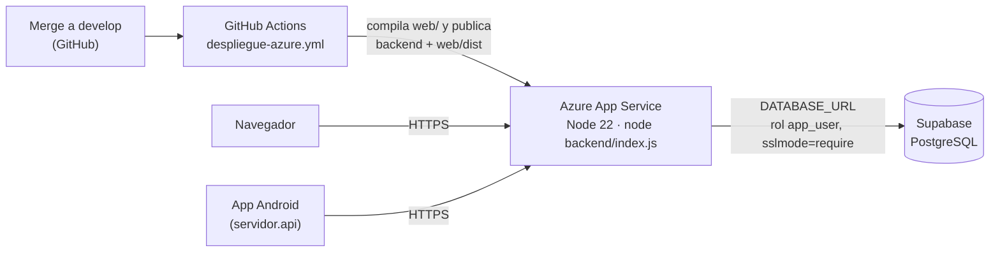

# Manual de despliegue

Este manual describe cómo instalar `planilla-sis`: la base de datos en Supabase, el backend y la web en Azure App Service, y la app móvil para Android.

> **Manejo de secretos.** Las contraseñas, `DATABASE_URL`, `JWT_SECRET`, el perfil de publicación de Azure y las coordenadas de la empresa no se guardan en el repositorio, en la web ni en la app. Se configuran en Supabase, en Azure, en los secretos de GitHub y en archivos locales que Git ignora (`backend/.env`, `mobile/local.properties`).

## 1. Esquema del despliegue



| Componente | Ubicación | Actualización |
| --- | --- | --- |
| Base de datos | Supabase (PostgreSQL gestionado) | El DBA aplica las migraciones manualmente (§2) |
| Backend y web | Azure App Service; el backend también sirve la web compilada | GitHub Actions, en cada merge a `develop` (§3 y §4) |
| App móvil | APK instalado en cada teléfono | Se genera con Android Studio (§5) |

## 2. Base de datos en Supabase

### 2.1 Crear el proyecto

1. Crear un proyecto en [supabase.com](https://supabase.com) y guardar la contraseña de la base (rol `postgres`) en un gestor de contraseñas. Esta contraseña no se comparte ni se sube al repositorio.
2. Elegir, de preferencia, una región cercana a la de Azure para reducir la latencia.

### 2.2 Aplicar las migraciones

Las migraciones están en `Database/migrations/`. Se aplican una sola vez, en el siguiente orden, con el rol `postgres` (nunca con `app_user`):

| Orden | Archivo |
| --- | --- |
| 1 | `M002_schema_inicial.sql` |
| 2 | `M003_rutas_y_asignaciones.sql` |
| 3 | `M004_registros_y_eventos.sql` |
| 4 | `M005_planillas_y_pagos.sql` |
| 5 | `M006_permisos_app_user.sql` |
| 6 | `M007_estados_y_permisos.sql` |
| 7 | `M008_rls_registros_eventos.sql` |
| 8 | `M009_parametros_feriados.sql` |
| 9 | `M010_rls_todas_las_tablas.sql` |
| 10 | `M011_sesiones_refresh.sql` |
| 11 | `M012_ruta_puntos_validaciones.sql` |

**Opción A: editor SQL de Supabase**

1. Abrir **SQL Editor → New query**.
2. Pegar el contenido completo de la migración y presionar **Run**.
3. Las migraciones que incluyen `REVOKE`, `DROP POLICY` o `ALTER` muestran la advertencia *"This query includes destructive operations"*. Se debe confirmar para continuar.
4. Si la migración da error, no se aplica ningún cambio. Corregir el problema y volver a ejecutarla antes de pasar a la siguiente.

**Opción B: `psql` desde la computadora**

En Supabase, en **Connect → Session pooler**, copiar la cadena de conexión (puerto `5432`) y ejecutar:

```bash
psql "postgresql://postgres.<ref>:<contraseña>@aws-0-<región>.pooler.supabase.com:5432/postgres?sslmode=require" \
  -v ON_ERROR_STOP=1 -1 -f Database/migrations/M002_schema_inicial.sql
```

La opción `-1` ejecuta el archivo en una sola transacción y `ON_ERROR_STOP=1` detiene la ejecución en el primer error. El comando se repite con cada archivo, en orden.

### 2.3 Contraseña del rol de la aplicación

M002 crea el rol `app_user` sin contraseña, porque esta no puede quedar en el repositorio. Se asigna desde el editor SQL:

```sql
ALTER ROLE app_user WITH PASSWORD 'una-contraseña-larga-y-aleatoria';
```

Esta contraseña solo se usa en la variable `DATABASE_URL` de Azure (§3.2).

### 2.4 Datos iniciales (solo para pruebas)

`Database/seeds/S001_datos_desarrollo.sql` crea tres cuentas (`admin@local.test`, `supervisor@local.test` y `trabajador@local.test`), una ruta de desarrollo con el trabajador asignado y una jornada abierta. La contraseña de las cuentas se pasa como variable de `psql`, por lo que se ejecuta con la opción B:

```bash
psql "<cadena de conexión>" -v ON_ERROR_STOP=1 -v password='<contraseña de al menos 12 caracteres>' \
  -1 -f Database/seeds/S001_datos_desarrollo.sql
```

En producción no se ejecuta el seed. El DBA crea el primer administrador con un `INSERT` y los demás usuarios se crean desde la pantalla **Usuarios** de la web.

### 2.5 Verificación

```sql
-- Debe devolver 27 tablas y 27 con RLS
SELECT count(*) AS tablas, count(*) FILTER (WHERE c.relrowsecurity) AS con_rls
FROM pg_class c JOIN pg_namespace n ON n.oid = c.relnamespace
WHERE n.nspname = 'public' AND c.relkind = 'r';

-- app_user no debe ser superusuario ni saltarse RLS
SELECT rolname, rolsuper, rolbypassrls FROM pg_roles WHERE rolname = 'app_user';
```

En la segunda consulta, `rolsuper` y `rolbypassrls` deben ser `false`.

### 2.6 Llaves de Supabase

En **Project Settings → API**, Supabase muestra las llaves `anon` y `service_role`. `planilla-sis` no usa ninguna de las dos, porque el backend se conecta directamente a PostgreSQL con `app_user`. La llave `service_role` omite RLS, por lo que no se copia a Azure, al repositorio, a la web ni a la app.

## 3. Backend y web en Azure App Service

### 3.1 Crear la aplicación web

1. En el portal de Azure: **Create a resource → Web App**.
2. **Publish:** Code · **Runtime stack:** Node 22 LTS · **Operating System:** Linux. Para pruebas es suficiente el plan gratuito o el básico.
3. En **Configuration → General settings**:
   - **Startup Command:** `node backend/index.js`
   - **HTTPS Only:** activado.
   - **SCM Basic Auth Publishing Credentials:** activado (requerido por el perfil de publicación, §4).

### 3.2 Variables de entorno

En **Settings → Environment variables → App settings**:

| Variable | Valor | Nota |
| --- | --- | --- |
| `DATABASE_URL` | `postgresql://app_user.<ref>:<contraseña de app_user>@aws-0-<región>.pooler.supabase.com:5432/postgres?sslmode=require&uselibpqcompat=true` | Siempre con `app_user`, nunca con `postgres`. El usuario lleva el sufijo `.<ref>` del proyecto porque la conexión pasa por el *pooler* de Supabase. |
| `JWT_SECRET` | Cadena aleatoria larga | Se puede generar con `node -e "console.log(require('crypto').randomBytes(48).toString('base64'))"`. Al cambiarla se cierran todas las sesiones. |
| `JWT_ISSUER` | `planilla-sis` | Debe ser igual en todos los entornos que compartan tokens. |
| `JWT_AUDIENCE` | `planilla-sis-api` | Debe ser igual en todos los entornos que compartan tokens. |
| `CORS_ORIGINS` | *(vacío)* | No se necesita porque la web se sirve desde el mismo dominio. Solo se configura si la web se aloja en otro dominio. |
| `ZONA_OPERACION` | *(vacío)* o `America/Guatemala` | Opcional; `America/Guatemala` es el valor por defecto. |

Azure asigna `PORT` automáticamente. Al guardar los cambios, Azure reinicia la aplicación.

### 3.3 Funcionamiento del backend detrás de Azure

Azure recibe las conexiones HTTPS y las reenvía al backend con las cabeceras `X-Forwarded-Proto` y `X-Forwarded-For`. El backend está configurado para confiar en ese proxy (`app.set('trust proxy', 1)`). Con esto:

- Cuando la petición llega por HTTPS, las cookies de sesión llevan el atributo `Secure` y se agrega la cabecera `Strict-Transport-Security`.
- La IP del cliente se obtiene de `X-Forwarded-For`. Azure la envía con el formato `ip:puerto` y el backend elimina el puerto antes de guardarla.

## 4. Publicación automática con GitHub Actions

El flujo `.github/workflows/despliegue-azure.yml` se ejecuta en cada *push* a `develop`, es decir, en cada merge de un PR. También se puede ejecutar manualmente desde **Actions → Despliegue a Azure (prueba) → Run workflow**. El flujo compila la web (`npm ci && npm run build`), instala las dependencias de producción del backend y publica ambos en Azure.

Configuración inicial en GitHub (**Settings → Secrets and variables → Actions**):

| Tipo | Nombre | Valor |
| --- | --- | --- |
| Secret | `AZURE_WEBAPP_PUBLISH_PROFILE` | Contenido del archivo que se descarga en Azure desde **Overview → Download publish profile** |
| Variable | `AZURE_WEBAPP_NAME` | Nombre de la aplicación web en Azure |

Si se hacen dos merges seguidos, el flujo cancela la ejecución anterior y publica solo la más reciente.

### 4.1 Verificar el despliegue

1. En **Actions**, la última ejecución debe aparecer en verde.
2. Al abrir la URL de Azure (`https://<aplicación>.azurewebsites.net/`) debe cargar la pantalla de inicio de sesión. Después de un tiempo sin uso, la primera petición puede tardar o devolver `502` mientras Azure inicia la aplicación.
3. Sin sesión, `curl -i https://<aplicación>.azurewebsites.net/api/v1/me` debe responder `401` con un JSON de error.
4. Después de iniciar sesión en la web, en las herramientas del navegador (**Application → Cookies**) las cookies `psis_access` y `psis_refresh` deben tener **HttpOnly** y **Secure**. En **Network**, las respuestas deben incluir `Strict-Transport-Security`.

## 5. App móvil (Android)

### 5.1 Servidor de fábrica

La dirección del servidor se define al compilar, en `mobile/local.properties` (archivo local que Git ignora):

```properties
servidor.api=https://<aplicación>.azurewebsites.net/
```

- Se escribe solo el dominio, terminado en `/` y sin rutas como `/supervision` o `/api`. La app agrega `api/v1/...`.
- Si la línea no existe, la app usa el servidor de la red local de desarrollo.
- El servidor también se puede cambiar desde la pantalla de inicio de sesión, con la opción **Cambiar servidor**. La app muestra esa opción automáticamente si no logra conectarse.

### 5.2 Generar el APK

1. Abrir la carpeta `mobile/` en Android Studio y esperar a que termine **Sync Project with Gradle Files**.
2. Seleccionar **Build → Build App Bundle(s) / APK(s) → Build APK(s)**.
3. El archivo se genera en `mobile/app/build/outputs/apk/debug/app-debug.apk`. El archivo `app-debug-androidTest.apk` corresponde a las pruebas y no se instala.

Desde la terminal, el equivalente es `./gradlew assembleDebug` dentro de `mobile/`.

### 5.3 Instalar y probar

1. Copiar el APK al teléfono e instalarlo. Android solicita permitir la instalación de apps desconocidas.
2. Iniciar sesión con una cuenta de rol **trabajador**. Los administradores y supervisores usan la web.
3. Para marcar entrada, el trabajador debe tener una asignación de ruta vigente. Para validar la ubicación, la ruta debe tener al menos un punto de geocerca (§6).
4. Conceder el permiso de ubicación cuando la app lo solicite.

## 6. Datos necesarios para operar

1. **Usuarios:** el administrador crea cada cuenta en la pantalla **Usuarios**. El sistema genera una contraseña temporal que el usuario debe cambiar al ingresar.
2. **Rutas y geocerca:** cada ruta tiene uno o más puntos con latitud, longitud y un radio de 10 a 5000 m, que se configuran en **Rutas → Geocerca**. Las coordenadas reales de la empresa se registran solo en la base de datos, nunca en el repositorio.
3. **Asignaciones:** cada trabajador necesita una asignación vigente. La base de datos no permite que un trabajador tenga dos asignaciones con fechas que se crucen.
4. **Tarifas y parámetros:** antes de calcular una planilla, cada trabajador debe tener una tarifa por hora vigente y deben existir los parámetros de pago (`docs/reglas-calculo.md`). Mientras su pantalla no esté integrada, se cargan con SQL.

Los cambios en la ubicación o el radio de la geocerca no requieren un APK nuevo: la app los recibe del servidor al iniciar sesión o al sincronizar.

## 7. Problemas frecuentes

| Síntoma | Causa | Solución |
| --- | --- | --- |
| `502` en la primera petición | Azure está iniciando la aplicación | Esperar unos segundos y reintentar |
| `500` al iniciar sesión después de un despliegue | Variables de entorno faltantes o incorrectas (`JWT_*`, `DATABASE_URL`) | Revisar **Environment variables** y el **Log stream** de Azure |
| La app muestra "El servidor respondió con un error" y la respuesta es HTML | `servidor.api` incluye una ruta adicional (por ejemplo `/supervision`) | Dejar solo el dominio con `/` final y volver a compilar, o corregirlo con **Cambiar servidor** |
| "Esta aplicación es para trabajadores en ruta" | La cuenta no tiene rol de trabajador | Usar la web o ingresar con una cuenta de trabajador |
| "No tienes ruta asignada hoy" o `422 ASIGNACION_NO_ACTIVA` | El trabajador no tiene una asignación vigente | Asignarlo a una ruta (§6) |
| "Estás fuera de la zona" | La ubicación está fuera del radio de todos los puntos de la ruta | Verificar el punto y el radio; si el GPS tiene poca precisión, intentar al aire libre |
| Error de migración "already exists" | La migración ya estaba aplicada | Continuar con la siguiente |
| Android Studio: *Cannot resolve symbol 'R'* | El proyecto no está sincronizado | **File → Sync Project with Gradle Files** |

## 8. Entorno local de desarrollo

La web y la app pueden conectarse al servidor publicado en Azure o a un servidor local. Cada uno usa una base de datos distinta (Supabase o un PostgreSQL local), por lo que los datos registrados en uno no aparecen en el otro. Para una demostración, la app y la web deben usar el mismo servidor.

| | Servidor en Azure | Servidor local |
| --- | --- | --- |
| Web | URL de Azure | `http://localhost:5173` (§8.1) |
| App | APK compilado con `servidor.api` de Azure (§5.1) | **Cambiar servidor** → `http://<IP de la PC>:3000/` (§8.2) |
| Base de datos | Supabase | PostgreSQL local |

### 8.1 Servidor local

1. Instalar PostgreSQL 15 o superior y aplicar las migraciones (§2.2, opción B) y el seed (§2.4) en una base propia. El seed crea las cuentas de prueba de `@local.test`, una ruta de desarrollo y la asignación del trabajador.
2. Crear `backend/.env` a partir de `backend/.env.example`, con `DATABASE_URL` usando `app_user`. Después, ejecutar `npm install` y `npm run dev` en `backend/` (puerto 3000).
3. Ejecutar `npm install` y `npm run dev` en `web/`. Vite usa el puerto 5173 y redirige `/api` al backend en el puerto 3000. En local las cookies no llevan `Secure` porque la conexión es HTTP.

### 8.2 Conectar la app al servidor local

1. En la pantalla de inicio de sesión, tocar **Cambiar servidor** y escribir `http://<IP de la PC>:3000/`, por ejemplo `http://192.168.1.76:3000/`. La IP se consulta con `ipconfig`, en el adaptador WiFi (*Dirección IPv4*).
2. Requisitos:
   - El teléfono y la PC deben estar en la misma red WiFi.
   - El Firewall de Windows debe permitir conexiones entrantes al puerto 3000.
   - La app acepta HTTP para el servidor de desarrollo, por lo que no se necesita HTTPS en la red local.
3. Para volver a Azure, se deja vacío el campo del servidor y la app regresa al servidor de fábrica.

También se puede compilar un APK de desarrollo con `servidor.api=http://<IP de la PC>:3000/` en `mobile/local.properties`.
