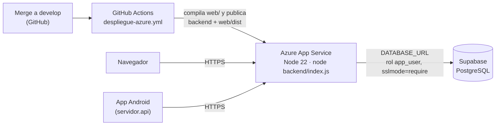

# Manual de despliegue

Cómo poner en marcha `planilla-sis` desde cero: base de datos en Supabase, backend y web en Azure App Service, y la app móvil para Android. Al final hay una sección de problemas frecuentes.

> **Secretos.** Ningún valor real (contraseñas, `DATABASE_URL`, `JWT_SECRET`, perfiles de publicación, coordenadas de la empresa) se escribe en el repositorio, en la web ni en la app. Viven solo en Supabase, en la configuración de Azure, en los secretos de GitHub y en archivos locales ignorados por Git (`backend/.env`, `mobile/local.properties`).

## 1. Cómo está desplegado



| Pieza | Dónde | Quién la actualiza |
| --- | --- | --- |
| Base de datos | Supabase (PostgreSQL gestionado) | El DBA, aplicando migraciones a mano (§2) |
| Backend y web | Azure App Service (un solo sitio; el backend sirve la web compilada) | GitHub Actions, en cada merge a `develop` (§3 y §4) |
| App móvil | APK instalado en cada teléfono | Se genera en Android Studio (§5) |

## 2. Base de datos en Supabase

### 2.1 Crear el proyecto

1. En [supabase.com](https://supabase.com) crea un proyecto. Guarda la contraseña de la base (la del rol `postgres`) en un gestor de contraseñas: no se comparte ni se sube al repo.
2. La región puede ser cualquiera; si es posible, elige la misma región o una cercana a la de Azure para bajar la latencia.

### 2.2 Aplicar las migraciones

Las migraciones están en `Database/migrations/` y se aplican **en este orden, una sola vez cada una**, con el rol administrador (`postgres`), nunca con `app_user`:

| Orden | Archivo |
| --- | --- |
| 1 | `M002_schema_inicial.sql` |
| 2 | `M003_rutas_y_asignaciones.sql` |
| 3 | `M004_registros_y_eventos.sql` |
| 4 | `M005_planillas_y_pagos.sql` |
| 5 | `M006_permisos_app_user.sql` |
| 6 | `M007_estados_y_permisos.sql` |
| 7 | `M008_rls_registros_eventos.sql` |
| 8 | `M009_parametros_feriados.sql` |
| 9 | `M010_rls_todas_las_tablas.sql` |
| 10 | `M011_sesiones_refresh.sql` |
| 11 | `M012_ruta_puntos_validaciones.sql` |

**Opción A: editor SQL de Supabase** (la que usa el equipo)

1. Abre **SQL Editor → New query**.
2. Pega el contenido completo de la migración y presiona **Run**.
3. Si aparece la advertencia *"This query includes destructive operations"*, es normal en migraciones que tienen `REVOKE`, `DROP POLICY` o `ALTER`: confirma.
4. Si sale un error, **no sigas con la siguiente**: la migración con error no se aplicó; corrígela y vuelve a correrla.

**Opción B: `psql` desde tu computadora**

En Supabase, **Connect → Session pooler**, copia la cadena de conexión (puerto `5432`) y úsala con tu contraseña:

```bash
psql "postgresql://postgres.<ref>:<contraseña>@aws-0-<región>.pooler.supabase.com:5432/postgres?sslmode=require" \
  -v ON_ERROR_STOP=1 -1 -f Database/migrations/M002_schema_inicial.sql
```

`-1` corre el archivo en una sola transacción y `ON_ERROR_STOP=1` se detiene ante el primer error. Repite con cada archivo en orden.

### 2.3 Contraseña del rol de la aplicación

M002 crea el rol `app_user` **sin contraseña** (no puede ir en el repo). Asígnasela en el editor SQL:

```sql
ALTER ROLE app_user WITH PASSWORD 'una-contraseña-larga-y-aleatoria';
```

Guárdala: va dentro de `DATABASE_URL` en Azure (§3.2) y en ningún otro lugar.

### 2.4 Datos iniciales (opcional, solo entornos de prueba)

`Database/seeds/S001_datos_desarrollo.sql` crea un administrador, un supervisor y un trabajador (`admin@local.test`, `supervisor@local.test`, `trabajador@local.test`), una ruta de desarrollo con el trabajador asignado y una jornada abierta. Usa una variable de `psql` para la contraseña, por eso se corre con la opción B:

```bash
psql "<cadena de conexión>" -v ON_ERROR_STOP=1 -v password='<contraseña de al menos 12 caracteres>' \
  -1 -f Database/seeds/S001_datos_desarrollo.sql
```

En un entorno real **no se corre el seed**: el primer administrador se crea con un `INSERT` controlado por el DBA y los demás usuarios con `POST /api/v1/admin/usuarios` (o desde la web cuando su pantalla esté integrada).

### 2.5 Verificar

```sql
-- Debe devolver 27 tablas y 27 con RLS
SELECT count(*) AS tablas, count(*) FILTER (WHERE c.relrowsecurity) AS con_rls
FROM pg_class c JOIN pg_namespace n ON n.oid = c.relnamespace
WHERE n.nspname = 'public' AND c.relkind = 'r';

-- app_user no debe ser superusuario ni saltarse RLS
SELECT rolname, rolsuper, rolbypassrls FROM pg_roles WHERE rolname = 'app_user';
```

La segunda consulta debe mostrar `rolsuper = false` y `rolbypassrls = false`.

### 2.6 Llaves de Supabase

Supabase muestra una llave `anon` y una `service_role` en **Project Settings → API**. `planilla-sis` **no usa ninguna**: el backend se conecta directo a PostgreSQL con `app_user`. La `service_role` salta RLS; no se copia a Azure, al repositorio, a la web ni a la app.

## 3. Backend y web en Azure App Service

### 3.1 Crear la aplicación web

1. En el portal de Azure: **Create a resource → Web App**.
2. **Publish:** Code · **Runtime stack:** Node 22 LTS · **Operating System:** Linux. El plan gratuito o básico alcanza para pruebas.
3. Una vez creada, en **Configuration → General settings**:
   - **Startup Command:** `node backend/index.js`
   - **HTTPS Only:** activado.
   - **SCM Basic Auth Publishing Credentials:** activado (lo necesita el perfil de publicación de §4).

### 3.2 Variables de entorno

En **Settings → Environment variables → App settings** agrega:

| Variable | Valor | Nota |
| --- | --- | --- |
| `DATABASE_URL` | `postgresql://app_user.<ref>:<contraseña de app_user>@aws-0-<región>.pooler.supabase.com:5432/postgres?sslmode=require&uselibpqcompat=true` | Siempre con `app_user`, nunca con `postgres`. El usuario lleva el sufijo `.<ref>` del proyecto porque pasa por el *pooler* de Supabase. |
| `JWT_SECRET` | Cadena aleatoria larga | Genérala con `node -e "console.log(require('crypto').randomBytes(48).toString('base64'))"`. Cambiarla cierra todas las sesiones. |
| `JWT_ISSUER` | `planilla-sis` | Debe coincidir en todos los entornos que compartan tokens. |
| `JWT_AUDIENCE` | `planilla-sis-api` | Ídem. |
| `CORS_ORIGINS` | *(vacío)* | La web se sirve desde el mismo dominio, así que no hace falta CORS. Solo se llena si la web se hospeda en otro dominio. |
| `ZONA_OPERACION` | *(vacío)* o `America/Guatemala` | Opcional; ese es el valor por defecto. |

`PORT` lo pone Azure; no se configura. Guarda los cambios: Azure reinicia la aplicación.

### 3.3 Qué hace el backend detrás de Azure

Azure termina HTTPS y reenvía la petición al backend con `X-Forwarded-Proto` y `X-Forwarded-For`. El backend confía en ese primer proxy (`app.set('trust proxy', 1)`), así que:

- las cookies de sesión salen con `Secure` y se agrega `Strict-Transport-Security` cuando la petición llegó por HTTPS;
- la IP del cliente se toma de `X-Forwarded-For` (Azure la manda como `ip:puerto`; el backend quita el puerto antes de guardarla).

## 4. Publicación automática con GitHub Actions

El flujo `.github/workflows/despliegue-azure.yml` corre en cada *push* a `develop` (es decir, en cada merge de un PR) y también a mano desde **Actions → Despliegue a Azure (prueba) → Run workflow**. Compila la web (`npm ci && npm run build`), instala las dependencias de producción del backend y publica ambos en Azure.

Configuración, una sola vez, en GitHub (**Settings → Secrets and variables → Actions**):

| Tipo | Nombre | Valor |
| --- | --- | --- |
| Secret | `AZURE_WEBAPP_PUBLISH_PROFILE` | Contenido del archivo que descarga Azure en **Overview → Download publish profile** |
| Variable | `AZURE_WEBAPP_NAME` | Nombre de la aplicación web en Azure |

Si dos merges entran seguidos, el flujo cancela el anterior y publica solo el último.

### 4.1 Verificar el despliegue

1. En **Actions**, el último flujo debe estar en verde.
2. Abre la URL de Azure (`https://<aplicación>.azurewebsites.net/`): debe cargar la pantalla de inicio de sesión. La primera petición después de un rato sin uso puede tardar o dar `502` mientras Azure arranca la aplicación; vuelve a intentar.
3. Comprueba la API sin sesión: `curl -i https://<aplicación>.azurewebsites.net/api/v1/me` debe responder `401` con un JSON de error.
4. Inicia sesión en la web y, en las herramientas del navegador (**Application → Cookies**), comprueba que `psis_access` y `psis_refresh` tienen **HttpOnly** y **Secure**; en **Network**, la respuesta debe traer `Strict-Transport-Security`.

## 5. App móvil (Android)

### 5.1 Servidor de fábrica

La URL del servidor se fija al compilar, desde `mobile/local.properties` (archivo local, ignorado por Git):

```properties
servidor.api=https://<aplicación>.azurewebsites.net/
```

- Solo el dominio, terminado en `/`, **sin** rutas como `/supervision` o `/api`: la app agrega `api/v1/...`.
- Sin esta línea, la app apunta al servidor de la red local de desarrollo.
- El trabajador puede cambiar el servidor desde la pantalla de inicio de sesión (**Cambiar servidor**), y la app lo muestra sola si no logra conectarse.

### 5.2 Generar el APK

1. Abre la carpeta `mobile/` en Android Studio y espera a que termine **Sync Project with Gradle Files**.
2. **Build → Build App Bundle(s) / APK(s) → Build APK(s)**.
3. El archivo queda en `mobile/app/build/outputs/apk/debug/app-debug.apk`. No confundirlo con `app-debug-androidTest.apk`, que es el de las pruebas.

Desde la terminal: `./gradlew assembleDebug` dentro de `mobile/`.

### 5.3 Instalar y probar

1. Copia el APK al teléfono e instálalo; Android pedirá permitir **instalar apps desconocidas** para la aplicación con que lo abras.
2. Inicia sesión con una cuenta de rol **trabajador** (la app rechaza a administradores y supervisores: ellos usan la web).
3. El trabajador necesita una **asignación de ruta vigente** para marcar entrada, y la ruta debe tener al menos un punto de geocerca para que se valide la ubicación (§6).
4. Concede el permiso de ubicación cuando la app lo pida.

## 6. Datos para operar

Con la web (o con SQL si la pantalla todavía no está integrada):

1. **Usuarios:** el administrador crea cada cuenta con una contraseña temporal; el usuario la cambia al entrar.
2. **Rutas y geocerca:** cada ruta tiene uno o más puntos (`ruta_puntos`) con latitud, longitud y radio de 10 a 5000 m. Las coordenadas reales de la empresa se cargan solo en la base, nunca en el repositorio.
3. **Asignaciones:** cada trabajador necesita una asignación vigente (`asignaciones_ruta`); la base no permite dos asignaciones del mismo trabajador con fechas que se crucen.
4. **Tarifas y parámetros:** tarifa por hora vigente para cada trabajador y parámetros de pago (`docs/reglas-calculo.md`) antes de calcular una planilla.

Cambiar la ubicación o el radio de la geocerca **no requiere un APK nuevo**: la app los recibe del servidor al iniciar sesión o al sincronizar.

## 7. Problemas frecuentes

| Síntoma | Causa | Solución |
| --- | --- | --- |
| `502` en la primera petición | Azure está arrancando la aplicación (arranque en frío) | Esperar unos segundos y reintentar |
| `500` al iniciar sesión justo después de un despliegue | Variables de entorno faltantes o mal escritas (`JWT_*`, `DATABASE_URL`) | Revisar **Environment variables** y el **Log stream** de Azure |
| La app dice "El servidor respondió con un error" y la respuesta es HTML | `servidor.api` tiene una ruta extra (p. ej. `/supervision`) | Dejar solo el dominio con `/` final y volver a compilar, o corregirlo con **Cambiar servidor** |
| "Esta aplicación es para trabajadores en ruta" | La cuenta no tiene rol trabajador | Usar la web, o entrar con una cuenta de trabajador |
| "No tienes ruta asignada hoy" o `422 ASIGNACION_NO_ACTIVA` | El trabajador no tiene asignación vigente | Asignarlo a una ruta (§6) |
| "Estás fuera de la zona" | La ubicación está a más del radio de todos los puntos de su ruta | Verificar el punto y el radio; con poca precisión del GPS, intentar al aire libre |
| Error de migración "already exists" | La migración ya se había aplicado | No es necesario repetirla; seguir con la siguiente |
| Android Studio: *Cannot resolve symbol 'R'* | El proyecto no está sincronizado | **File → Sync Project with Gradle Files** |

## 8. Entorno local de desarrollo

La web y la app pueden usarse contra el servidor publicado en Azure o contra un servidor local. Los dos modos usan
**bases de datos distintas** (Supabase y un PostgreSQL local): lo que se marque en uno no aparece en el otro. Para
una demostración, la app y la web deben apuntar al mismo servidor.

| | Contra Azure | Contra el servidor local |
| --- | --- | --- |
| Web | Abrir la URL de Azure | `http://localhost:5173` (pasos 1 a 3) |
| App | APK compilado con `servidor.api` de Azure (§5.1); no requiere nada más | **Cambiar servidor** → `http://<IP de la PC>:3000/` (paso 4) |
| Base de datos | Supabase | PostgreSQL local |

### 8.1 Levantar el servidor local

1. PostgreSQL 15 o superior local; aplica las migraciones (§2.2, opción B) y el seed (§2.4) sobre una base propia.
   El seed crea las cuentas `admin`, `supervisor` y `trabajador` de `@local.test`, una ruta de desarrollo y la
   asignación del trabajador.
2. `backend/.env` a partir de `backend/.env.example`, con `DATABASE_URL` usando `app_user`. Luego `npm install` y
   `npm run dev` en `backend/` (puerto 3000).
3. `npm install` y `npm run dev` en `web/` (Vite en el puerto 5173, con *proxy* de `/api` hacia el backend en el
   puerto 3000). En local las cookies viajan sin `Secure` porque la conexión es HTTP; en Azure llevan `Secure`.

### 8.2 Conectar la app al servidor local

4. En la pantalla de inicio de sesión, tocar **Cambiar servidor** y escribir `http://<IP de la PC en la red>:3000/`
   (por ejemplo `http://192.168.1.76:3000/`). La IP se consulta con `ipconfig` (adaptador WiFi, *Dirección IPv4*).
   - La app permite HTTP para el servidor de desarrollo, así que no hace falta HTTPS en la red local.
   - El teléfono y la PC deben estar en la **misma red WiFi**.
   - El Firewall de Windows debe permitir conexiones entrantes al puerto 3000; si la app no conecta, suele ser esto.
   - Para volver a Azure, dejar el campo vacío: la app regresa al servidor de fábrica.
5. Otra opción es compilar un APK de desarrollo con `servidor.api=http://<IP de la PC>:3000/` en
   `mobile/local.properties`.
